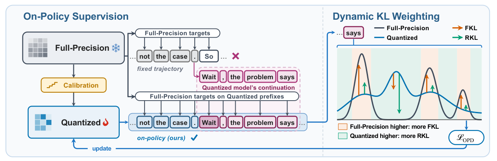
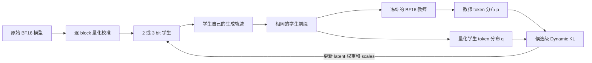

# Right On Q：在量化学生自己的轨迹上恢复推理

> 收录状态：**高成本研究资料，完整实验不复现（审查 DONE）**。未实现 runtime、量化训练、教师服务或 benchmark；没有本地指标，没有 GPU 验证要求，也不进入 evolve 晋级。不能把本页的公式解读标成模型复现。

## 论文信息

| 字段 | 内容 |
|---|---|
| 论文 | [Right On Q: Recovering Reasoning under Quantization via Self-Generated Trajectories](https://arxiv.org/abs/2610.29378v1) |
| 公司 / 作者机构 | 一作 Boyuan Zheng：University of Michigan, Ann Arbor；Jing Xiong、Zhen Zhang：UC Santa Barbara；Zechun Liu：Meta AI。按一作机构聚合，不归成 Meta 一作 |
| 原始发布日期 | 2026-10-21 08:03:24 UTC，arXiv v1；本次 10 月 22 日公告 |
| 原作者代码 | 截至本轮核对，v1 正文及 arXiv 页面未给原作者实现链接，未找到可核实的原作者仓库；论文引用的 EvalScope 不是本论文实现 |
| 原作者代码许可 | 未找到代码，许可未知，不假定 MIT / Apache；论文使用 arXiv 非独占分发许可，不等同开放源码许可 |
| 本地 Adapter / key | `right-on-q`，`adapter=null`；仅文档收录 |
| 本地复现代码位置 | 无；未实现训练、推理或评测 runtime |
| 指标 / GPU receipt | 无；高成本完整实验不运行，不生成伪指标或虚拟 GPU receipt |

## 原始论文总结

### 背景与主要改动

低比特量化会改变模型生成的前缀。只在固定的全精度参考回答上蒸馏，不能覆盖量化学生真正遇到的错误和长推理状态。OnQ 从逐 block 校准开始，让量化学生自己生成回答，再由冻结的原始全精度教师在**相同学生前缀**上提供分布监督。

第二个问题是同一前缀中不同候选 token 的偏差方向不同：学生既可能低估某些 token，也可能高估另一些 token。论文采用候选级 Dynamic KL，用教师与学生概率的比值调整 forward / reverse KL 的权重，而不是整句共用一个混合系数。

### 原文模型流程图

来源为 [v1 PDF](https://arxiv.org/pdf/2610.29378v1) 物理第 3 页 Figure 2。直接从原 PDF 裁切，已目视核对两侧标题、前缀、监督箭头与图例；没有用本地重绘替代原图。版权归原作者，来源与校验值见 `assets/provenance.json`。

### 核心公式

按组均匀非对称量化使用 latent 权重 $w$、scale $s$ 和 zero point $z$：

$$
w_{\rm int}=\operatorname{clamp}(\operatorname{round}(w/s)+z,0,2^N-1),
\qquad \hat w=s(w_{\rm int}-z).
$$

逐 block 校准先拟合全精度 block 输出。随后在学生生成的前缀 $h$ 上，记教师分布 $p_v=P(v\mid h)$，学生分布 $q_v=Q_\theta(v\mid h)$：

$$
\alpha_v=\operatorname{sg}\left[\frac{p_v}{p_v+q_v}\right],\qquad
D_{\rm dyn}(h)=\sum_v\left[
\alpha_v p_v\log\frac{p_v}{q_v}
+(1-\alpha_v)q_v\log\frac{q_v}{p_v}\right].
$$

$\operatorname{sg}$ 是 stop-gradient；rollout 和教师目标在本次更新中固定。OPD 更新 latent 权重与 scales，zero points 在这一阶段保持固定。实现近似并不是截断后直接重新归一化：Appendix A.3 使用教师 / 学生 top-20 的并集，增加“其余概率质量”类别，保留学生残差概率的梯度，并对教师类别做 $10^{-8}$ 平滑。

### 论文离线与线上效果

原论文在 Qwen3-1.7B / 4B / 8B 的 2 / 3 bit 量化上比较九组任务，包含数学、代码、知识与指令遵循。论文报告 2 bit Qwen3-8B 的平均分比最强比较基线高 10.26 个百分点，并分析长回答的截断与重复现象。以上全部为**原论文离线结果**；未报告线上产品 A/B，本地没有结果表，也没有测量该数值。

## 本地复现

### 成本评估与处理决定

正文 §4 与 Appendix A.1-A.2 给出完整训练预算：

| 阶段 | 论文配置 |
|---|---|
| 模型组合 | 1.7B / 4B / 8B 学生，2 / 3 bit，原始 BF16 模型作教师 |
| 逐 block 校准 | 4,096 个 2,048-token 窗口，每个 block 2 epochs |
| OPD prompt 池 | 25,600 条，多领域 |
| 训练步数 | 1.7B 为 400 步，4B / 8B 为 300 步 |
| 每步采样 | 128 条 prompt，各生成 1 条回答，学生温度 1.0 |
| 训练回答上限 | 第 1-50 步 4,096；51-100 步 8,192；以后 16,384 token |
| 系统 | verl，NVIDIA H100 / H200；vLLM 提供全精度教师 |
| 评测 | 九组任务，回答上限 32,768 token；主要设置三种子 |

论文未给统一运行小时数，本页不编造耗时。长轨迹在线生成、量化训练、全精度教师及完整多模型多精度评测的组合，不适合当前单 A100 / A30 的低成本收录节奏。因此**高成本完整实验不复现，审查 DONE**，无自动重试。

### 实现、数据协议与结果边界

没有下载模型或训练数据，没有运行 QAT / OPD，没有 benchmark 分数，没有 GPU 声明。也未把一个 toy KL 公式测试替代成论文主链路；后续若单独批准实现，至少需同时保留逐 block 初始化、学生真实量化前向 / rollout、冻结同前缀教师监督、候选级 stop-gradient 权重与残差概率类别，才可讨论对应保真度。

本条不注册 runtime、不提供能力 adapter、不进入 evolve controller，也不生成 `metrics/*.json`。高成本不复现是终态处理，不是缺失指标或等待 GPU 的未完成任务。
