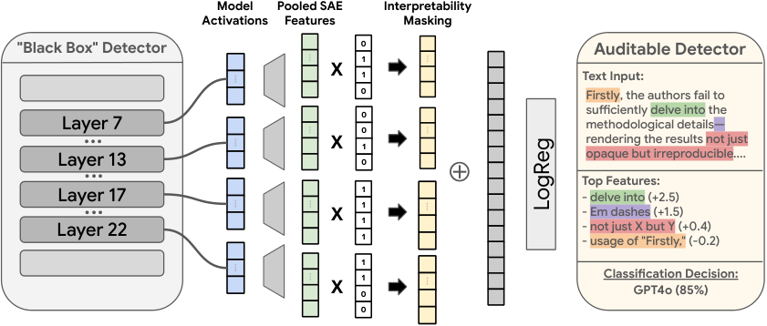

# DetectorScope: Auditable sparse-feature detector head

<!-- source-sha256: 1cec4de6a6435be3970d4caedeef69ee5bd22fbbf384fc711cc4f313826e4f40 -->

[简体中文](README.md)

> **L1 synthetic activation and sparse-head mechanism only.** No full detector, deployment or benchmark reproduction.

## Paper information

| Field | Details |
| --- | --- |
| Paper | [Building Auditable AI Text Detectors with Sparse Autoencoders](https://arxiv.org/abs/2610.30006v1); [reviewed full text](https://arxiv.org/html/2610.30006v1) |
| Affiliations | First author Liam Dugan: University of Pennsylvania; research during Google DeepMind student work, with DeepMind co-authors. |
| First public release | 2026-10-21 16:41:14 UTC |
| Author code | [Official DeepMind repository](https://github.com/google-deepmind/detectorscope/tree/52ecc87775154b35d4550911de22faad4fc68f40), Apache-2.0 at `52ecc87775154b35d4550911de22faad4fc68f40`; model/data terms separate. Created 2026-10-24 13:32:05 UTC. An Oct 22 commit timestamp does not establish public release that day. |
| Local key | `detector-scope`; no adapter |
| Local code | `src/auto_research/foundation_models/detector_scope.py` |
| Local evidence | [Local mechanism metrics](metrics/component-cuda-seeds42-44.json); [A100 validation receipt](../../gpu-validations/detector-scope-a100-20261026.json) |

## What the paper changes

Pool frozen SAE activations across valid tokens and concatenate layers, then filter concepts by automatic description-validation scores. A sparse linear head yields logit contributions verifiable by zeroing features. Neither a text description nor a rank score certifies concept semantics, human review or low false-positive risk.

### Original paper figure



Original figure from the reviewed paper, reused without redrawing. See [figure provenance](assets/provenance.json).

### Core equations

$$
h_{b,(\ell,i)}=\max_{t\in\mathrm{valid}(b)}a_{b\ell ti},\quad
s_i=\mathrm{Spearman}(q_i,\hat q_i),\quad m_i=\mathbb I[s_i\ge\tau].
$$

$$
w\leftarrow\mathrm{sign}(w)\max(|w|-\eta\lambda,0).
$$

Spearman uses average ranks on ties and rejects constant sequences, based on external observed/predicted quantiles. Fit RMS on training rows only, without centering; never-active features divide by one. Normalize/mask before BCE SGD with momentum and a proximal L1 step, not an extra subgradient; bias unpenalized. Fold scale and mask into weights $\tilde w_i=m_iw_i/r_i$. Contribution $\tilde w_i h_i$ is exactly the logit change from zeroing pooled feature $i$, not a probability difference or causal text edit.

### Results reported by the authors

Table 1 FT-Model+SAE with the explanation mask gives COLING test F1 75.4 and RAID F1 93.2 (percentage scale). Datasets differ; neither score is local BCE or mechanism error. No production A/B.

## Local reproduction and limits

`pool_sae_features`, `spearman_simulation_scores`, `fit_training_rms`, `AuditableSparseHead.proximal_step` and `predict_with_attributions` operate on synthetic activations (12 training documents, four separate prediction inputs). Backbone, SAE, scores and labels are external/frozen. Prediction never refits RMS; a deliberately wrong outlier fit is a leakage negative control, not used by the model. CPU and A100 three seeds check masks, order, ties, proximal exact zeros, training RMS, scale folding and additive attribution. The caller owns real split isolation; no SAE or Evolve.

```bash
PYTHONPATH=src python -c 'from auto_research.foundation_models.detector_scope import diagnostic; print(diagnostic(42))'
PYTHONPATH=src python -m pytest -q tests/test_detector_scope.py
```

### Full experiment: not reproduced

Four layers of 16K SAE features, 610K COLING documents, multiple PRDB conditions and large-scale Gemini explanations. Authors report 185 B200 GPU-hours for SAE and 80 A6000 GPU-hours for neural models. Full study not reproduced; no model/corpus download, API, trial or retry.

### Additional references

[Paper Section 4](https://arxiv.org/html/2610.30006v1#S4)
