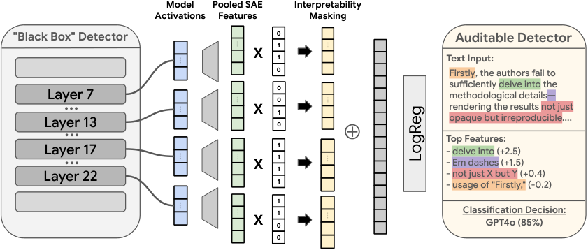
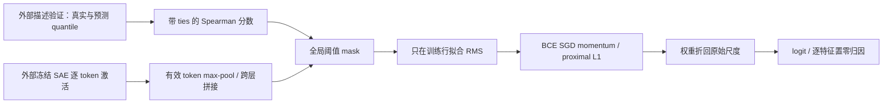

# DetectorScope：可审计的稀疏特征检测头

> 本地仅实现 L1 小张量机制：冻结 SAE 特征接口、描述验证分数、稀疏线性头与精确归因。不是完整 AI 文本检测器，也不是公开 benchmark 能力复现。完整实验成本过高，不复现（审查 DONE）。

## 论文信息

| 字段 | 内容 |
|---|---|
| 论文链接 | [Building Auditable AI Text Detectors with Sparse Autoencoders](https://arxiv.org/abs/2610.30006v1) |
| 公司 / 机构 | 一作 Liam Dugan：University of Pennsylvania；工作在 Google DeepMind 学生研究期间完成，正文列多位 DeepMind 合作者 |
| 首次公开日期 | **2026-10-21 16:41:14 UTC**，arXiv v1；本页公式和成本核对固定 v1 |
| 原作者代码 | [官方仓库](https://github.com/google-deepmind/detectorscope/tree/52ecc87775154b35d4550911de22faad4fc68f40)，固定 SHA `52ecc87775154b35d4550911de22faad4fc68f40`，Apache-2.0；权重/数据许可需分别核对 |
| 源码时间口径 | 仓库创建于 2026-10-24 13:32:05 UTC；固定提交为 Oct24 更新引用。历史 `Public Release` 提交的 Oct22 日期不能证明当日已公开；本次是官方源码触发的近期补漏，不算 Oct26 新首发 |
| Adapter | `detector-scope` 为 catalog key；`adapter=null`，不是 reproduce/evolve 能力 adapter |
| 本地复现代码 | `src/auto_research/foundation_models/detector_scope.py`；测试 `tests/test_detector_scope.py` |

## 原始论文总结

### 背景与主要改动

DetectorScope 把黑盒检测器的残差流转换为 SAE 稀疏特征，按 token 取最大值后跨层拼接，再用自动解释的验证分数筛掉不可靠概念。轻量 L1 线性头只使用保留特征，因此每个预测能分解成可置零核验的概念贡献，而不是在黑盒输出后补写理由。

原文还包含 SAE 训练、Gemini 描述生成与验证、大语料特征缓存和多条件检测实验；这些不是本地稀疏头的隐式功能。描述文字存在不代表语义正确，Spearman 分数也不是人工审查或误伤风险担保。

### 原论文关键图

<!-- paper-figure:start -->



图片来自[原论文](https://arxiv.org/html/2610.30006v1#S4)，版权归原作者所有。保留原图内容，来源、SHA256 和核验信息见 `assets/provenance.json`。

<!-- paper-figure:end -->



### 核心公式

设第层第 token 的外部 SAE 激活为 $a_{b\ell ti}\ge0$。按有效 token 池化，层顺序固定：

$$
h_{b,(\ell,i)}=\max_{t\in\mathrm{valid}(b)}a_{b\ell ti},\quad
s_i=\mathrm{Spearman}(q_i,\hat q_i),\quad m_i=\mathbb I[s_i\ge\tau].
$$

Spearman 对 ties 使用平均秩；常量真实或预测序列无法验证描述，本地拒绝而不伪造分数。$q,\hat q$ 是外部实际记录，不由样例标签反推。

训练集 RMS $r_i=\sqrt{N_{train}^{-1}\sum_bh_{bi}^2}$，从不中心化；从未激活的特征用除数 1。训练输入 $z=h\odot m/r$，目标为平均 BCE 加 $\lambda\lVert w\rVert_1$。附录 B.2 的真实更新顺序是 BCE 梯度 SGD momentum，随后 Eq.9：

$$
w\leftarrow\mathrm{sign}(w)\max(|w|-\eta\lambda,0).
$$

不额外再对 L1 求次梯度，不惩罚 bias。保存的原始尺度权重为 $\tilde w_i=m_iw_i/r_i$；$\mathrm{logit}(h)=b+\sum_i\tilde w_ih_i$。贡献 $c_i=\tilde w_ih_i$ 精确等于**池化特征置零的 logit 差**，不是概率差，也不声称等于改写原文后的因果效果。

### 论文离线与线上效果

原文 Table 1 的 FT-Model+SAE 在全局解释 mask 后保持较强检测表现；COLING test F1 为 75.4，RAID test F1 为 93.2（百分制）。数据集之间口径不同，不能与本地 BCE 或机制误差横比。未报告生产线上 A/B，本页不据此声称已部署能力。

## 本地复现

本轮已在CPU及真实NVIDIA A100上执行同一冻结版本、42/43/44三个种子：[独立机制指标](metrics/component-cuda-seeds42-44.json)、[脱敏GPU凭证](../../gpu-validations/detector-scope-a100-20261026.json)。仅验收下述L1组件，不宣称完整模型能力。

```bash
PYTHONPATH=src python -c 'from auto_research.foundation_models.detector_scope import diagnostic; print(diagnostic(42))'
PYTHONPATH=src python -m pytest -q tests/test_detector_scope.py
```

### 数据协议与结果

诊断使用小规模合成**激活张量**，12 个训练文档、4 个隔离预测输入；外部 backbone/SAE、分数和标签均冻结，不回传梯度。预测调用不会重拟合 RMS；有意把 held-out 大离群值放入另一次错误拟合，作为泄漏负控，实际模型从不使用该错误尺度。

命名 checks 实际验证 padding/跨层顺序、Spearman ties、训练集 RMS、冻结接口、SGD momentum/proximal L1、精确零、原始尺度折叠与逐特征归因。其值只能支持公式和接口，不是检测准确率。CPU/A100 三 seed 证据由统一验收记录在 `metrics/component-cuda-seeds42-44.json`；GPU 回执为 `docs/gpu-validations/detector-scope-a100-20261026.json`，无回执前不宣称 GPU 通过。

### 代码映射与边界

`pool_sae_features` 对应 §4.1；`spearman_simulation_scores` 对应 §4.2 的描述验证；`fit_training_rms`、`AuditableSparseHead.proximal_step` 对应附录 B.2；`predict_with_attributions` 对应原始尺度可加分解。训练/验证划分须由调用者真实提供，本接口不是防泄漏沙箱。

完整训练包含四层各 16K SAE、610k COLING 训练文档和多 PRDB 条件。作者报告 SAE **185 B200 GPU 小时**、neural 模型 **80 A6000 GPU 小时**，另需大规模 Gemini 自动解释。成本过高，不复现（审查 DONE）：不下载模型/语料、不调用 API、不试跑、不自动重试。L1 不接入 evolve 晋级，不用规则特征冒充真实 SAE 或宣称检测效能。
