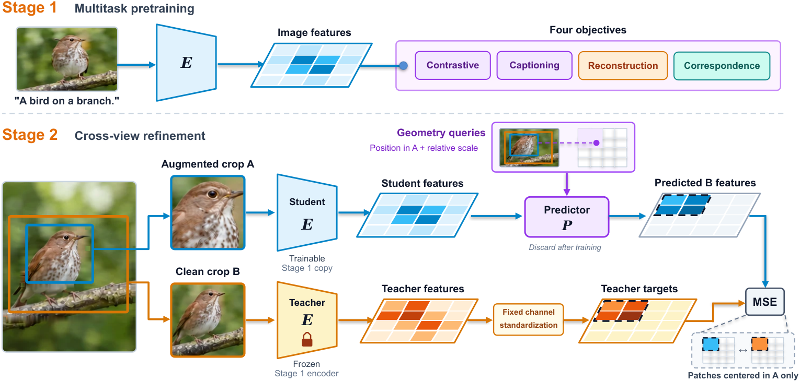

# ALPS: Visual State Encoders for World Models

<!-- source-sha256: 2453d13d5d981530325ba6c217ab99635fcc7c865f9ca3d257c6af9c3c7d08c7 -->

[简体中文](README.md)

> **L1 Stage 2 geometry and loss interfaces; diagnostic only.** No trained ALPS encoder or full experiment.

## Paper information

| Field | Details |
| --- | --- |
| Paper | [ALPS: Visual State Encoders for World Models](https://arxiv.org/abs/2610.30120v1) |
| Affiliations | First author Yanqing Liu: UC Santa Cruz; collaborations include UCSB and Google (Jieru Mei and Hongliang Fei). |
| First public release | 2026-10-21 17:57:11 UTC |
| Author code | [UCSC-VLAA/ALPS](https://github.com/UCSC-VLAA/ALPS), Apache-2.0, `30ab44b9fcdf3253fc67f5a53e31ea5141eb45c1`; training/inference/evaluation source released 2026-10-22 01:45:01 UTC. Public weights were not downloaded. |
| Local key | `alps`; no adapter |
| Local code | `src/auto_research/foundation_models/alps.py` |
| Local evidence | [Local mechanism metrics](metrics/component-cuda-seeds42-44.json); [A100 validation receipt](../../gpu-validations/alps-a100-20261022.json) |

## What the paper changes

A single visual state should support robot-state probes, text alignment and image reconstruction. Stage 1 trains ViT-B/16 with shared pre-final-LayerNorm patch tokens for contrastive, caption, reconstruction and dense crop correspondence. Stage 2 initializes the student and a **fixed teacher** from Stage 1. A four-layer predictor uses geometry to predict clean crop B teacher tokens from enhanced crop A. Supervise only B centers in A; discard the predictor and retain the student and language interface.

### Original paper figure



Original figure from the reviewed paper, reused without redrawing. See [figure provenance](assets/provenance.json).

### Core equations

$$
\mathcal L_1=\mathcal L_{itc}+\mathcal L_{cap}+w_{rec}\mathcal L_{rec}+0.25\mathcal L_{dense}.
$$

$$
p_i=g\left(\frac{y_i-y_A}{s_A},\frac{x_i-x_A}{s_A}\right),\quad
r=\frac{s_B}{s_A},\quad
q_i=m+\mathrm{PE}(p_i)+W_r[\ln r,(\ln r)^2].
$$

$$
\bar z=\operatorname{stopgrad}((z^{teacher}-\mu)/\sigma),\qquad
\mathcal L_2=\frac1B\sum_b\frac{\sum_i v_{bi}\,\frac1d\sum_c(\hat z_{bic}-\bar z_{bic})^2}
{\max(\sum_i v_{bi},1)}.
$$

Crops are normalized (top,left,side); paper grid 14. Geometry queries use mask token, continuous coordinates and affine log-ratio and squared-log-ratio projection with bias. Position channels [sin y, cos y, sin x, cos x] use $10000^{-k/(W/4)}$, not the encoder's table convention. Teacher normalization uses fixed training-channel statistics and detaches, not EMA. Half-open overlap includes lower but excludes upper edges. Average patches per image, then images. Empty overlap contributes zero; upstream sampler separately requires 16 valid patches with up to ten retries.

### Results reported by the authors

Across 15 frozen encoders, the paper reports lowest LIBERO aggregate probe error among ViT-Bs and about 17% further reduction from cross-view training. With its text encoder, mean LIBERO success across four suites is 85.5%; PushT/Wall/Granular study world-model planning and reconstruction. Static image training is not proof of fine temporal understanding. No production A/B or local capability.

## Local reproduction and limits

`crossview_geometry`, `sincos_2d`, `geometry_queries`, `teacher_targets` and `crossview_loss_from_pred`/`stage2_objective` validate shape, finite inputs, positive scales/ranges and std. Accept external predictor/teacher tokens and fixed statistics; no sampler, image augmentation, encoders or predictor. Diagnostics use two crop pairs, 4×4 patches, query width eight and random width-six tokens, with a test-only linear readout. Independent scalar references and mask, normalization and geometry/scale controls verify student gradients and zero teacher/out-of-mask gradients. No pretrained calls, benchmark, gold or Evolve; maintain training/validation/test isolation.

```bash
PYTHONPATH=src python -m pytest tests/test_alps.py
PYTHONPATH=src python -c 'from auto_research.foundation_models.alps import diagnostic; print(diagnostic(42))'
```

### Full experiment: not reproduced

Stage 1 handles 12.8B images at 128px and 1B at 224px with joint visual/text/caption/reconstruction objectives. Stage 2 uses 5M images, 4,883 steps, global batch 1,024 and stats from 32,768 training images. Add 15 encoders, probes and multi-seed robot policy training. No full training, large resources, probes or retries.

### Additional references

[Full paper](https://arxiv.org/html/2610.30120v1) · [Paper Figure 2](https://arxiv.org/html/2610.30120v1#S2.F2)
