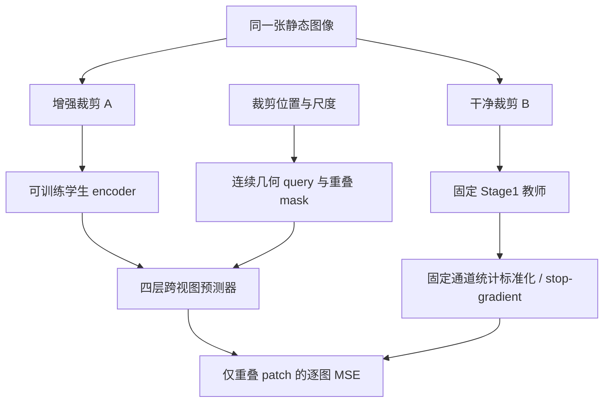
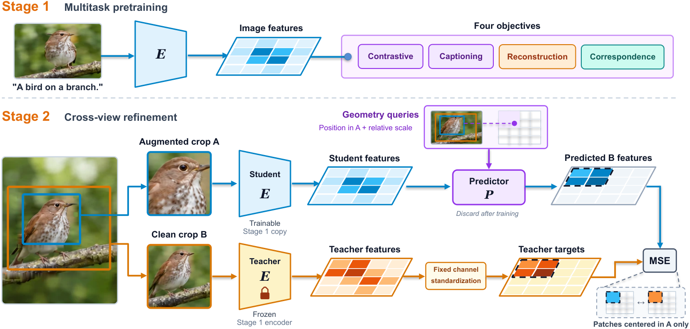

# ALPS：面向世界模型的视觉状态表征

## 论文信息

| 字段 | 内容 |
| --- | --- |
| 论文链接 | [arXiv 2610.30120 v1](https://arxiv.org/abs/2610.30120v1)；[固定原文](https://arxiv.org/html/2610.30120v1) |
| 原文标题 | ALPS: Visual State Encoders for World Models |
| 公司 / 机构 / 学校 | 一作 Yanqing Liu，University of California, Santa Cruz；共同作者机构包括 UCSB 和 Google。Google 作者为 Jieru Mei、Hongliang Fei，不将 Google 误写成一作机构 |
| 首次公开日期 | 2026-10-21 17:57:11 UTC（arXiv v1）；是本轮新首发，不是旧论文补发现 |
| 原作者代码 | [官方 UCSC-VLAA/ALPS](https://github.com/UCSC-VLAA/ALPS)，Apache-2.0；固定 revision `30ab44b9fcdf3253fc67f5a53e31ea5141eb45c1`，2026-10-22 01:45:01 UTC 发布训练/推理/评测代码。权重已公开，但本地组件不下载 |
| 本地 adapter / 稳定键 | `alps`；`adapter: null`、`component_only`，是 Stage 2 几何与损失接口，不是训练完成的 ALPS encoder |
| 本地复现代码目录 | `src/auto_research/foundation_models/alps.py`；`tests/test_alps.py` |
| 完整实验 | **成本过高，不复现（审查 DONE）**；保留论文与低成本组件，不自动重试完整实验 |

## 原始论文总结

### 背景与主要改动

世界模型以视觉 token 为状态进行预测和规划，但一个编码器通常只擅长物理状态、语言对齐或像素重建中的一部分。ALPS 尝试让同一组 patch token 同时承担三种接口：机器人状态探针能读出位置，文字指令能对应图像，而未来 token 能被解码成图像以便检查。

第一阶段从零训练 ViT-B/16：同一组**未做最终 LayerNorm 的 patch token**接受图文对比、caption、自重建和密集跨裁剪对应四种监督。第二阶段将第一阶段 encoder 同时用作学生初始化和**固定教师**；学生看带外观增强的裁剪 A，预测器根据裁剪几何查询位置，预测教师在干净裁剪 B 上的标准化 token。只对 B 中中心落在 A 内的 patch 计算损失，训练后丢弃预测器，保留学生 encoder 和第一阶段的语言接口。



图中 encoder、四层预测器和预训练均属于原论文方法；本地只实现下述明确列出的接口，不以随机网络代替这些模型并声称完整复现。

<!-- paper-figure:start -->
### 原论文关键图

[](https://arxiv.org/html/2610.30120v1#S2.F2)

**Figure 2** 展示共享 patch token 的第一阶段多任务监督，以及第二阶段固定教师、几何查询和重叠预测。图片来自[原论文](https://arxiv.org/html/2610.30120v1)，保留原始图像与文字，版权归原作者；[来源与文件哈希](assets/provenance.json)。
<!-- paper-figure:end -->

### 核心公式

第一阶段目标为：

$$
\mathcal L_1=\mathcal L_{itc}+\mathcal L_{cap}+w_{rec}\mathcal L_{rec}+0.25\mathcal L_{dense}.
$$

第二阶段裁剪用中心正方形中的归一化 `(top, left, side)` 表示。B 中第 $i$ 个 patch 的中心为 $(y_i,x_i)$；在 A 的 patch 坐标系中（论文 $g=14$）：

$$
p_i=g\left(\frac{y_i-y_A}{s_A},\frac{x_i-x_A}{s_A}\right),\quad
r=\frac{s_B}{s_A},\quad
q_i=m+\mathrm{PE}(p_i)+W_r[\ln r,(\ln r)^2].
$$

上游实际 `scale_proj` 为带 bias 的线性层，本地保留 affine bias。预测器的位置编码按 `[sin y, cos y, sin x, cos x]` 排列，$\omega_k=10000^{-k/(W/4)}$，与图像 encoder 的位置表顺序和分母不同，不能互换。

教师 token 使用训练前一次性统计的逐通道均值和标准差：

$$
\bar z=\operatorname{stopgrad}((z^{teacher}-\mu)/\sigma),\qquad
\mathcal L_2=\frac1B\sum_b\frac{\sum_i v_{bi}\,\frac1d\sum_c(\hat z_{bic}-\bar z_{bic})^2}
{\max(\sum_i v_{bi},1)}.
$$

其中 $v$ 使用上游半开区间：中心落在 A 的下边界有效，上边界无效。先计算每张图重叠 patch 的平均，再按图平均，**不是把整个 batch 所有有效 token 混在一起平均**。上游损失在无重叠时贡献 0；训练采样器另外设有 `min_valid=16`、最多 10 次重采样。本地保留损失端安全分母，外部调用者不能把它误当作完整采样器。教师是固定副本，**不是 EMA 教师**。

### 论文离线与线上结果

原论文在冻结表征协议下比较 15 个公开 encoder：ALPS 的 LIBERO 聚合状态探针误差在 ViT-B 模型中最低，跨视图阶段进一步降低约 17%。使用本身文字编码器时，论文报告四套 LIBERO 平均成功率 85.5%；它还在 PushT、Wall、Granular 等世界模型规划任务评估预测与重建。

这些均为**原论文结果**，不是本地组件指标。论文没有报告搜广推生产线上 A/B，不将机器人 benchmark 当作线上部署证据。ALPS 仍有状态/语言/像素之间的权衡，静态图像预训练也不自动赋予精细时序动作理解。

## 本地复现

### 已实现的接口

| 接口 | 保留的机制 | 不包含的能力 |
| --- | --- | --- |
| `crossview_geometry` | 归一化方形裁剪、row-major `(y,x)` patch 中心、相对尺度、半开重叠 mask | 图像解码、增强和训练采样器 |
| `sincos_2d` / `geometry_queries` | 连续位置频率、可学习 mask token、log-scale 与 log-scale 平方的 affine 投影 | 四层 self/cross-attention predictor |
| `teacher_targets` | 外部固定逐通道统计、标准化与 stop-gradient | 预训练教师、统计量自动估计、EMA |
| `crossview_loss_from_pred` / `stage2_objective` | 外部预测/教师 token 的逐图 masked MSE，学生梯度和教师隔离 | encoder 训练、checkpoint 效果或机器人能力 |

```python
from auto_research.foundation_models.alps import stage2_objective

# predictions: 真实外部预测器输出 (batch, grid*grid, channels)
# teacher_tokens: 固定 Stage1 教师在干净 B crop 的输出
# mean/std: 仅训练数据校准一次的固定通道统计；不可从测试 batch 重新估计
loss = stage2_objective(predictions, teacher_tokens, box_a, box_b, mean, std, grid=14)
loss.backward()  # 只向 predictions 对应学生路径传梯度
```

输入会检查 shape、有限值、正尺度、裁剪范围和标准差；不静默修正无效数据。模块导入不要求 torch，执行时才加载；不联网、不自动安装依赖、不执行上游脚本或下载 checkpoint。正式评测必须将训练统计与测试轨迹隔离，验证集选参，测试集只用于最终报告。

### 验证与结果边界

```bash
PYTHONPATH=src python -m pytest tests/test_alps.py
PYTHONPATH=src python -c 'from auto_research.foundation_models.alps import diagnostic; print(diagnostic(42))'
```

诊断使用两组裁剪、$4\times4$ patch、8 维 query 和 6 维随机 token。只用一个**测试专用线性 readout**连接 query 到预测，便于检查几何参数梯度；该 readout 不是原论文预测器，不用于复现学习能力。独立逐标量公式核对损失，负对照分别移除重叠 mask、固定标准化和几何/尺度 query；同时检查教师零梯度、mask 外预测梯度为零和学生梯度有限。所有预训练模型调用为 0，没有 benchmark 样本、gold 访问或能力准确率。

- 指标合同：`formula_absolute_error`、`overlap_patch_count`、负对照差值和梯度范数；不展示成功率或 accuracy。
- 统一短时 CUDA 证据目标：[A100 收据](../../gpu-validations/alps-a100-20261022.json)；对应[三 seed 组件产物](metrics/component-cuda-seeds42-44.json)。链接由同一 MR 的冻结运行生成，未生成前不能宣称已通过 GPU 验证。
- 固定 **L1**、`diagnostic_only=true`、`promotion_eligible=false`、`evolve_integrated=false`；多 seed 或 CUDA 运行不会自动升级成 L2/L3，也不进入 Evolve promotion。

### 成本与未复现范围

原文 Stage 1 处理 **128 亿张 128px 样本 + 10 亿张 224px 样本**，并联合训练图像 encoder、文字 encoder、caption decoder、重建与 dense 目标；Stage 2 再处理 **500 万张**图像（4,883 steps、global batch 1,024），其固定统计来自 32,768 张训练图像。完整评测还包含 15 个 encoder、状态探针、语言/像素任务、世界模型和多 seed LIBERO 策略训练。

按这一数据和训练矩阵，在单卡 A100/A30 或 Mac 上重跑完整论文明显超出本项目低成本预算；这是基于原配置的成本判断，不是假装测得了完整耗时。**完整预训练和实验成本过高，不复现（审查 DONE）**，`not_reproduced_high_cost` 为终态，不下载大模型/训练数据、不试探性跑完整训练、不自动重试。低成本公式组件与真实 GPU 短时验证是独立交付，不等于“ALPS 模型已复现”。
