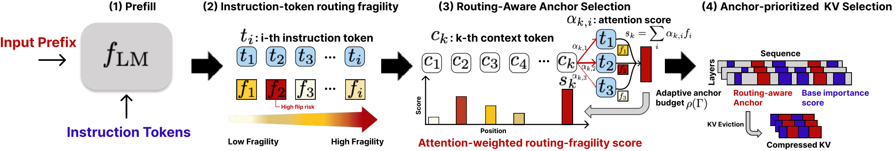

# MoEZip: Routing-Aware KV Cache Compression for Sparse Mixture-of-Experts LLMs

<!-- source-sha256: 32b4eced778461faca1ffabd18350744af6e57607401cb6549fec559819415f1 -->

[简体中文](README.md)

> **L1 KV selection and gather; diagnostic only.** No full MoE model or compressor baseline.

## Paper information

| Field | Details |
| --- | --- |
| Paper | [MoEZip: Routing-Aware KV Cache Compression for Sparse Mixture-of-Experts LLMs](https://arxiv.org/abs/2610.30206v1) |
| Affiliations | Minsang Kim: Korea University and SK Telecom; Seung Jun Baek: Korea University. |
| First public release | 2026-10-21 13:06:30 UTC |
| Author code | [kmswin1/MoEZip](https://github.com/kmswin1/MoEZip) at `197959dbae2adfab7ec233f584ce951b827e04cc` contains only README and Apache-2.0 LICENSE, no implementation. README examples are not executable release evidence. |
| Local key | `moezip`; no adapter |
| Local code | `src/auto_research/foundation_models/moezip.py` |
| Local evidence | [Local mechanism metrics](metrics/component-cuda-seeds42-44.json); [A100 validation receipt](../../gpu-validations/moezip-a100-20261023.json) |

## What the paper changes

Removing KV can change attention and routing. Use Fisher trace from prefill instruction-token gates as a sensitivity proxy and propagate it to context locations with headwise maximum attention. Retain global routing anchors in all layer/heads and fill remaining budget using external base-compressor scores, without future answer tokens.

### Original paper figure



Original figure from the reviewed paper, reused without redrawing. See [figure provenance](assets/provenance.json).

### Core equations

$$
f_{t,l}^{softmax}=1-\sum_e g_{t,l,e}^2,\qquad
f_{t,l}^{sigmoid}=\sum_e g_{t,l,e}(1-g_{t,l,e}).
$$

$$
r_i=\sum_{l\in\mathcal M}\sum_{t\in\mathcal I}
\max_h\alpha_{t,l,h,i}\,f_{t,l},\qquad
\Gamma=\frac{1}{|\mathcal M||\mathcal I|}\sum_{l,t}\mathbf1[f_{t,l}>\tau].
$$

$$
\mathcal S_{l,h}=\mathcal A\cup
\mathcal S^{base}_{l,h}(B-B_f;[L]\setminus\mathcal A).
$$

Threshold is 85% of the theoretical maximum trace; set $\rho=.05+.20\Gamma$ and clip floor budget to 32–128, also capped at the actual budget locally. Gather deduplicated anchors and remaining base picks in original index order, preserving position IDs. Trace is a direction-averaged curvature proxy, not router Jacobian or a guarantee of top-k flip; gold-answer flip analysis is offline only. Softmax and sigmoid trace expressions coincide on a vector summing to one, so compare the two gate transforms on the same logits.

### Results reported by the authors

Table 1 Qwen3-30B at 10% retention: KVZip 19.51, reconstruction-query/cache-reusable MoEZip-Recon 41.95 and query-conditioned MoEZip 44.89. Conditioning and reuse differ. No local model/LongBench or production A/B.

## Local reproduction and limits

`fisher_trace`, `select_cache` and `compress_cache` implement both gates, max aggregation, budget, duplicate exclusion and real gather; no KVZip reimplementation. Synthetic fixture: two layers, three heads, eight instruction tokens/experts, 512 context, 256 rows/head. Explicit Fisher matrix, uniform/peaked 32–64 anchors, max-vs-mean, retention across heads, tiny/zero budgets, indices and invalid input checks. Three seeds are L1 only.

```bash
PYTHONPATH=src python scripts/run_oct23_priority_components.py \
  --device cpu --seeds 42,43,44 --source-commit COMMIT \
  --frozen-proof oct23-frozen-proof.json --output runs/oct23-cpu-new.json
```

### Full experiment: not reproduced

Appendix C reports all A100-80GB, typically two GPUs/run and eight for 235B, roughly 15,000–16,000 A100 GPU-hours excluding exploration/failures. No checkpoints, benchmark probe, automated training or Evolve.

### Additional references

[Paper PDF](https://arxiv.org/pdf/2610.30206v1) · [Paper PDF, p. 4](https://arxiv.org/pdf/2610.30206v1#page=4)
