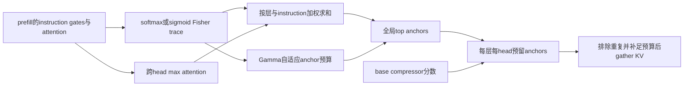
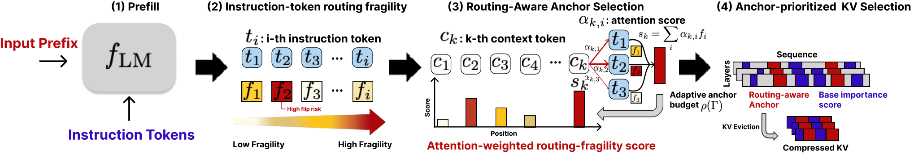

# MoEZip：路由敏感的 KV anchors

## 论文信息

| 字段 | 内容 |
| --- | --- |
| 论文链接 | [arXiv 2610.30206 v1](https://arxiv.org/abs/2610.30206v1)；[固定 PDF](https://arxiv.org/pdf/2610.30206v1) |
| 原文标题 | MoEZip: Routing-Aware KV Cache Compression for Sparse Mixture-of-Experts LLMs |
| 公司 / 机构 / 学校 | Minsang Kim：Korea University / SK Telecom；Seung Jun Baek：Korea University |
| 首次公开日期 | 2026-10-21 13:06:30 UTC（arXiv v1；10/23 new 公告） |
| 原作者代码 | [官方仓库](https://github.com/kmswin1/MoEZip)存在；固定 commit `197959dbae2adfab7ec233f584ce951b827e04cc` 仅含 README 与 Apache-2.0 LICENSE，**未发布实现代码**；不把 README 的运行示例当作已存在脚本 |
| 本地 adapter / 稳定键 | `moezip`；`adapter: null`，`component_only` |
| 本地复现代码目录 | `src/auto_research/foundation_models/moezip.py`；统一入口 `scripts/run_oct23_priority_components.py` |
| 完整实验 | 成本过高，不复现（审查 DONE）；本地按论文公式独立实现选择与 gather 组件 |

## 原始论文总结

### 背景与主要改动

MoE 的 KV 删除会扰动 attention 输出，进而改变路由。MoEZip 用已观察 instruction token 的路由分布 Fisher trace 作为敏感性代理，经 attention 传播到 context 位置，预留全局 routing anchors；其余预算沿用调用者提供的 dense/MoE base compressor 分数。future answer 不可用于真实选择。



<!-- paper-figure:start -->
### 原论文关键图

[](https://arxiv.org/pdf/2610.30206v1#page=4)

**Figure 2，第4页**：instruction 路由敏感性、attention 传播、anchors 与 base scorer 的预算组合。采用 arXiv HTML 原始图片，未经改绘；原作者版权，CC BY 4.0，见 [来源与哈希](assets/provenance.json)。
<!-- paper-figure:end -->

### 核心公式

对路由 gate $g_{t,l}$，logit 坐标中的 Fisher trace 分别为

$$
f_{t,l}^{softmax}=1-\sum_e g_{t,l,e}^2,\qquad
f_{t,l}^{sigmoid}=\sum_e g_{t,l,e}(1-g_{t,l,e}).
$$

$$
r_i=\sum_{l\in\mathcal M}\sum_{t\in\mathcal I}
\max_h\alpha_{t,l,h,i}\,f_{t,l},\qquad
\Gamma=\frac{1}{|\mathcal M||\mathcal I|}\sum_{l,t}\mathbf1[f_{t,l}>\tau].
$$

$\tau$ 为对应理论最大 trace 的85%；$\rho=.05+.20\Gamma$，$B_f=\operatorname{clip}(\lfloor B\rho\rfloor,32,128)$。本地另将 $B_f$ 限制为不超过 $B$，避免 tiny budget 违反正文 $B_f\le B$ 合同。全局 $\mathcal A=\operatorname{Top}_{B_f}(r)$，每层每头保留

$$
\mathcal S_{l,h}=\mathcal A\cup
\mathcal S^{base}_{l,h}(B-B_f;[L]\setminus\mathcal A).
$$

Fisher trace 是方向平均的分布曲率代理，不是 router top-k 翻转的充分必要条件；它不包含 router 对 hidden state 的 Jacobian。论文 teacher-forced gold-answer flip 分析仅为离线诊断，不进入这里的 selector 输入。

### 论文离线与线上效果

固定 v1 表1在 Qwen3-30B、10% KV保留时报告：KVZip 19.51、同 reconstruction query 且可复用 cache 的 MoEZip-Recon 41.95、query-conditioned MoEZip 44.89；不能忽略 query conditioning 与 cache reuse 的差别。本地没有运行这些模型或 LongBench。未报告生产线上 A/B。

## 本地复现

`fisher_trace`、`select_cache`、`compress_cache` 保留两种 gate、跨头 max、全局 anchors、App C 默认预算边界、base 排除重复补齐及真实 KV gather。输出原 context 索引并维持升序，调用者必须据此保留 position IDs。base 分数是显式接口，不伪装成已实现 KVZip。

```bash
PYTHONPATH=src python scripts/run_oct23_priority_components.py \
  --device cpu --seeds 42,43,44 --source-commit COMMIT \
  --frozen-proof oct23-frozen-proof.json --output runs/oct23-cpu-new.json
```

统一设备检查入口为 `auto_research.foundation_models.moezip.diagnostic(seed, device)`。CUDA 路径要求真实 A100/A30 收据：`docs/gpu-validations/moezip-a100-20261023.json`。这里没有 model forward、生成答案或 pretrained checkpoint。

### 数据协议与结果口径

每 seed 生成2层、3 heads、8 instruction、8 experts、512 context 的路由/attention/base统计；每头保留256行。独立构造显式 $\operatorname{diag}(g)-gg^\top$ 计算 trace 参考，并实际 gather K/V；uniform 与 peaked 路由检查自适应32至64 anchors。3 seeds 仍只是 L1 机制诊断，不构成 MoE 能力或质量提升证据。

### 验证与边界

测试核对两种显式 Fisher 矩阵、max 与 mean 聚合的区别、global anchor 在所有 layer/head 中的保留、base 无重复补齐、原位索引、实际 gather、B=0/tiny B 及非法 attention/预算。注意当同一概率向量恰好和为1时，两种 trace 公式代数相同；gate 家族应在相同 logits 经 softmax/sigmoid 后比较。

### 成本与未复现范围

原文 App C 明确所有实验使用 A100-80GB：普通每run两卡，235B实验八卡，完整报告约15000至16000 A100 GPU-hours，且不含探索或失败试验。显著超出单卡 A100/A30 或本地 Mac 预算。完整实验**成本过高，不复现（审查 DONE）**；不下载 checkpoint、不试跑 LongBench/RULER、不进入自动训练或 Evolve 晋级队列。此决定不把 paper 效果当作本地已验证事实。
