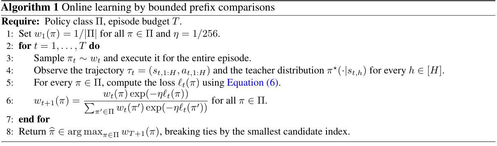

# Reverse-KL policy distillation: Bounded prefix comparisons in finite policy classes

<!-- source-sha256: 8e570e100620d7a65bb8c0f9b5c222fcd619f56461a52f8230b4810f43f5073b -->

[简体中文](README.md)

> **CPU finite-MDP implementation of Algorithm 1 and exact probability audit.** No LLM experiment; omitted settings are outside scope, not a cost-deferred capability.

## Paper information

| Field | Details |
| --- | --- |
| Paper | [Reverse-KL Policy Distillation: Statistical Guarantees and Limits](https://arxiv.org/abs/2610.30844v1) |
| Affiliations | Haolin Liu and Chen-Yu Wei: University of Virginia; Julian Zimmert: Google Research and National Taiwan University. |
| First public release | 2026-10-22 07:19:49 UTC |
| Author code | No public author repository in the paper or arXiv entry; no source license applicable. |
| Local key | `rkl-policy-distillation`; no adapter |
| Local code | `src/auto_research/foundation_models/rkl_policy_distillation.py` |
| Local evidence | [Local mechanism metrics](metrics/component-cpu-seeds42-44.json) |

## What the paper changes

Reverse-KL risk depends on the candidate's own visit distribution. Refitting on past rollout states can overweight states a candidate rarely reaches. Online full-feedback Algorithm 1 samples one policy for a full episode, queries the teacher's action distribution only at visited states and updates exponential weights using clipped cumulative KL and a truncated prefix importance ratio.

Original algorithm excerpt



This is an [Algorithm 1 excerpt](https://arxiv.org/pdf/2610.30844v1#page=7), not an architecture figure. See [provenance](assets/provenance.json).

### Core equations

$$
k_h(s;\pi)=\operatorname{KL}(\pi_h(\cdot\mid s)\Vert\pi_h^\star(\cdot\mid s)),\qquad
L(\pi)=\mathbb E_{P^\pi}\sum_h k_h(s_h;\pi).
$$

$$
e_h(\pi)=\min(1,\sum_{u\le h}k_u(s_u;\pi))-
\min(1,\sum_{u<h}k_u(s_u;\pi)),
$$

$$
r_h(\pi,\pi_t)=\min\left(1,\prod_{u<h}
\frac{\pi_u(a_u\mid s_u)}{\pi_{t,u}(a_u\mid s_u)}\right),\qquad
\ell_t(\pi)=\sum_h r_h(\pi,\pi_t)(e_h(\pi)-e_h(\pi_t)).
$$

$$
w_{t+1}(\pi)\propto w_t(\pi)\exp(-\ell_t(\pi)/256).
$$

The finite reward-free MDP uses shared initial distribution and transition rules. The prefix ratio excludes the current action and multiplies **both** terms of the difference. Total increments are at most one; the comparison lies in [-1,1]. Initialize uniformly, update at fixed 1/256 and return the largest final weight, breaking ties by smallest index, without querying true risk. A candidate assigning mass outside teacher support fails.

### Results reported by the authors

Theorem 3.2 assumes $\mathbb E_{P^\pi}[K_\pi^2]\le B\mathbb E_{P^\pi}[K_\pi]<\infty$ for all candidates with $B\ge1$. The high-probability order $O(B[L^\star+\log(|\Pi|/\delta)/T])$ does not remove constants or $B$, or establish arbitrary horizon independence. Table 1 compares statistical settings, not experiments. Section 5 leaves practical algorithms and empirical LLM tests for future work. No production A/B.

## Local reproduction and limits

`bounded_prefix_comparisons`, `exponential_weights` and `learn_online` implement Algorithm 1; the teacher accepts only visited (step,state) queries, exactly $H$ per episode. `evaluate_exact_moments` runs only after training and audits exact moments and minimum fixture $B$. The CPU fixture has two states/actions, three steps/candidates, a teacher outside the class and 256 complete episodes. Exhaustive trajectory checks compare exact recurrence, chain rule, moments, shared-prefix antisymmetry, Eq.2/6, prefix zero, shared ratio, cumulative clipping, teacher queries and update/ties. Three seeds verify L1, not minimax sample complexity.

```bash
PYTHONPATH=src python scripts/run_oct23_priority_components.py \
  --device cpu --seeds 42,43,44 --source-commit COMMIT \
  --frozen-proof oct23-frozen-proof.json --output runs/oct23-cpu-new.json
```

### Scope limits

Limits: up to 64 policies, 16 states/actions/steps and 4,096 episodes. Enumeration costs $O(T|\Pi|H|\mathcal A|)$ excluding environment sampling. Offline estimation, Hellinger extension, action-feedback lower-bound construction and all LLM training are out of scope. No GPU, data download, capability claim or Evolve promotion.

### Additional references

[Paper PDF](https://arxiv.org/pdf/2610.30844v1)
