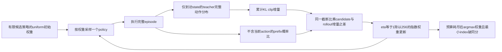
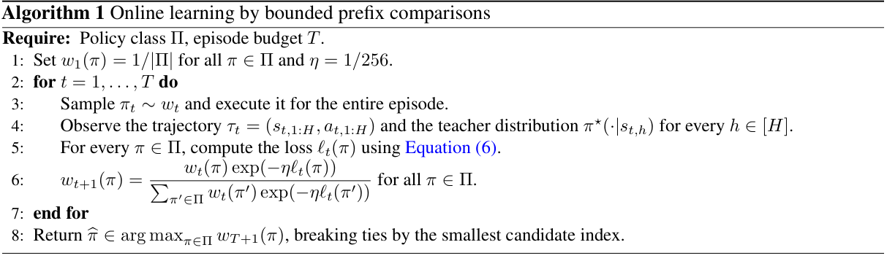

# Reverse-KL Policy Distillation：有限策略空间的前缀比较

## 论文信息

| 字段 | 内容 |
| --- | --- |
| 论文链接 | [arXiv 2610.30844 v1](https://arxiv.org/abs/2610.30844v1)；[固定 PDF](https://arxiv.org/pdf/2610.30844v1) |
| 原文标题 | Reverse-KL Policy Distillation: Statistical Guarantees and Limits |
| 公司 / 机构 / 学校 | Haolin Liu、Chen-Yu Wei：University of Virginia；Julian Zimmert：Google Research / National Taiwan University。Google 合作稿，不是 Google 一作机构稿 |
| 首次公开日期 | 2026-10-22 07:19:49 UTC（arXiv v1；10/23 new 公告） |
| 原作者代码 | **未发现作者公开实现仓库**；正文和官方 arXiv 入口没有代码链接，代码许可证不适用 |
| 本地 adapter / 稳定键 | `rkl-policy-distillation`；`adapter: null`，`component_only` |
| 本地复现代码目录 | `src/auto_research/foundation_models/rkl_policy_distillation.py`；统一入口 `scripts/run_oct23_priority_components.py` |
| 实现与实验范围 | CPU 有限 MDP 上的完整 Algorithm 1 与精确概率审计；不要求 GPU，不包含 LLM 或实用蒸馏实验 |

## 原始论文总结

### 背景与主要改动

反向 KL 的风险取决于候选策略自己的访问分布。仅在过往 rollout 状态上重新拟合 token KL，会把“候选自己很少到达的状态”算得过重。本文的在线 full-feedback Algorithm 1 同时截断累计 KL 和前缀重要性比，通过有界候选/rollout 比较更新策略空间中的指数权重。



<!-- paper-figure:start -->
### 原文算法

原文没有 Figure；不能把下图称为原论文架构图。这是 [Algorithm 1，第7页](https://arxiv.org/pdf/2610.30844v1#page=7) 的局部原始截图，辅助核对固定学习率、完整 episode 与最终返回规则；原作者版权，见 [来源与哈希](assets/provenance.json)。


<!-- paper-figure:end -->

### 核心公式

在有限策略类 $\Pi$、reward-free 有限时域 MDP 上，初始分布与状态转移由所有候选共享。teacher 在访问状态提供完整动作分布。令

$$
k_h(s;\pi)=\operatorname{KL}(\pi_h(\cdot\mid s)\Vert\pi_h^\star(\cdot\mid s)),\qquad
L(\pi)=\mathbb E_{P^\pi}\sum_h k_h(s_h;\pi).
$$

累计截断增量、前缀比与比较 loss 为

$$
e_h(\pi)=\min(1,\sum_{u\le h}k_u(s_u;\pi))-
\min(1,\sum_{u<h}k_u(s_u;\pi)),
$$

$$
r_h(\pi,\pi_t)=\min\left(1,\prod_{u<h}
\frac{\pi_u(a_u\mid s_u)}{\pi_{t,u}(a_u\mid s_u)}\right),\qquad
\ell_t(\pi)=\sum_h r_h(\pi,\pi_t)(e_h(\pi)-e_h(\pi_t)).
$$

同一个 $r_h$ 同时作用于差值两项；前缀不包含当前 action。$\sum_he_h\le1$ 且 $\ell_t\in[-1,1]$。从 $w_1(\pi)=1/|\Pi|$ 出发，按 $w_t$ 抽取整个 episode 的 rollout policy，再更新

$$
w_{t+1}(\pi)\propto w_t(\pi)\exp(-\ell_t(\pi)/256).
$$

最终返回 $\arg\max w_{T+1}$，并列取最小候选 index，不用事后真实风险选择。反向 KL 的 teacher-support 条件必须成立；teacher 在候选正概率动作上为零时，本地明确失败。

### 理论假设、离线与线上效果

Theorem 3.2 要求所有候选满足 relative second-moment 条件 $\mathbb E_{P^\pi}[K_\pi^2]\le B\mathbb E_{P^\pi}[K_\pi]<\infty$，$B\ge1$。其高概率界为 $O(B[L^\star+\log(|\Pi|/\delta)/T])$；常数和 $B$ 不能被省略，也不能据此声称任意 horizon 独立。Table 1 讨论 full/action feedback 与 online/offline 四种统计 setting，不是四组实测。

正文没有 LLM 能力实证；§5 明确把实用/计算高效算法及实证列为 **future work**。未报告生产线上 A/B。这里实现的有限策略枚举算法不等于已经解决高维神经网络蒸馏。

## 本地复现

`bounded_prefix_comparisons` 实现 Eq.2/Eq.6；`exponential_weights` 固定 `1/256`；`learn_online` 实现 Algorithm 1。teacher 接口只能按 `(h,state)` 查询完整动作分布，每 episode 恰好查询 $H$ 次，不接收全局风险、最优候选或 gold trajectory。`evaluate_exact_moments` 是独立评估入口，用有限状态前向概率递推精确计算 $\mathbb E[K]$、$\mathbb E[K^2]$ 和该 fixture 的最小可用 $B$；只能在训练返回之后运行。

```bash
PYTHONPATH=src python scripts/run_oct23_priority_components.py \
  --device cpu --seeds 42,43,44 --source-commit COMMIT \
  --frozen-proof oct23-frozen-proof.json --output runs/oct23-cpu-new.json
```

CPU 专属入口为 `auto_research.foundation_models.rkl_policy_distillation.diagnostic(seed)`。没有 CUDA 路径、预训练模型或外部数据下载，不需要 GPU receipt。

### 数据协议与结果口径

固定合成环境包含2状态、2动作、3步、3候选；teacher 不在候选类内，执行256个完整 episodes。seed 只控制 policy/状态/action 采样。候选以最终权重选择；随后精确风险仅用于报告及假设审计。三 seeds 的局部运行只检验 L1 算法与概率合同，不能验证 minimax 样本复杂度或 LLM 改进。

### 验证、代码映射与边界

独立测试逐轨迹枚举并对照有限状态递推，核对 trajectory KL chain rule 与二阶矩；枚举 rollout 下的期望，验证交换候选/rollout 的 shared-prefix-mass 反对称性。另核对逐标量 Eq.2/Eq.6、前缀零概率、同一比同时作用于 baseline 的负控、clip 增量而非逐 token clip 的负控、teacher 只查询实际到访状态、固定 eta 更新重放和最小 index 破同分。

成本护栏为 $|\Pi|\le64$、$S,A,H\le16$、$T\le4096$；默认仅做上述小 fixture。完整策略枚举的时间为 $O(T|\Pi|H|\mathcal A|)$（不计环境采样），并不随 LLM 参数规模保持高效。状态/动作有限且可精确存储是本组件适用边界。§4 的离线估计、Hellinger 扩展、action-feedback 下界实例和任何 LLM 训练均未实现；状态为 `not_run_scope_limited_protocol`，不是“成本过高”或“已实证验证”。不进入 Evolve 自动晋级。
