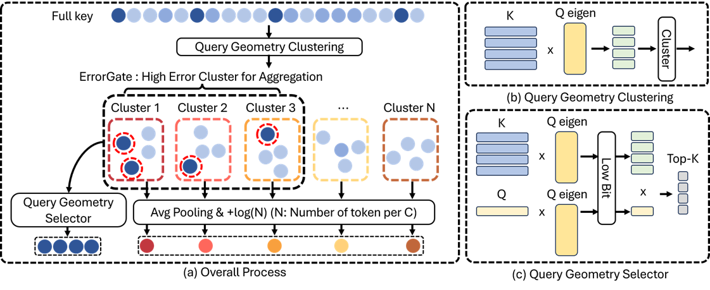

# OpenAttention: Query geometry and count-aware residual tail proxies

<!-- source-sha256: ba91161b6e4f8689b0678bc76987ed0925d2d25ccb86f860f62466ee597cff6b -->

[简体中文](README.md)

> **L1 single-head attention mechanism; diagnostic only.** Full model and custom-kernel performance not reproduced.

## Paper information

| Field | Details |
| --- | --- |
| Paper | [OpenAttention: One Percent Is Enough with Tail Proxies](https://arxiv.org/abs/2610.30951v1) |
| Affiliations | First author Hyunwoo Yu; Sogang University, Samsung Electronics and Pusan National University. |
| First public release | 2026-10-22 09:03:08 UTC |
| Author code | [hyunwoo137/OpenAttention](https://github.com/hyunwoo137/OpenAttention), Apache-2.0 at `6e43d4fc8c0e95b26d17d198a4545c627b2d6931`. |
| Local key | `openattention`; no adapter |
| Local code | `src/auto_research/foundation_models/openattention.py` |
| Local evidence | [Local mechanism metrics](metrics/component-cuda-seeds42-44.json); [A100 validation receipt](../../gpu-validations/openattention-a100-20261023.json) |

## What the paper changes

Sparse reads must handle unread KV rows as well as select exact ones. QGC mixes static and conditioning query second moments equally, projects keys as $KU_r\Lambda_r^{1/2}$ and runs Lloyd clustering. QGS quantizes $U_r^\top k_i$ coordinatewise to int8 and ranks with the current projected query. Geometry uses prefill-visible queries, not future answers. ErrorGate estimates proxy error per cluster and allocates exact reads by capped water filling.

### Original paper figure



Original figure from the reviewed paper, reused without redrawing. See [figure provenance](assets/provenance.json).

### Core equations

$$
\bar z_b=\frac{q^\top\bar k_b}{\sqrt d},\quad
\hat\sigma_b^2=\frac1d\sum_j q_j^2\operatorname{Var}_b(k_j),\quad
\hat\epsilon_b=n_be^{\bar z_b}e^{\hat\sigma_b^2/2}
\operatorname{erf}(\hat\sigma_b/\sqrt2).
$$

$$
q_b=\min(n_b,\lambda\hat\epsilon_b/\max_{b'}\hat\epsilon_{b'}),
\qquad\sum_bq_b=E.
$$

Round quotas down and spend the remainder on high-scoring clusters with spare capacity. After removing exact rows, recompute residual mean key/value and count $n_b$; the joint softmax gives the mean value logit $q^\top\bar k_b/\sqrt d+\log n_b$. The Gaussian/diagonal assumptions are estimates, not exact finite-cluster bounds or optimality guarantees.

### Results reported by the authors

Llama-3.1-8B RULER-32K HARD is 86.30 at 1% read versus 87.04 dense. Reported 5–10× decode-attention kernel gains omit some index-scan/setup costs and are not end-to-end service speed. No production A/B or local model result.

## Local reproduction and limits

`fit_cache`, `qgs_scores`, `errorgate`, `waterfill`, `residual_proxy_attention` and `attend` execute the single-head chain, directly recomputing residual statistics rather than porting Triton. All-zero error uses equal weights; ties use original position; empty clusters have no proxy. Seeds generate 128 width-16 keys, width-8 values, 24 static/eight conditioning queries, and decode query only after index fit; eight clusters, QGC rank eight, QGS rank 12, 16 exact rows plus 12 detector rows give 28 reads, not 1%. Dense expansion of each proxy checks the log count, all-read/equal-key accuracy, budgets, int8 bound, geometry and signed mean logit. No checkpoint, multi-head serving, dynamic index append, speed or Evolve claims.

```bash
PYTHONPATH=src python scripts/run_oct23_priority_components.py \
  --device cpu --seeds 42,43,44 --source-commit COMMIT \
  --frozen-proof oct23-frozen-proof.json --output runs/oct23-cpu-new.json
```

### Full experiment: not reproduced

Full experiments use 7B/8B models, 16K–96K contexts and several budgets/benchmarks; RULER alone uses seven tasks × 200 examples plus kernel comparisons. This exceeds single-device memory/time budget. No weight download, capability probe or automatic retry.

### Additional references

[Paper PDF](https://arxiv.org/pdf/2610.30951v1) · [Paper PDF, p. 5](https://arxiv.org/pdf/2610.30951v1#page=5)
