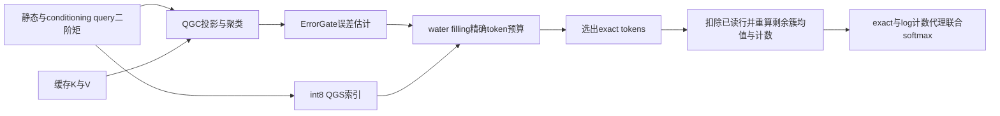
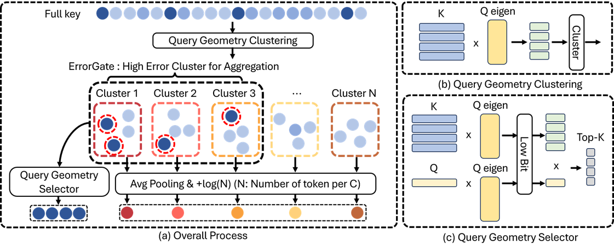

# OpenAttention：查询几何与剩余尾部代理

## 论文信息

| 字段 | 内容 |
| --- | --- |
| 论文链接 | [arXiv 2610.30951 v1](https://arxiv.org/abs/2610.30951v1)；[固定 PDF](https://arxiv.org/pdf/2610.30951v1) |
| 原文标题 | OpenAttention: One Percent Is Enough with Tail Proxies |
| 公司 / 机构 / 学校 | Sogang University、Samsung Electronics、Pusan National University；一作 Hyunwoo Yu |
| 首次公开日期 | 2026-10-22 09:03:08 UTC（arXiv v1；10/23 new 公告） |
| 原作者代码 | [已发布的官方仓库](https://github.com/hyunwoo137/OpenAttention)，Apache-2.0；固定 commit `6e43d4fc8c0e95b26d17d198a4545c627b2d6931` |
| 本地 adapter / 稳定键 | `openattention`；`adapter: null`，`component_only` |
| 本地复现代码目录 | `src/auto_research/foundation_models/openattention.py`；统一入口 `scripts/run_oct23_priority_components.py` |
| 完整实验 | 成本过高，不复现（审查 DONE）；本地仅为 L1 张量机制诊断 |

## 原始论文总结

### 背景与主要改动

低读取率稀疏注意力不只需要选出少量重要 KV，还需要处理未读取的尾部。OpenAttention 在 query 二阶矩定义的几何空间内聚类，以 ErrorGate 估计簇内代理误差并分配精确读取预算；每个簇的未读部分成为一个带计数的均值代理。它不是单纯的 top-k 截断或均值池化。



<!-- paper-figure:start -->
### 原论文关键图

[](https://arxiv.org/pdf/2610.30951v1#page=5)

**Figure 5，第5页**：QGC、ErrorGate、QGS 与 count-aware proxy 的完整关系。采用 arXiv HTML 原始图片，未重绘或修改科学内容；原作者版权，CC BY 4.0，见 [来源与哈希](assets/provenance.json)。图中计数须理解为移除精确读取行后的剩余计数。
<!-- paper-figure:end -->

### 核心公式

令 $M=\tfrac12\mathbb E_{q\sim static}[qq^\top]+\tfrac12\mathbb E_{q\sim conditioning}[qq^\top]$。QGC 在 $\Phi=KU_r\Lambda_r^{1/2}$ 上运行 Lloyd 聚类；QGS 对 $U_r^\top k_i$ 逐坐标 int8 量化，再用投影后的当前 query 排序。geometry 只用 prefill 可用 query，不用未来 answer query。

$$
\bar z_b=\frac{q^\top\bar k_b}{\sqrt d},\quad
\hat\sigma_b^2=\frac1d\sum_j q_j^2\operatorname{Var}_b(k_j),\quad
\hat\epsilon_b=n_be^{\bar z_b}e^{\hat\sigma_b^2/2}
\operatorname{erf}(\hat\sigma_b/\sqrt2).
$$

$$
q_b=\min(n_b,\lambda\hat\epsilon_b/\max_{b'}\hat\epsilon_{b'}),
\qquad\sum_bq_b=E.
$$

按 floor 后剩余预算补给分数高且有容量的簇。精确行移除后，各剩余簇在 softmax 中贡献 logit $q^\top\bar k_b/\sqrt d+\log n_b$ 和 value $\bar v_b$。ErrorGate 的高斯与对角方差假设是估计，不是有限簇精确误差或普适输出误差上界；比例分配也不是最优性定理。

### 论文离线与线上效果

固定 v1 §4：Llama-3.1-8B 的 RULER-32K HARD 在1%读取预算下报告 86.30，dense 为87.04；这是论文结果，不是本地结果。原文 kernel 的5至10倍 decode-attention 加速不包含所有索引扫描/准备成本，不能扩张为端到端服务加速。未报告生产线上 A/B。

## 本地复现

`fit_cache`、`qgs_scores`、`errorgate`、`waterfill`、`residual_proxy_attention`、`attend` 真实执行完整单头算子链。为便于独立核对，残余均值直接从未读行重算，而不是移植 Triton 的缓存和减法实现。全零误差按等权 water filling 处理；排序并列按原位置，空簇保持无代理，均为显式确定性边界。

```bash
PYTHONPATH=src python scripts/run_oct23_priority_components.py \
  --device cpu --seeds 42,43,44 --source-commit COMMIT \
  --frozen-proof oct23-frozen-proof.json --output runs/oct23-cpu-new.json
```

统一设备检查入口为 `auto_research.foundation_models.openattention.diagnostic(seed, device)`；CUDA 不可用时失败，不回退 CPU。CUDA 路径要求真实 A100/A30 收据：`docs/gpu-validations/openattention-a100-20261023.json`。生成 fixture 无预训练模型、无公开权重、无数据下载。

### 数据协议与结果口径

每 seed 生成128行16维 key、8维 value、24个静态 query 与8个 conditioning query；拟合索引之后才生成 decode query。8簇、QGC rank8、QGS rank12、16个精确行，计入 $1.5C=12$ 个 detector KV rows 后总计28行，**不是论文1%读取实验**。该小规模诊断仅核对公式与可执行性，不是语言模型能力比较。

### 验证与代码映射

独立测试将每个代理展开成 $n_b$ 个重复均值行，再运行 dense softmax，核对 log-count 与残余重算；验证全读和等 key 簇的精确还原、精确预算与容量、int8 误差界、二阶矩重建及保留 mean-logit 正负号的 ErrorGate。省掉 count、使用陈旧簇均值、将正负 mean 平方或忽略 metadata 读取，都不等价于此实现。

### 成本与未复现范围

原文完整评测涉及7B/8B模型、16K至96K上下文和多套基准/多读取预算；仅 RULER 主设置便有7任务各200样本，另有多模型、长上下文与 kernel 对照。所需权重/KV驻留和重复长序列运行超出本轮单卡短时成本约束（这是配置推断，不是本地测速）。完整实验**成本过高，不复现（审查 DONE）**。不下载权重、不启动缩略能力试跑，不将本组件加入自动 Evolve 晋级；不支持多头服务集成、动态追加索引或 Triton 性能宣称。
