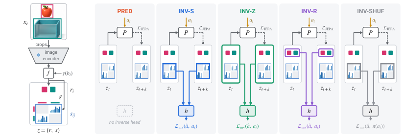

# Inside-JEPA: Put relational channels into the predictive state

<!-- source-sha256: 70473cf5d51a75f514c9a3be54d20a36703a7f89165a332191e6053409c8190a -->

[简体中文](README.md)

> **L1 trainable relational-state and loss component; diagnostic only.** Full world-model experiments not reproduced.

## Paper information

| Field | Details |
| --- | --- |
| Paper | [Inside-JEPA: From Prediction to Relational Grounding in Latent World Models](https://arxiv.org/abs/2610.31194v1) |
| Affiliations | First author Hossein Resani: Australian Institute for Machine Learning, Adelaide University |
| First public release | 2026-10-22 12:43:03 UTC (announced 2026-10-23) |
| Author code | No author method repository, SHA or code license verified. The paper is CC BY 4.0; “code is distributed” describes the representation, not an open-source release. |
| Local key | `inside-jepa`; no adapter |
| Local code | `src/auto_research/foundation_models/inside_jepa.py` |
| Local evidence | [Local mechanism metrics](metrics/component-cuda-seeds42-44.json); [A100 validation receipt](../../gpu-validations/inside-jepa-a100-20261025.json) |

## What the paper changes

Concatenate explicit channels for ordered entity pairs to the JEPA state. The inverse head predicts actions from present and future **online** states so gradients reach both, whereas the prediction target is detached EMA. Add frozen 512-dimensional crop features, normalized xyxy Fourier features (raw coordinates plus sine/cosine at frequencies $2^k\pi$, $k=0,\ldots,3$) and entity types before LayerNorm to produce width 128. Entity latents are width 32, ordered-pair channels eight or sixteen. Four slots, padded and diagonal terms fixed at zero, give 256 dimensions for eight channels, not 224.

### Original paper figure



Original figure from the reviewed paper, reused without redrawing. See [figure provenance](assets/provenance.json).

### Core equations

$$
r_i=\operatorname{LN}(We_i),\quad
s_{ij}=\sigma\big(g([e_i,e_j,e_i-e_j,e_i\odot e_j])\big),\quad z=(r,s).
$$

$$
\mathcal L_{\rm JEPA}=\|P(z_t,u(a_t))-\operatorname{sg}(\bar z_{t+k})\|_2^2,
\qquad
\mathcal L=\mathcal L_{\rm JEPA}+\ell(h(v_t,v_{t+k}),a_t).
$$

EMA momentum 0.996 updates after optimization. PRED uses only JEPA; INV-S reads relations with gradients through both frames; INV-Z reads the full state; INV-R reads entities without direct inverse gradient to the relation head, although shared encoding can affect it; INV-SHUF shuffles **only inverse targets**, retaining real actions in prediction. Discrete inverse uses CE, continuous uses squared L2 summed over dimensions then averaged across the batch, inverse weight one. AOT-S/NCE-S/SUP-S are out of scope.

### Results reported by the authors

The paper reports SSv2 matched AUROC 0.593 for PRED and 0.658 for INV-S across 65 actions and 13 relations, not universal improvements. Relations are 2D box proxies, not 3D contact. Planning readout uses relation labels. Hungarian alignment is fitted and evaluated on the same validation examples; an independent capability test would freeze alignment and include a random-head control. No production A/B or local relationship AUROC/accuracy/planning success.

## Local reproduction and limits

`RelationalStateEncoder` takes frozen [B,4,512] features, [B,4,4] boxes, types and shared mask, max 64 frame pairs. `InsideJEPA` covers five arms, discrete/continuous actions and EMA. Crop/ResNet18/detection/tracking are external. Unspecified box/pair/inverse-head details are caller modules; test MLPs are not author architecture. Preserve given 256-wide relation head, 64-dimensional action embedding and 512-wide predictor. Four synthetic pairs and one AdamW update check online gradients, detached targets, EMA, mask and routing. No CUDA fallback, capability or Evolve claim.

```bash
PYTHONPATH=src python -c 'from auto_research.foundation_models.inside_jepa import diagnostic; print(diagnostic(42))'
PYTHONPATH=src python -m pytest tests/test_inside_jepa.py
```

### Full experiment: not reproduced

SSv2/Something-Else uses AdamW, batch 64, 40 epochs (8,720 main steps), 120-epoch comparisons and 3–5 seeds. RH20T is 83 chunks/about 91.7 GB with detection/tracking and V-JEPA2 ViT-L. No GPU model or total hours reported. No data/weight downloads, trial or retry.

### Additional references

[Full paper](https://arxiv.org/html/2610.31194v1) · [Paper Section 2](https://arxiv.org/html/2610.31194v1#S2) · [Paper Section 3](https://arxiv.org/html/2610.31194v1#S3) · [Paper Section 4](https://arxiv.org/html/2610.31194v1#S4)
