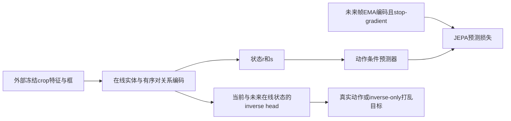
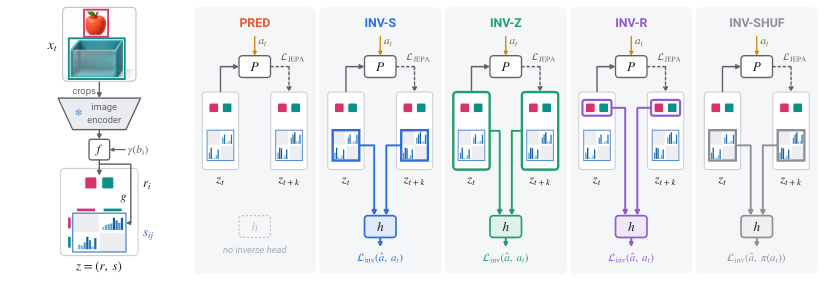

# Inside-JEPA：将关系通道放进 JEPA 状态

## 论文信息

| 字段 | 内容 |
| --- | --- |
| 论文链接 | [arXiv 2610.31194 v1](https://arxiv.org/abs/2610.31194v1)；[固定正文](https://arxiv.org/html/2610.31194v1) |
| 原文标题 | Inside-JEPA: From Prediction to Relational Grounding in Latent World Models |
| 公司 / 机构 / 学校 | 一作 Hossein Resani：Australian Institute for Machine Learning, Adelaide University；无 Google / Meta 作者署名 |
| 首次公开日期 | 2026-10-22 12:43:03 UTC（arXiv v1）；10月23日公告，本轮是近期补漏，不是10月25日新首发 |
| 原作者代码 | 在固定 v1 摘要、正文与精确标题检索的原始来源中未找到作者源码；仓库、固定 SHA、源码许可证均不可核验。论文为 CC BY 4.0；正文“code is distributed”指表示分布式，不是开源声明 |
| 本地 adapter / 稳定键 | `inside-jepa`；`adapter: null`，`component_only` |
| 本地复现代码目录 | `src/auto_research/foundation_models/inside_jepa.py`；测试 `tests/test_inside_jepa.py` |
| 完整实验 | **成本过高，不复现（审查 DONE）**；本地仅交付 L1 可训练机制，不进入自动重试队列 |

## 原始论文总结

### 背景与主要改动

普通 JEPA 能预测潜在状态，但潜变量未必对应可解释关系。本文把每个有序实体对的关系通道直接拼入动态状态，并要求逆动态头根据前后关系通道恢复动作；预测损失的未来目标仍由 EMA 编码器提供，而逆动态的未来状态必须来自**可反传的 online 编码器**。仅预测、读全部状态、只读实体和打乱动作标签的对照用于区分信号来自哪里。[原文 §3](https://arxiv.org/html/2610.31194v1#S3)



<!-- paper-figure:start -->
### 原论文关键图

[](https://arxiv.org/html/2610.31194v1#S2)

**Figure 2**：左侧是实体编码、实体潜变量与有序对通道；右侧逐一展示五臂的逆动态输入和梯度通路。直接保存固定 v1 的原始 PNG，无重绘或科学内容修改。图片来自[原论文](https://arxiv.org/html/2610.31194v1)，版权归原作者所有，CC BY 4.0。[来源与 SHA256](assets/provenance.json)。
<!-- paper-figure:end -->

### 核心公式与五臂

外部冻结 crop 特征 $\phi_i\in\mathbb R^{512}$ 与归一化 xyxy 框的 Fourier 特征、实体类型相加，经 LayerNorm 得到128维 $e_i$。框特征包含原坐标和 $\sin/\cos(2^k\pi b), k=0,\ldots,3$。实体潜变量32维，有序对关系通道取 $K=8$ 或16：

$$
r_i=\operatorname{LN}(We_i),\quad
s_{ij}=\sigma\big(g([e_i,e_j,e_i-e_j,e_i\odot e_j])\big),\quad z=(r,s).
$$

保留4个实体槽位；padding 与对角项在本地显式固定为0，$K=8$ 时状态维度为256，不因删除对角项而变成224。EMA momentum 为 **0.996**；每次 optimizer step 后显式更新目标编码器。

$$
\mathcal L_{\rm JEPA}=\|P(z_t,u(a_t))-\operatorname{sg}(\bar z_{t+k})\|_2^2,
\qquad
\mathcal L=\mathcal L_{\rm JEPA}+\ell(h(v_t,v_{t+k}),a_t).
$$

| 臂 | 逆动态输入 $v$ | 与预测分支的区别 |
| --- | --- | --- |
| PRED | 无 inverse head | 只有 JEPA loss |
| INV-S | 关系通道 $s$ | 逆动态梯度到两帧的 $f,g$ |
| INV-Z | 完整状态 $(r,s)$ | 实体与关系同时进入 inverse head |
| INV-R | 仅实体潜变量 $r$ | 无直接到关系头 $g$ 的 inverse 梯度；共享 $f$ 仍可间接改变关系 |
| INV-SHUF | $s$，inverse 目标为批内 $\pi(a)$ | **仅打乱 inverse target**，预测器仍接收真实动作 |

离散动作使用交叉熵，连续控制使用平方 L2，$\lambda_{inv}=1$。本地平方 L2 为逐样本维度求和、batch 求均值，明确 reduction，不把它默认为逐元素 MSE。额外 AOT-S、NCE-S、SUP-S 控制不在本组件范围内。[原文 §3 / Appendix A](https://arxiv.org/html/2610.31194v1#S3)

### 论文离线与线上效果

SSv2 主设置、65类动作和13种关系上，原文 PRED 的 matched AUROC 为0.593，INV-S 为0.658；并非每种关系或每种臂都更好。关系来自2D框，是图像平面几何代理，不能说已学会真实3D接触或包含。动作规划的 readout 使用关系标签训练，不能描述为纯无监督规划。[原文 §4—5](https://arxiv.org/html/2610.31194v1#S4)

未报告生产线上 A/B；以上是原论文离线结果，不是本地实测。

原文 Hungarian 通道匹配在验证集上拟合并在相同验证样本上报告 AUROC，不是独立 test 估计。本地若后续增加正式能力比较，必须在 validation 选择匹配后冻结到 test，并保留相同几何输入的 random-head 负控。**本组件不计算关系 AUROC、动作准确率或规划成功率。**

## 本地复现与操作

`RelationalStateEncoder` 接收 `[B,4,512]` 冻结特征、`[B,4,4]` 归一化框、实体类型和共享实体 mask，本地组件每次调用最多64对帧；真实 crop、ResNet18、检测跟踪均由外部提供，当前未运行它们。`InsideJEPA` 实现预测器、可选离散/连续动作条件、五臂损失与显式 EMA 更新。

原文没有给出 box-MLP 的宽度/激活、pair-MLP 的激活或 inverse-head 拓扑，因此它们是显式调用方 `nn.Module` 接口；诊断中的小 MLP / 线性 inverse head 是**本地测试头，不是原作者架构**。保留论文给出的实体维度、关系头256隐藏宽度、64维 action embedding 和512隐藏宽度 predictor，但不宣称完整 architecture parity 或原文参数量。

```bash
PYTHONPATH=src python -c 'from auto_research.foundation_models.inside_jepa import diagnostic; print(diagnostic(42))'
PYTHONPATH=src python -m pytest tests/test_inside_jepa.py
```

`diagnostic(seed, device='cpu')` 使用4对生成特征，执行一次真实 AdamW 更新；核对前后帧 inverse 梯度、目标 stop-gradient、EMA 数值、padding/对角项、五臂路由及固定 fixture loss。`device='cuda'` 必须真有 CUDA，否则失败、不回退 CPU。原始三种子和 GPU 收据由本轮统一验收绑定；张量通过与 loss 下降仅证明 L1 算法机制可训练，**不证明真实视频 grounding、world-model 能力或 Evolve 改善**，不晋级正式能力对比。

### 成本与未复现范围

完整 SSv2 / Something-Else 五臂采用相同 AdamW、batch64、40 epochs，主设置8720 steps，另有120 epochs和3—5 seeds；RH20T共83个chunk约91.7GB，并扩展检测追踪和 V-JEPA2 ViT-L。论文未披露 GPU 型号或总GPU小时，本页不编造。该完整矩阵超出单 A100/A30/Mac 短时预算，**成本过高，不复现（审查 DONE）**；不下载视频、机器人数据或权重，不启动完整试跑、不自动重试。以上为配置推断，不是本地计时。
