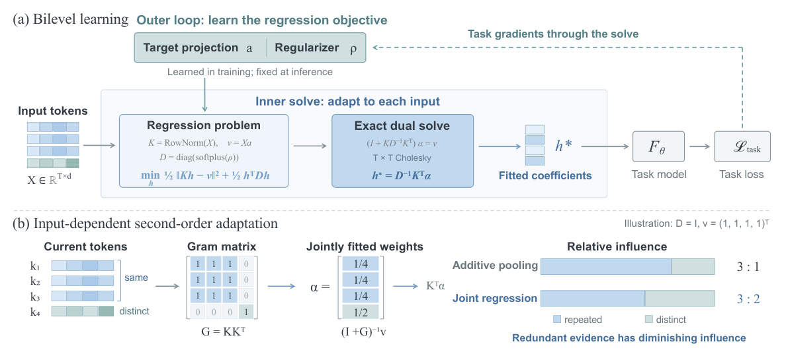

# TTR-Compressor: Differentiable sequence compression with test-time regression

<!-- source-sha256: e9abc343a15865e7c5ee4caa9be83444b5ffbbf5179ea219aa5c974c7e1d85ce -->

[简体中文](README.md)

> **L1 uniform-weight base compressor and outer-gradient diagnostics only.** Full training not reproduced due to cost.

## Paper information

| Field | Details |
| --- | --- |
| Paper | [Rethinking Sequence Compression with Test-time Regression](https://arxiv.org/abs/2610.31574v1) |
| Affiliations | First author Sihan Yang: The Chinese University of Hong Kong; collaborators include an independent researcher and Token Foundry / Alibaba Group. |
| First public release | 2026-10-22 17:14:38 UTC (announced 2026-10-23) |
| Author code | [Sphere-AI-Lab/ttr-compressor](https://github.com/Sphere-AI-Lab/ttr-compressor) at `29f643f1348a4b3893f4740433b1fc8b8c39b2e7`; [project page](https://spherelab.ai/ttr-compressor/). No clear core license was verified, and third-party licenses do not cover the original core. Independent local implementation. The repository reports October 20 without an exact verified paper timestamp; this page uses arXiv v1. |
| Local key | `ttr-compressor`; no adapter |
| Local code | `src/auto_research/foundation_models/ttr_compressor.py` |
| Local evidence | [Local mechanism metrics](metrics/component-cuda-seeds42-44.json); [A100 validation receipt](../../gpu-validations/ttr-compressor-a100-20261024.json) |

## What the paper changes

Treat a group of tokens as regression observations: use directions for keys and raw magnitudes in scalar learned targets. Solve ridge coefficients on every forward pass and use them as the compressed representation. The outer task trains projection and regularizer through the exact solve. Test-time refitting changes input-dependent coefficients, not model weights; the base has $2d$ trainable parameters.

### Original paper figure



Original figure from the reviewed paper, reused without redrawing. See [figure provenance](assets/provenance.json).

### Core equations

$$
k_t=x_t/\|x_t\|_2,\qquad v_t=a^\top x_t,\qquad
D=\operatorname{diag}(\operatorname{softplus}(\rho)),
$$

$$
h^*=\arg\min_h\tfrac12\|Kh-v\|_2^2+\tfrac12h^\top Dh
=(K^\top K+D)^{-1}K^\top v.
$$

$$
(I_T+\widetilde K\widetilde K^\top)\alpha=v,\qquad
h^*=D^{-1/2}\widetilde K^\top\alpha.
$$

$$
\nabla_aL=X^\top Ks,\qquad
\nabla_\rho L=-\operatorname{sigmoid}(\rho)\odot h^*\odot s.
$$

Key and target normalization are deliberately asymmetric: normalized targets admit a trivial static solution, and unnormalized keys make the Gram dominated by magnitude. The dual Cholesky solve uses no explicit inverse or detachment, costs $O(T^2d+T^3)$, and simplifies to $O(T^2d)$ only for $T\ll d$. Equation 9 uses $s=(K^\top K+D)^{-1}g$ for outer gradient $g$.

### Results reported by the authors

Table 1 reports selected RULER tasks/lengths for 345M: attention-weighted pooling 0.3920, base TTR 0.5092 and convolutional TTR 0.5144. Table 3 3×3 visual merging: MLP 52.27, base TTR 54.30. The 54.85 result with 55.6% fewer tokens than 2×2 MLP is convolutional, not the local base. Table 2 short-context tests do not activate compression. No production A/B or local capability results.

## Local reproduction and limits

`ttr_compress` uses positive diagonal ridge and dual Cholesky; `TTRCompressor` registers $a,\rho$. `diagnostic(42, device='cpu')` trains four synthetic groups of seven 12-dimensional tokens with one SGD update. FP32/FP64 only; `ridge_floor` is optional, while upstream adds 0.01 and uses BF16/multihead packing. Tests compare primal/dual, Eq.9 gradients, input/parameter gradcheck, permutation, scaling and duplicate-evidence saturation against wrong-normalization/raw-key/pooling controls. Reject empty/zero-norm/non-finite inputs, mismatch, underflow, overflow and failed solves, without jitter or pseudoinverse. Limits $T\le128,d\le4096$ and 1,048,576 scalars. No convolution, multihead retrieval, visual packing, downstream projection or Evolve promotion.

```bash
PYTHONPATH=src python -c 'from auto_research.foundation_models.ttr_compressor import diagnostic; print(diagnostic(42))'
```

### Full experiment: not reproduced

Sections 5.1/5.3 describe 345M pretraining for 30,000 steps at global batch 128 and 8K context (~30B tokens, eight H100s), 1B/100B extension, and a 4B visual merge pipeline with LLaVA-558K and 1.3M multimodal samples on sixteen H100s. This is a configuration-based deferral, not local timing. No downloads, trial, claimed HiLS/Qwen3-VL reproduction or retries.

### Additional references

[Paper PDF](https://arxiv.org/pdf/2610.31574v1) · [Paper PDF, p. 4](https://arxiv.org/pdf/2610.31574v1#page=4)
