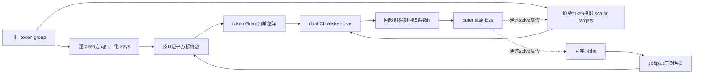
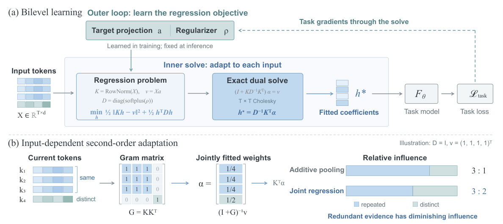

# TTR-Compressor：可微测试时回归压缩

## 论文信息

| 字段 | 内容 |
| --- | --- |
| 论文链接 | [arXiv 2610.31574 v1](https://arxiv.org/abs/2610.31574v1)；[固定 PDF](https://arxiv.org/pdf/2610.31574v1)；[作者项目页](https://spherelab.ai/ttr-compressor/) |
| 原文标题 | Rethinking Sequence Compression with Test-time Regression |
| 公司 / 机构 / 学校 | 一作 Sihan Yang：The Chinese University of Hong Kong；合作包括 Independent Researcher、Token Foundry / Alibaba Group。无 Google/Meta 作者机构 |
| 首次公开日期 | arXiv v1：2026-10-22 17:14:38 UTC，10/23 new 公告；Oct24 检索时仍为同一公告，本篇为重叠窗口新增入库，不是10/24新首发 |
| 原作者代码 | [官方公开源码](https://github.com/Sphere-AI-Lab/ttr-compressor)，固定 commit `29f643f1348a4b3893f4740433b1fc8b8c39b2e7`。未找到顶层或 TTR 核心文件的明确许可证；第三方子项目带许可证不自动覆盖原创核心。**本地独立按论文公式重写，未复制上游核心代码** |
| 本地 adapter / 稳定键 | `ttr-compressor`；`adapter: null`，`component_only` |
| 本地复现代码目录 | `src/auto_research/foundation_models/ttr_compressor.py`；测试 `tests/test_ttr_compressor.py` |
| 完整实验 | 成本过高，不复现（审查 DONE）；仅交付均匀权重 base compressor 的 L1 张量与外层梯度诊断 |

上游 README 自报10/20发布论文/代码，但未提供可核精确论文发布时刻；这里的 `published_at` 采用官方 arXiv v1 时间，不据 README 日期改写时间戳，也不混淆检索日、公告日和首发日。

## 原始论文总结

### 背景与主要改动

固定池化或投影分别聚合 token，难以按当前输入的相关结构调整压缩。TTR 把一组 token 视作回归观测：由 token 方向构造 key，由保留模长的原始 token 生成可学习标量 target；每次前向精确求解 ridge 系数，直接把系数作为压缩表示。外层任务 loss 通过闭式求解训练 target 投影与正则。

“test-time”指输入相关的回归系数在前向内重新拟合，不表示推理时更新模型参数。基础版本只有 $2d$ 个可训练参数，不是另建一个 agent 或训练时读取正确压缩答案。



<!-- paper-figure:start -->
### 原论文关键图

[](https://arxiv.org/pdf/2610.31574v1#page=4)

**Figure 2，第4页**：上半部分是内层 Cholesky 回归与外层任务梯度，下半部分展示重复 token 与独特 token 的相对贡献。这里直接渲染原 PDF 的完整图示区域，未重绘或修改科学内容；原作者版权，arXiv perpetual non-exclusive license，**不是 CC BY**，见 [裁切与哈希](assets/provenance.json)。

图片来自[原论文](https://arxiv.org/pdf/2610.31574v1#page=4)，版权归原作者所有。
<!-- paper-figure:end -->

### 核心公式

输入 $X\in\mathbb R^{T\times d}$，基础版本采用均匀观测权重：

$$
k_t=x_t/\|x_t\|_2,\qquad v_t=a^\top x_t,\qquad
D=\operatorname{diag}(\operatorname{softplus}(\rho)),
$$

$$
h^*=\arg\min_h\tfrac12\|Kh-v\|_2^2+\tfrac12h^\top Dh
=(K^\top K+D)^{-1}K^\top v.
$$

key 和 target 的不对称归一化是定义机制：若 target 也改成 $a^\top k_t$，静态向量 $a$ 就能平凡拟合；若 key 不归一化，原始模长会主导 Gram，亦不是论文的 TTR。

令 $\widetilde K=KD^{-1/2}$，实际计算

$$
(I_T+\widetilde K\widetilde K^\top)\alpha=v,\qquad
h^*=D^{-1/2}\widetilde K^\top\alpha.
$$

使用 Cholesky 解方程，不显式求逆、不 detach。复杂度为 $O(T^2d+T^3)$；只有 $T\ll d$ 时才可将表格中的主项简称为 $O(T^2d)$。对外层梯度 $g=\nabla_hL$，令 $s=(K^\top K+D)^{-1}g$，原文 Eq.9 给出

$$
\nabla_aL=X^\top Ks,\qquad
\nabla_\rho L=-\operatorname{sigmoid}(\rho)\odot h^*\odot s.
$$

### 论文离线与线上效果

固定 v1 表1：345M 模型的 RULER 选定检索任务/长度平均，attention-weighted pooling 为0.3920、base TTR为0.5092、带卷积TTR为0.5144。表3的 $3\times3$ 视觉合并平均，MLP为52.27、base TTR为54.30。论文“少55.6%视觉token而接近 $2\times2$ MLP”的54.85数值来自**卷积版本**，不能写成本地未实现卷积的 base 结果。

表2短上下文测试不会激活 compressor，不能拿它证明压缩机制带来通用能力提升。以上均为论文结果，不是本地结果；未报告生产线上 A/B。

## 本地复现

`ttr_compress` 独立实现正对角 generalized ridge 与 dual Cholesky；`TTRCompressor` 将 $a,\rho$ 注册成可训练参数。`diagnostic(seed, device='cpu')` 生成4组、每组7个12维 token，执行外层反传和一次真实 SGD 更新，返回严格的 `seed/metrics/checks`。既不下载数据或权重，也不调用 pretrained 模型。

仅支持 FP32/FP64 小张量路径；FP64用于独立数值参考。本地默认 $D=\operatorname{softplus}(\rho)$ 对应论文 Eq.3；可显式设置非负 `ridge_floor`。固定上游代码另加0.01 floor，并包含BF16/多head packing；本地不声称与该工程实现逐 bit 相同。没有卷积、多头稀疏检索、视觉分组打包或后续语言投影模块。

可直接检查组件：

```python
from auto_research.foundation_models.ttr_compressor import diagnostic
result = diagnostic(42, device="cpu")
assert all(result["checks"].values())
```

正式批次运行使用统一 Oct24 runner 的源码冻结证明。CUDA 路径需在真实 A100/A30 上执行，并保留 `docs/gpu-validations/ttr-compressor-a100-20261024.json`；单有 CPU 测试通过不代表 GPU gate 已通过。

### 数据协议、测试与边界

固定生成张量与 seed 42/43/44 只用于 L1 机制验证，没有 validation/test 能力比较或模型晋级。独立测试覆盖 primal 法方程、dual 等价、Eq.9 解析梯度、对输入/$a$/$\rho$ 的 gradcheck、base token 置换不变性、整体缩放响应与重复证据饱和闭式。错误归一化、raw key 及 mean-pooling 都有负控；三个 seed 不会把机制诊断升级成能力复现。

零 token 模长、空组、NaN/Inf、dtype/device或维度不匹配、softplus数值下溢为零、Gram溢出或 Cholesky 失败均明确拒绝，不偷偷加 jitter、截断、伪逆或回退常数结果。局部成本护栏为 $T\le128,d\le4096$、总输入至多1048576标量；默认诊断远低于上限。

### 成本与未复现范围

原文 §5.1/§5.3：345M 预训练30000步、global batch128、8K序列，约30B token，使用8×H100；扩展版本为1B/100B token。视觉合并使用4B语言骨干，LLaVA-558K及1.3M多模态样本两阶段训练，16×H100。上述完整训练明确超出本轮单张A100/A30或Mac预算（依据原文配置，不是本地测速）。

完整模型训练和多基准评估**成本过高，不复现（审查 DONE）**，不下载、不试跑、不进入自动重试或实现队列。当前组件不构成 HiLS-Attention、Qwen3-VL 或论文端到端结果复现，不宣称服务加速，不接入 Evolve 自动晋级。
