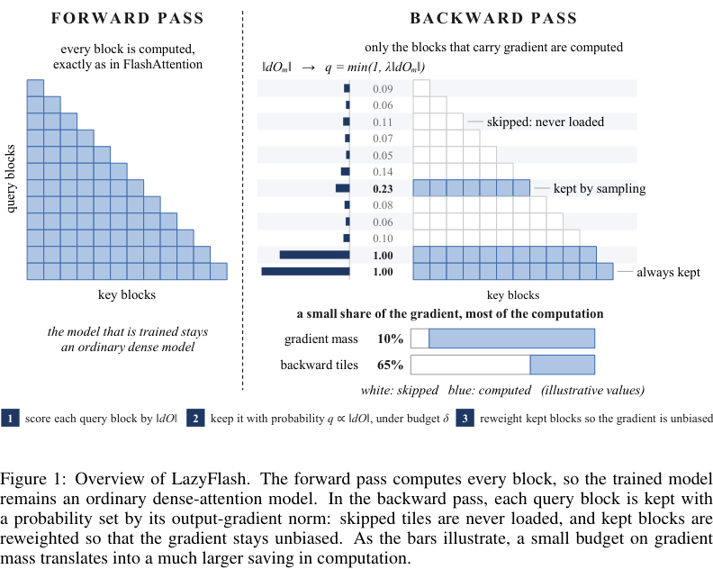

# LazyFlash: Forward-Dense, Backward-Sparse Attention for Accelerated Long-Context Fine-Tuning

<!-- source-sha256: d8feab6aafa18c1b6952b2e3771eabc3cb4107fadc6d295fa59fbd9d1f9bb60a -->

[简体中文](README.md)

> **Reference entry only.** The defining tiled backward kernel and full long-context study were not reproduced due to cost.

## Paper information

| Field | Details |
| --- | --- |
| Paper | [LazyFlash: Forward-Dense, Backward-Sparse Attention for Accelerated Long-Context Fine-Tuning](https://arxiv.org/abs/2610.31911v1); [reviewed full text](https://arxiv.org/html/2610.31911v1) |
| Affiliations | First author Keqi Deng: Microsoft |
| First public release | 2026-10-22 21:04:07 UTC (announced 2026-10-26) |
| Author code | No verifiable LazyFlash method repository or code license in reviewed v1. FlashAttention is an upstream library, not the author's LazyFlash source. |
| Local key | `lazyflash`; no adapter |
| Local code | No executable local implementation. |
| Local evidence | No local experiment, metrics or GPU receipt. |

## What the paper changes

Training and serving keep exact dense forward attention. Each query block's output-gradient Frobenius norm measures its contribution; a gradient-mass budget determines backward sampling probabilities, rather than arbitrary fixed top-k. The retained blocks are inverse-probability weighted. Speed depends on skipping tile loads and computation inside the FlashAttention backward kernel.

### Original paper figure

Original figure from the reviewed paper, reused without redrawing. See [figure provenance](assets/provenance.json).

### Core equations

$$
c_m=\|dO_m\|_F,\qquad p_m=\min(1,\lambda c_m).
$$

Reciprocal probability weighting preserves the dense gradient **in expectation**, not in every sampled backward pass. Masking the result of a dense backward or counting skipped tiles without skipping their operations does not implement LazyFlash.

### Results reported by the authors

The paper reports up to 5.7× faster attention backward and 1.7× end-to-end training acceleration. Timings are author H200 results, not local measurements. No production A/B.

## Local reproduction and limits

No operator, command, kernel, local metrics, GPU receipt or Evolve capability. No toy dense-backward mask is presented as the method.

### Full experiment: not reproduced

Eight H200s, context 65,536, 2,500 steps, multiple Qwen3 models and 50K hours of speech data, plus kernel verification over lengths, models and precision. No compilation, weight load, trial or retry on the available single-device budget.

### Additional references

[Paper PDF, p. 4](https://arxiv.org/pdf/2610.31911v1#page=4)
