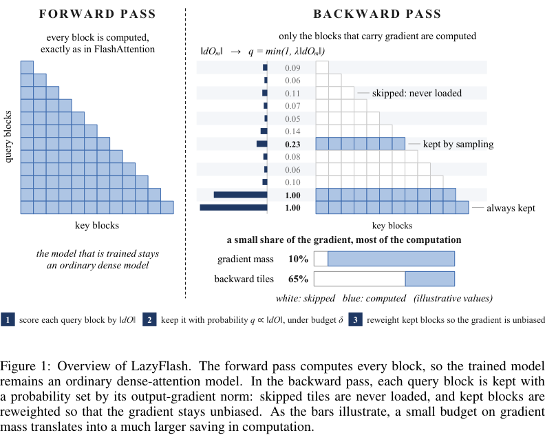

# LazyFlash: Forward-Dense, Backward-Sparse Attention for Accelerated Long-Context Fine-Tuning

前向仍是精确dense attention，反向依据每个query block的输出梯度范数分配采样概率，丢弃低gradient-mass blocks并用importance权重维持无偏梯度；真正加速依赖FlashAttention tiled backward不加载被跳过tiles。完整kernel和长上下文多卡实验成本过高，不复现。

## 论文信息

| 字段 | 内容 |
| --- | --- |
| 论文链接 | [arXiv 2610.31911 v1](https://arxiv.org/abs/2610.31911v1)；[固定核对全文 v1](https://arxiv.org/html/2610.31911v1) |
| 公司 / 机构 / 学校 | 一作 Keqi Deng：Microsoft；全文署名未列Google/Meta，不因使用Gemma或引用JEPA就标为Google/Meta论文。 |
| 首次公开日期 | 2026-10-22 21:04:07 UTC（arXiv v1提交）；2026-10-26 new公告，不混淆提交日与公告日。 |
| 原作者代码 | 固定v1及其官方链接未找到可核验LazyFlash专属方法仓库；未发布/未找到，不能将FlashAttention上游库算作作者方法代码；未找到可核验的方法源码许可证；论文与FlashAttention上游许可各自独立 |
| 本地 adapter / 稳定键 | `lazyflash`；`adapter: null`；`deferred_high_cost` |
| 本地复现代码目录 | 无，本轮仅收录审查资料，不声明已实现 |
| 完整实验 | **成本过高，不复现（审查 DONE）**；不阻塞审查水位、不自动重试。 |

## 原始论文总结

### 背景与主要改动

与稀疏前向attention不同，LazyFlash保留训练和部署前向完全dense。它按query block的dO Frobenius范数衡量梯度贡献，用gradient-mass budget约束预计丢弃量，并importance采样反向block。必须在tiled FlashAttention反向内部跳过内存访问/计算，才能兑现论文速度；用PyTorch dense backward后置零或toy mask不构成该方法的低成本完整实现。

<!-- paper-figure:start -->
### 原论文关键图

**Figure 1**，固定v1第4页原图及caption裁切。图片来自[原论文](https://arxiv.org/html/2610.31911v1)，版权归原作者所有；未重绘或修改科学内容。[原始来源、SHA256和尺寸](assets/provenance.json)。
<!-- paper-figure:end -->

### 核心公式

$$
c_m=\|dO_m\|_F,\qquad p_m=\min(1,\lambda c_m).
$$
被采样的block按其保留概率的倒数重加权，维持dense梯度的无偏估计；这不保证任意一次随机反向与dense相同。正文结合budget计算阈值与概率，而非随意固定top-k。此页不实现一个只统计mask却仍执行dense反向的伪kernel。

### 论文离线与线上效果

原文报告最高5.7倍attention-backward和1.7倍端到端训练加速；不是本地测量。没有生成可被误当成训练提速证据的toy metrics。

未报告本文方法的生产线上A/B，不将开源benchmark或引用商业模型视为线上部署证据。

## 本地复现

无本地operator、metrics或GPUreceipt；无capability/evolve声明。原方法的定义性产物是可执行的tiled backward kernel，本轮不以通用softmax/mask代理充数。已读方法、实验及附录后终结完整复现成本审查。

本页没有本地实验命令或指标文件；`gpu_validation_passed=false`。资料收录不等于实现完成，不把高成本结论转写为待自动重试的TODO。

## 复现边界

原文8张H200、65,536长度、2500steps，多个Qwen3模型和语音50K小时训练数据；所有计时在H200。自定义FlashAttention反向kernel及跨长度/模型/精度验证本身也超过本轮单卡低成本范围。不安装/编译kernel或加载权重来“试试”。

**成本过高，不复现（审查 DONE）**。以上是成本先行的终态审查，不是先跑大实验再得出的超时。 `diagnostic_only=true`、`promotion_eligible=false`、`evolve_integrated=false`，没有以registry标签假称多轮控制器集成。
