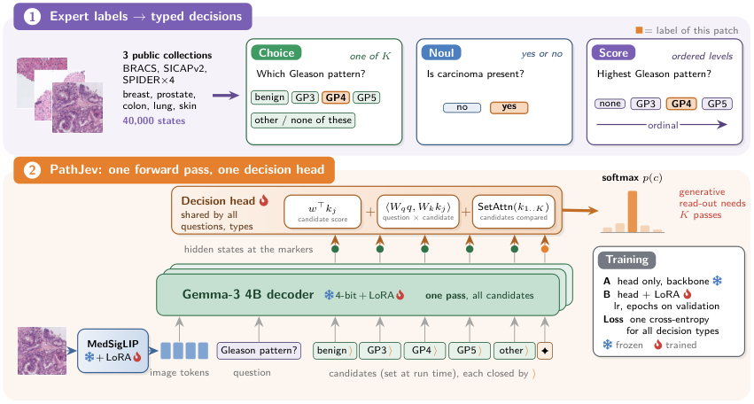

# PathJev: Decision-Native Vision–Language Modelling for Histopathology

<!-- source-sha256: f9e5e3a10bb7f3bc3bcb2dd317150055ad3e3e0698bbf656fced223e7240bb52 -->

[简体中文](README.md)

> **Reference entry only.** The full pathology study was not reproduced due to cost (review complete).

## Paper information

| Field | Details |
| --- | --- |
| Paper | [PathJev: Decision-Native Vision–Language Modelling for Histopathology](https://arxiv.org/abs/2610.32478v1); [reviewed full text](https://arxiv.org/html/2610.32478v1) |
| Affiliations | First author Cristian Tommasino: University of Naples Federico II |
| First public release | 2026-10-23 10:47:40 UTC (announced 2026-10-26) |
| Author code | [CosmoIknosLab/PathJev](https://github.com/CosmoIknosLab/PathJev) at `1f5fa8d29220fbdbc31496484170e85fe83d4bea`, Apache-2.0, includes implementation, inference, analysis, configs, tests and results. [PathJev-P weights](https://huggingface.co/Cristiandieti/PathJev-P) are available. Paper CC BY-NC-ND 4.0; MedGemma and data terms are separate. |
| Local key | `pathjev`; no adapter |
| Local code | No executable local implementation. |
| Local evidence | No local experiment, metrics or GPU receipt. |

## What the paper changes

PathJev converts expert pathology-patch labels into typed Choice/Noul/Score decisions with candidate sets supplied at runtime. In one forward pass, the shared decision head reads question and candidate marker states, combines candidate, interaction and set-attention terms, and normalizes over the given candidates. The head and two-stage training follow OmniMed-Jev. The pathology contribution is the 40K decision states, typed labeling, patient/slide and overlap audit, unseen-organ tests and generative readout comparisons.

### Original paper figure

Original figure from the reviewed paper, reused without redrawing. See [figure provenance](assets/provenance.json).

### Core equations

$$
z_{jk}=w^\top k_{jk}+\langle W_q q_j,W_k k_{jk}\rangle/\sqrt d+\operatorname{SetAttn}(k_{j1:K})_k,\quad
p_{jk}=\mathrm{softmax}_k(z_{jk}),\quad \mathcal L=-\frac1M\sum_{j,k}y_{jk}\log p_{jk}.
$$

Candidates are input text, not global classifier classes, and the prompt excludes the target. Score uses one-hot grade labels as specified, not a replacement ordinal-distance loss.

### Results reported by the authors

On the test with no known overlap, balanced accuracy is 0.541 versus 0.492 for a same-backbone generative baseline. Calibration depends on readout: mean ECE is around 0.201 for both length-normalized generative output and PathJev. The paper notes unseen-organ overconfidence and missing patient IDs in some data. No production A/B or local capability result.

## Local reproduction and limits

No operator, command, metrics or GPU receipt. The author repository is a reference; no MedGemma, patches or whole slides were downloaded, and no generic classifier or existing Jev infrastructure is represented as a PathJev implementation.

### Full experiment: not reproduced

The study uses MedGemma1.5-4B NF4, 896×896 images, roughly 39.6M LoRA/head parameters and 40K states. Table 7 reports 10.4–10.5 hours per single-GPU PathJev seed versus 16.3–16.5 hours for Gen-SFT, before the added cost of hyperparameter selection, three seeds, multi-dataset inference and whole-slide experiments. No download, trial or retry.

### Additional references

[Original figure resource](https://arxiv.org/html/2610.32478v1/fig1_overview.png)
