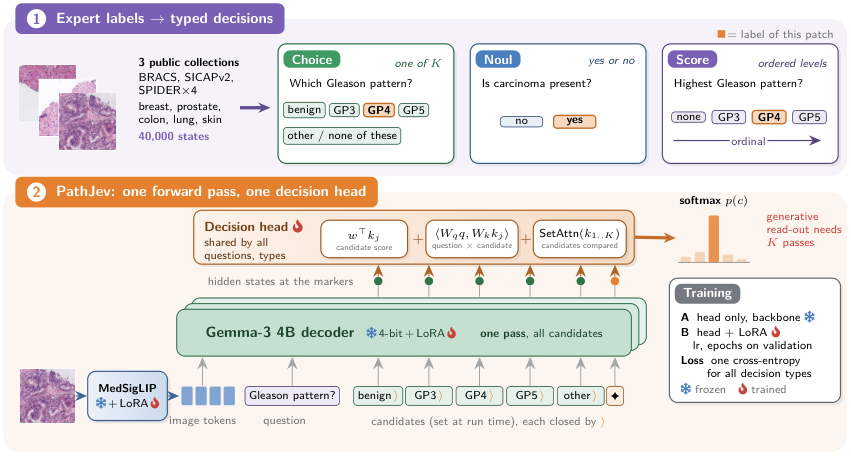

# PathJev: Decision-Native Vision–Language Modelling for Histopathology

将病理patch专家标签转成带runtime候选集的Choice/Noul/Score决策，以MedGemma4B和共享decision head训练；按患者/切片隔离、未见器官及不同generative概率读法检验校准。核心新贡献是病理数据与受控协议，完整三种子训练和whole-slide实验成本过高，不复现。

## 论文信息

| 字段 | 内容 |
| --- | --- |
| 论文链接 | [arXiv 2610.32478 v1](https://arxiv.org/abs/2610.32478v1)；[固定核对全文 v1](https://arxiv.org/html/2610.32478v1) |
| 公司 / 机构 / 学校 | 一作 Cristian Tommasino：University of Naples Federico II；全文署名未列Google/Meta，不因使用Gemma或引用JEPA就标为Google/Meta论文。 |
| 首次公开日期 | 2026-10-23 10:47:40 UTC（arXiv v1提交）；2026-10-26 new公告，不混淆提交日与公告日。 |
| 原作者代码 | [作者仓库](https://github.com/CosmoIknosLab/PathJev)，固定commit `1f5fa8d29220fbdbc31496484170e85fe83d4bea`；作者方法仓库公开，固定commit目录包含src/inference/analysis/configs/tests及结果；公开模型https://huggingface.co/Cristiandieti/PathJev-P；本轮只核资源，不下载模型/病理数据；Apache-2.0（固定repo commit LICENSE）；论文CC BY-NC-ND4.0；数据集/MedGemma许可独立 |
| 本地 adapter / 稳定键 | `pathjev`；`adapter: null`；`deferred_high_cost` |
| 本地复现代码目录 | 无，本轮仅收录审查资料，不声明已实现 |
| 完整实验 | **成本过高，不复现（审查 DONE）**；不阻塞审查水位、不自动重试。 |

## 原始论文总结

### 背景与主要改动

模型一遍前向在question/candidate markers读取hidden，decision head混合candidate线性项、question-candidate交互和set attention，对runtime候选做softmax。head和两阶段训练继承已有OmniMed-Jev；PathJev的重要新增是病理40K states、专家标签到三种typed decisions、split/overlap审计、未见器官与generative readout对照。不能只实现一个普通softmax就声称复现病理泛化。

<!-- paper-figure:start -->
### 原论文关键图

**Figure 1**，固定v1HTML原始图文件逐字节保存。图片来自[原论文](https://arxiv.org/html/2610.32478v1)，版权归原作者所有；未重绘或修改科学内容。[原始来源、SHA256和尺寸](assets/provenance.json)。
<!-- paper-figure:end -->

### 核心公式

$$
z_{jk}=w^\top k_{jk}+\langle W_q q_j,W_k k_{jk}\rangle/\sqrt d+\operatorname{SetAttn}(k_{j1:K})_k,\quad
p_{jk}=\mathrm{softmax}_k(z_{jk}),\quad \mathcal L=-\frac1M\sum_{j,k}y_{jk}\log p_{jk}.
$$
候选是输入中的文本，不是固定分类器的全局类别；prompt不包含target。Score用原文one-hot等级标签，不能自行改成ordinal距离损失。

### 论文离线与线上效果

在无已知overlap的test上balanced accuracy0.541对同backbone generative0.492，但ECE优势依赖readout：length-normalized generative与PathJev均值约0.201，并非普遍校准更优。原文还承认未见器官过置信、部分patient标识缺失；本地不复制论文分数为实测。

未报告本文方法的生产线上A/B，不将开源benchmark或引用商业模型视为线上部署证据。

## 本地复现

无本地operator/metrics/GPUreceipt；原作者repo与分析计划可直接查阅。没有下载MedGemma、病理patch/whole-slide、没有用通用分类head或字段校验冒充完整病理方法。纯公式阅读或既有JEV基础设施不等于新增capability/evolve接入。

本页没有本地实验命令或指标文件；`gpu_validation_passed=false`。资料收录不等于实现完成，不把高成本结论转写为待自动重试的TODO。

## 复现边界

MedGemma1.5-4B NF4、896×896图像、LoRA+head约39.6M参数、40Kstates；Table7单GPU每seed PathJev全程10.4–10.5h、Gen-SFT16.3–16.5h，另有超参选择/3seeds/多数据集推理、whole-slide。远超单卡短时预算，不下载公开权重来重复验证成本。

**成本过高，不复现（审查 DONE）**。以上是成本先行的终态审查，不是先跑大实验再得出的超时。 `diagnostic_only=true`、`promotion_eligible=false`、`evolve_integrated=false`，没有以registry标签假称多轮控制器集成。
