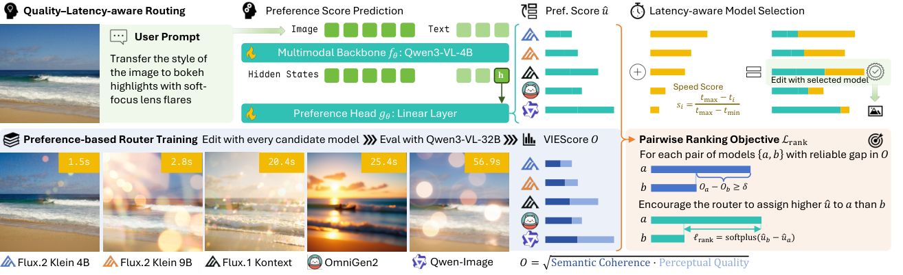

# EditJev: System One Routing for Image Editing Models

<!-- source-sha256: 73e70d4c1b35c30468ecf5cc449684c0728a11bb3d2744fcc48ed152c071527c -->

[简体中文](README.md)

> **L1 preference head, pairwise loss and router; diagnostic only.** Full image-editing experiments were not reproduced due to cost.

## Paper information

| Field | Details |
| --- | --- |
| Paper | [EditJev: System One Routing for Image Editing Models](https://arxiv.org/abs/2610.32635v1); [reviewed full text](https://arxiv.org/html/2610.32635v1) |
| Affiliations | First author Zhile Guan: Peking University |
| First public release | 2026-10-23 13:46:53 UTC (announced 2026-10-26) |
| Author code | No author EditJev method repository or source license verified. Candidate-editor repositories are not the router source; the paper has an arXiv non-exclusive license. |
| Local key | `editjev`; no adapter |
| Local code | `src/auto_research/system_one/editjev.py` |
| Local evidence | [Local mechanism metrics](metrics/component-cuda-seeds42-44.json); [A100 validation receipt](../../gpu-validations/editjev-a100-20261026.json) |

## What the paper changes

Image editors have complementary strengths. Offline, run and judge all candidates and turn reliable quality gaps into pairwise supervision. The router takes the last non-padding hidden state of one image/instruction forward pass and predicts a utility vector in fixed candidate order. At serving time, add a fixed normalized speed prior weighted by beta and select once; candidate editors are not evaluated before choosing.

### Original paper figure



Original figure from the reviewed paper, reused without redrawing. See [figure provenance](assets/provenance.json).

### Core equations

$$
SC_i=\min(s_i^{success},s_i^{preserve}),\quad PQ_i=\min(s_i^{natural},s_i^{artifactfree}),\quad O_i=\sqrt{SC_iPQ_i}.
$$

$$
\mathcal P_b=\{(a,c):O_{ba}>O_{bc},\ O_{ba}-O_{bc}\ge\delta\},\quad
\mathcal L=\frac1B\sum_b\frac{\sum_{(a,c)\in\mathcal P_b}\operatorname{softplus}(u_{bc}-u_{ba})}{\max(1,|\mathcal P_b|)}.
$$

$$
s_i=\frac{t_{max}-t_i}{t_{max}-t_{min}},\qquad \hat i=\arg\max_i(u_i+\beta s_i).
$$

Reduce pairwise softplus per request before the batch mean, not across all pairs globally. A request with no pair contributes differentiable zero. When all mean latencies coincide the speed formula is undefined; the local interface rejects rather than inventing a policy. Higher beta favors faster models for equal utility.

### Results reported by the authors

The authors report ImgEdit 4.592 versus the best fixed editor at 4.540 and GEdit-En 8.255 versus 8.194, with estimated end-to-end latency reductions of 60.8% and 31.7%. These depend on the real backbone, offline judge and candidate pool. No production A/B, local quality score or measured speedup.

## Local reproduction and limits

`PreferenceHead` gathers the last non-padding token for left or right padding and projects it linearly. Qwen3-VL hidden states come from the caller. `offline_quality` and `pairwise_ranking_loss` use detached labels only in training; `route` receives utilities, mean latencies and beta, not judge scores, editor outputs or test gold. Ties follow fixed candidate order. CPU and A100 seeds 42/43/44 check formulas, gradients, interfaces and negative controls with small tensors and no CUDA fallback. No backbone load, editor, LoRA data, judge or Evolve integration.

```bash
PYTHONPATH=src python -c 'from auto_research.system_one.editjev import diagnostic; print(diagnostic(42))'
python -m pytest tests/test_oct26_foundation_components.py
```

### Full experiment: not reproduced

The full matrix includes a Qwen3-VL-4B LoRA router, FLUX.2 Klein 4B/9B, Kontext, OmniGen2 and Qwen-Image-Edit (20B), all-candidate offline outputs, Qwen3-VL-32B/GPT judging, 737 ImgEdit plus 606 GEdit-En requests, and ablations. RTX PRO 6000 timings are not local A100 measurements. No model downloads, batch API calls or automatic retries.

### Additional references

[Original figure resource](https://arxiv.org/html/2610.32635v1/EditJEV_Method.png)
