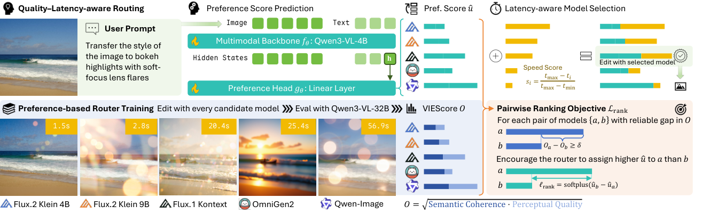

# EditJev: System One Routing for Image Editing Models

对图像与编辑指令的一次backbone前向取最后非padding hidden，用线性head输出各编辑器偏好；离线按质量gap构造成对排序监督，推理仅结合预测偏好与归一化速度选一个编辑器。本地实现目标与路由，不生成图像或读取测试质量答案。

## 论文信息

| 字段 | 内容 |
| --- | --- |
| 论文链接 | [arXiv 2610.32635 v1](https://arxiv.org/abs/2610.32635v1)；[固定核对全文 v1](https://arxiv.org/html/2610.32635v1) |
| 公司 / 机构 / 学校 | 一作 Zhile Guan：Peking University；全文署名未列Google/Meta，不因使用Gemma或引用JEPA就标为Google/Meta论文。 |
| 首次公开日期 | 2026-10-23 13:46:53 UTC（arXiv v1提交）；2026-10-26 new公告，不混淆提交日与公告日。 |
| 原作者代码 | 固定v1正文及本轮官方链接未找到作者EditJev方法仓库；未发布/未找到，不把模型候选仓库当router源码；未找到可核验的方法源码许可证；论文arXiv non-exclusive license |
| 本地 adapter / 稳定键 | `editjev`；`adapter: null`；`component_only` |
| 本地复现代码目录 | `src/auto_research/system_one/editjev.py` |
| 完整实验 | **成本过高，不复现（审查 DONE）**；不阻塞审查水位、不自动重试。 |

## 原始论文总结

### 背景与主要改动

固定使用一个图像编辑器会忽视样本级互补性。EditJev先离线让所有候选产生输出并由judge评分，再将可靠质量差转为pairwise监督；router不生成模型名称，而直接输出固定候选顺序的utility vector。推理无需先运行各编辑器，仅对utility加beta倍固定速度分后选一次argmax。

<!-- paper-figure:start -->
### 原论文关键图

[](https://arxiv.org/html/2610.32635v1/EditJEV_Method.png)

**Figure 2**，固定v1HTML原始图文件逐字节保存。图片来自[原论文](https://arxiv.org/html/2610.32635v1)，版权归原作者所有；未重绘或修改科学内容。[原始来源、SHA256和尺寸](assets/provenance.json)。
<!-- paper-figure:end -->

### 核心公式

$$
SC_i=\min(s_i^{success},s_i^{preserve}),\quad PQ_i=\min(s_i^{natural},s_i^{artifactfree}),\quad O_i=\sqrt{SC_iPQ_i}.
$$
$$
\mathcal P_b=\{(a,c):O_{ba}>O_{bc},\ O_{ba}-O_{bc}\ge\delta\},\quad
\mathcal L=\frac1B\sum_b\frac{\sum_{(a,c)\in\mathcal P_b}\operatorname{softplus}(u_{bc}-u_{ba})}{\max(1,|\mathcal P_b|)}.
$$
$$
s_i=\frac{t_{max}-t_i}{t_{max}-t_{min}},\qquad \hat i=\arg\max_i(u_i+\beta s_i).
$$
每个request先按pair数归一化，再batchmean；不能把全batch所有pair合并平均。无pair的request贡献可微零。tmax=tmin时原式未定义，本地拒绝并要求调用方声明策略，不暗中补heuristic。

### 论文离线与线上效果

原文ImgEdit整体4.592对最强固定4.540，GEdit-En8.255对8.194；估计端到端latency分别降低60.8%与31.7%。该提升依赖真实视觉backbone、离线judge及候选池；本地没有复制这些分数或速度结论。

未报告本文方法的生产线上A/B，不将开源benchmark或引用商业模型视为线上部署证据。

## 本地复现

本轮已在CPU及真实NVIDIA A100上执行同一冻结版本、42/43/44三个种子：[独立机制指标](metrics/component-cuda-seeds42-44.json)、[脱敏GPU凭证](../../gpu-validations/editjev-a100-20261026.json)。仅验收下述L1组件，不宣称完整模型能力。

`PreferenceHead`真实执行最后非padding token gather与线性投影，支持左/右padding；上游真实Qwen3-VL hidden由调用方负责。`offline_quality`和`pairwise_ranking_loss`仅在训练使用离线label，label停止梯度。`route(utilities, mean_latencies, beta=...)`不接judge结果、候选输出或test gold。未实现Qwen3-VL加载、LoRA训练数据生成、MLLM judge或图像编辑器。相同utility下较大beta偏向更快模型；本地固定候选顺序解argmax平局。

```bash
PYTHONPATH=src python -c 'from auto_research.system_one.editjev import diagnostic; print(diagnostic(42))'
python -m pytest tests/test_oct26_foundation_components.py
```

`diagnostic(seed, device='cpu')`只运行生成小张量上的独立公式、梯度、接口和负控；CUDA不可用直接失败、不回退CPU。本轮已完成CPU与真实A100同源三种子机制验收，不是完整模型效果复现。

## 复现边界

完整方案Qwen3-VL-4B LoRA router，五个编辑器FLUX.2 Klein4B/9B、Kontext、OmniGen2、Qwen-Image-Edit（20B），离线所有候选生成及Qwen3-VL-32B/GPT judge，737 ImgEdit+606 GEdit-En请求和多组消融。论文RTX PRO6000延迟计时不适合伪装成A100本地实测，不下载多套编辑权重或批量调API。

**成本过高，不复现（审查 DONE）**。以上是成本先行的终态审查，不是先跑大实验再得出的超时。本地组件只证明所列计算与梯度，不证明原模型/数据流程或正式benchmark收益。 `diagnostic_only=true`、`promotion_eligible=false`、`evolve_integrated=false`，没有以registry标签假称多轮控制器集成。
