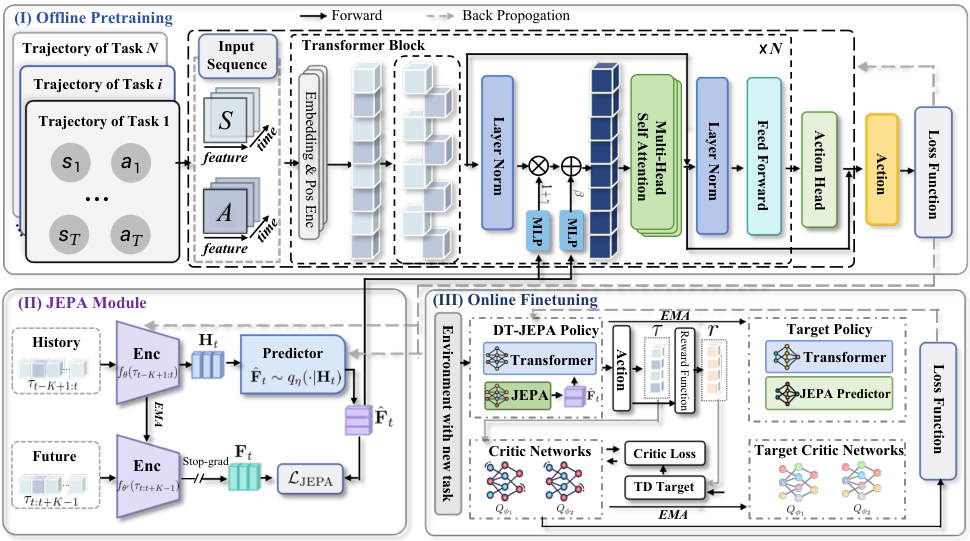

# DT-JEPA: Learning to Predict Future Representations for Decision-Making

<!-- source-sha256: 2cc1cbec19b52dcb4ffd65b921cc4a011a2089ef2bb6de30987366c2d893e240 -->

[简体中文](README.md)

> **L1 objective and gradient component; diagnostic only**, not D4RL control capability. Full experiment not reproduced due to cost (review complete).

## Paper information

| Field | Details |
| --- | --- |
| Paper | [DT-JEPA: Learning to Predict Future Representations for Decision-Making](https://arxiv.org/abs/2610.32657v1); [reviewed full text](https://arxiv.org/html/2610.32657v1) |
| Affiliations | First author Changxu Ni: Southeast University |
| First public release | 2026-10-23 14:04:18 UTC (announced 2026-10-26) |
| Author code | No author DT-JEPA source or method license was verified in v1 or its official links. TD-JEPA and similar names are not substitutes. The paper is CC BY 4.0. |
| Local key | `dt-jepa`; no adapter |
| Local code | `src/auto_research/foundation_models/dt_jepa.py` |
| Local evidence | [Local mechanism metrics](metrics/component-cuda-seeds42-44.json); [A100 validation receipt](../../gpu-validations/dt-jepa-a100-20261026.json) |

## What the paper changes

Scalar return-to-go cannot distinguish trajectories with the same return but different dynamics. Predict a diagonal Gaussian over future latents from history, using a detached EMA future encoder only during training. A reparameterized sample conditions the Decision Transformer via AdaLN with separate scale and shift MLPs. Offline training combines behavior cloning and NLL; online adaptation uses the smaller of two target critics for a multi-step target and a Q1-guided actor objective.

### Original paper figure



Original figure from the reviewed paper, reused without redrawing. See [figure provenance](assets/provenance.json).

### Core equations

$$
q_\eta(F\mid H)=\mathcal N(\mu(H),\operatorname{diag}(\sigma(H)^2)),\quad
\mathcal L_J=\mathbb E[-\log q_\eta(\operatorname{sg}(f_{\theta'}(\tau_{t:t+K-1}))\mid f_\theta(\tau_{t-K+1:t}))].
$$

$$
\hat F=\mu+\sigma\odot\epsilon,\quad \tilde h=(1+\mathrm{MLP}_\gamma(\hat F))\odot\mathrm{LN}(h)+\mathrm{MLP}_\beta(\hat F),\quad
\mathcal L_{pre}=\mathcal L_{BC}+\lambda_J\mathcal L_J.
$$

$$
\hat Q_m=\sum_{k=m}^{t-1}\gamma^{k-m}r_k+\gamma^{t-m}\min(Q'_1(s_t,\hat a_t),Q'_2(s_t,\hat a_t)),\quad
\mathcal L_{adapt}=\mathcal L_{BC}+\lambda'_J\mathcal L_J-\lambda_Q\mathbb E\sum_m Q_1(s_m,\hat a_m).
$$

Sum the Gaussian NLL over latent dimensions and average the batch. BC and critic reductions sum time/action dimensions before batch averaging; a generic elementwise MSE mean would reweight terms. Targets and TD bootstrap are detached, but the actor retains critic gradients through its action.

### Results reported by the authors

The main table reports the best result on 10 of 12 Gym MuJoCo configurations and beating PDT on 18 of 19. There is no local return or success rate and no production A/B in the paper.

## Local reproduction and limits

`PredictiveFuture` accepts externally supplied history encoder, mean/log-standard-deviation predictor, gamma/beta MLPs, action head and observable-history DT hidden states. The future trajectory enters only pretraining loss, not the forward interface. Local linear heads are fixtures, not a disclosed Transformer. Buffer-bearing encoders are rejected rather than guessing EMA semantics; multi-step TD accepts contiguous fixed segments without terminal transitions. CPU and actual A100 seeds 42/43/44 check formulas, masks, detached targets, gradients and EMA; CUDA cannot fall back. No online collection, high-return subset rule, environment, full DT or Evolve.

```bash
PYTHONPATH=src python -c 'from auto_research.foundation_models.dt_jepa import diagnostic; print(diagnostic(42))'
python -m pytest tests/test_oct26_foundation_components.py
```

### Full experiment: not reproduced

D4RL has 19 locomotion/navigation settings, five main-table seeds, unseen-reward online adaptation, baselines and ablations. The appendix gives a four-layer, four-head width-512 DT, batch 256/context 20. No total GPU hours were reported; the complete matrix exceeds one A100/A30 or Mac. No MuJoCo installation, trajectory download, trial or retry.

### Additional references

[Original figure resource](https://arxiv.org/html/2610.32657v1/F3.png)
