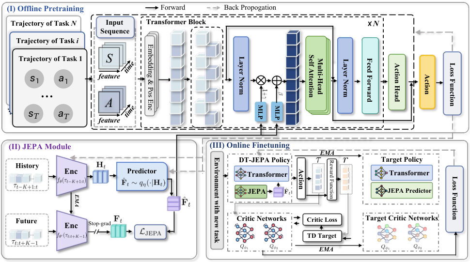

# DT-JEPA: Learning to Predict Future Representations for Decision-Making

从历史轨迹预测未来latent的对角高斯分布，以停止梯度的EMA未来编码器做NLL目标，并将重参数采样latent经AdaLN调制历史DT表示；在线目标结合BC、JEPA及双critic价值指导。本地保留这些目标与梯度，不冒充D4RL控制能力。

## 论文信息

| 字段 | 内容 |
| --- | --- |
| 论文链接 | [arXiv 2610.32657 v1](https://arxiv.org/abs/2610.32657v1)；[固定核对全文 v1](https://arxiv.org/html/2610.32657v1) |
| 公司 / 机构 / 学校 | 一作 Changxu Ni：Southeast University；全文署名未列Google/Meta，不因使用Gemma或引用JEPA就标为Google/Meta论文。 |
| 首次公开日期 | 2026-10-23 14:04:18 UTC（arXiv v1提交）；2026-10-26 new公告，不混淆提交日与公告日。 |
| 原作者代码 | 固定v1正文、arXiv资源与本轮官方链接未找到作者DT-JEPA方法仓库；未发布/未找到，不能拿TD-JEPA或其他同名实现替代；未找到可核验的方法源码许可证；论文CC BY 4.0 |
| 本地 adapter / 稳定键 | `dt-jepa`；`adapter: null`；`component_only` |
| 本地复现代码目录 | `src/auto_research/foundation_models/dt_jepa.py` |
| 完整实验 | **成本过高，不复现（审查 DONE）**；不阻塞审查水位、不自动重试。 |

## 原始论文总结

### 背景与主要改动

传统DT用单个return-to-go条件，无法区分回报相同但未来动力学不同的轨迹。本方法将条件改成由历史预测的未来latent分布：历史encoder生成Gaussian参数，EMA target encoder只在训练期编码真实未来；重参数采样的预测未来通过独立gamma/beta MLP调制DT hidden。离线目标为BC加Gaussian NLL；在线通过双target critic的较小值构建多步target，并优化Q1指导的actor目标。

<!-- paper-figure:start -->
### 原论文关键图

[](https://arxiv.org/html/2610.32657v1/F3.png)

**Figure 2**，固定v1HTML原始图文件逐字节保存。图片来自[原论文](https://arxiv.org/html/2610.32657v1)，版权归原作者所有；未重绘或修改科学内容。[原始来源、SHA256和尺寸](assets/provenance.json)。
<!-- paper-figure:end -->

### 核心公式

$$
q_\eta(F\mid H)=\mathcal N(\mu(H),\operatorname{diag}(\sigma(H)^2)),\quad
\mathcal L_J=\mathbb E[-\log q_\eta(\operatorname{sg}(f_{\theta'}(\tau_{t:t+K-1}))\mid f_\theta(\tau_{t-K+1:t}))].
$$
$$
\hat F=\mu+\sigma\odot\epsilon,\quad \tilde h=(1+\mathrm{MLP}_\gamma(\hat F))\odot\mathrm{LN}(h)+\mathrm{MLP}_\beta(\hat F),\quad
\mathcal L_{pre}=\mathcal L_{BC}+\lambda_J\mathcal L_J.
$$
$$
\hat Q_m=\sum_{k=m}^{t-1}\gamma^{k-m}r_k+\gamma^{t-m}\min(Q'_1(s_t,\hat a_t),Q'_2(s_t,\hat a_t)),\quad
\mathcal L_{adapt}=\mathcal L_{BC}+\lambda'_J\mathcal L_J-\lambda_Q\mathbb E\sum_m Q_1(s_m,\hat a_m).
$$
NLL对latent维求和后batch平均；BC与critic对时间/动作维求和后batch平均，不能用通用MSE.mean悄悄改变权重。target和TD bootstrap停止梯度，actor的Q对action梯度保留。

### 论文离线与线上效果

原文主表在12个Gym MuJoCo配置中的10个最好，并优于PDT的19配置中的18个；这些是论文结论，不是本地结果。这里没有环境return或成功率，只有公式、mask、stop-gradient与参数EMA负控。

未报告本文方法的生产线上A/B，不将开源benchmark或引用商业模型视为线上部署证据。

## 本地复现

本轮已在CPU及真实NVIDIA A100上执行同一冻结版本、42/43/44三个种子：[独立机制指标](metrics/component-cuda-seeds42-44.json)、[脱敏GPU凭证](../../gpu-validations/dt-jepa-a100-20261026.json)。仅验收下述L1组件，不宣称完整模型能力。

`PredictiveFuture`显式接调用方提供的history encoder、返回mean/log-standard-deviation的predictor、gamma/beta MLP、action head，以及**只来自可观察历史**的DT hidden。未披露拓扑不补造；测试线性头仅是机制fixture，不是作者Transformer。未来轨迹仅进入pretraining_loss，forward不接未来、action标签或reward。原文未说明encoder buffer EMA，接口明确拒绝buffers；多步TD接口仅接连续无终止的固定segment，不擅自添加termination语义。完整在线数据收集、高回报子集门槛、MuJoCo环境及DT网络均未实现。

```bash
PYTHONPATH=src python -c 'from auto_research.foundation_models.dt_jepa import diagnostic; print(diagnostic(42))'
python -m pytest tests/test_oct26_foundation_components.py
```

`diagnostic(seed, device='cpu')`只运行生成小张量上的独立公式、梯度、接口和负控；CUDA不可用直接失败、不回退CPU。本轮已完成CPU与真实A100同源三种子机制验收，不是完整模型效果复现。

## 复现边界

D4RL共19个locomotion/navigation数据配置、主表5种子、多个未见reward的在线适配及基线/消融；附录DT4层/4头/512hidden、batch256/context20。原文未给总GPU小时，不臆测。完整offline+online矩阵超单卡短时预算，不安装MuJoCo、不下载轨迹、不启动环境试跑。

**成本过高，不复现（审查 DONE）**。以上是成本先行的终态审查，不是先跑大实验再得出的超时。本地组件只证明所列计算与梯度，不证明原模型/数据流程或正式benchmark收益。 `diagnostic_only=true`、`promotion_eligible=false`、`evolve_integrated=false`，没有以registry标签假称多轮控制器集成。
