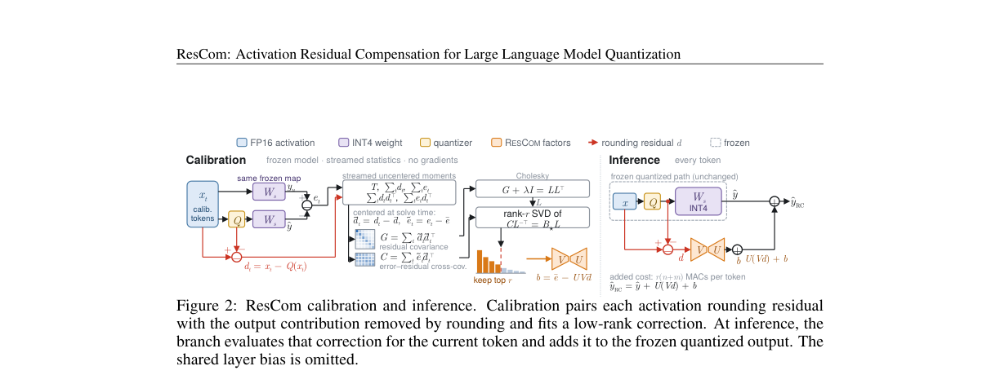
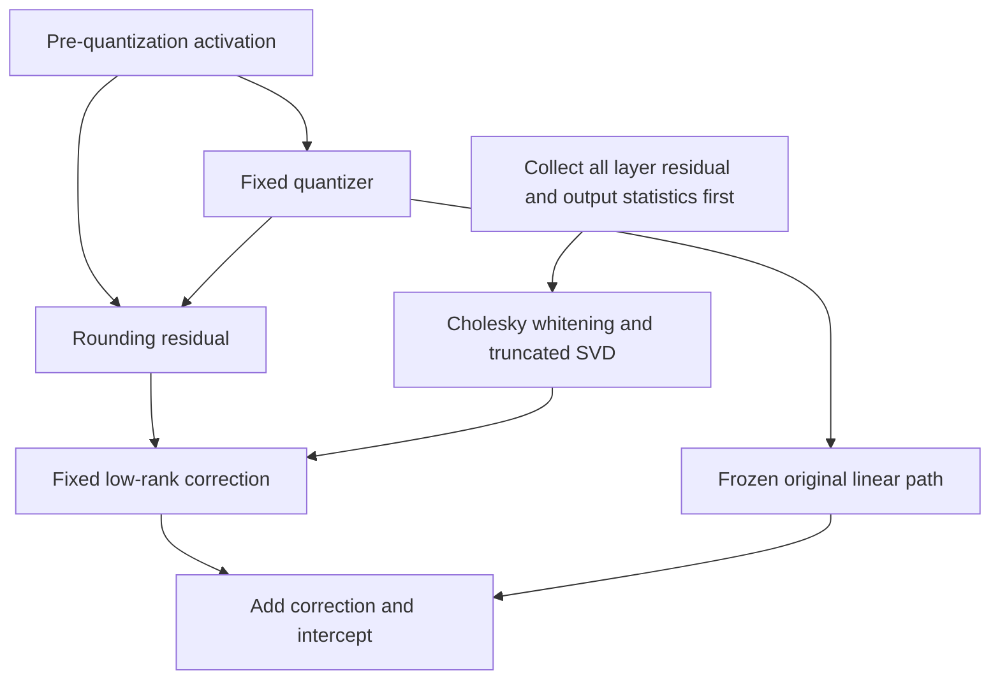

# ResCom: Low-rank output compensation from activation rounding residuals

<!-- source-sha256: 542f6c2a3ec5756474d7e548385de4a03a7210cf72232455b34a46011e2ad462 -->

[简体中文](README.md)

> Local status: **L1 standalone closed-form calibration; diagnostic only**. This is not a full quantized model or a native low-bit kernel. The complete experiment is **not reproduced due to cost (review complete)**, without automatic retries or Evolve promotion.

## Paper information

| Field | Details |
| --- | --- |
| Paper | [ResCom: Activation Residual Compensation for Large Language Model Quantization](https://arxiv.org/abs/2610.35955v1); [reviewed v1 full text](https://arxiv.org/html/2610.35955v1) |
| Affiliations | First author Ning Yang: Institute of Automation, Chinese Academy of Sciences; collaboration with Fudan University, CUHK and UCAS |
| First public release | 2026-10-25 03:02:21 UTC, arXiv v1 |
| Author code | No method repository was found in the reviewed v1 text, appendix or arXiv page. Baseline repositories such as SERQ are not ResCom source. |
| Local key | `rescom`; standalone component, no adapter or Evolve integration |
| Local code | `src/auto_research/foundation_models/rescom.py` |
| Entry points | `ResidualMoments`, `fit_residual_correction`, `diagnostic(seed, device)` |
| Local evidence | [Three-seed mechanism metrics](metrics/component-cuda-seeds42-44.json); [A100 validation receipt](../../gpu-validations/rescom-a100-20261029.json) |

## What the paper changes

Low-bit quantization maps distinct activations to the same lattice point. A correction that sees only the quantized value cannot recover differences within that cell. ResCom retains the activation rounding residual $d=x-Q(x)$ from the current forward pass and compensates for its effect on the output with a low-rank branch. The quantized model, main weights and quantizer stay frozen.

Ranking channels by residual magnitude is not equivalent: even a small residual can be amplified by the main projection. ResCom uses cross-statistics of residuals and output errors to allocate its rank budget for output reconstruction. It solves a regularized reduced-rank regression with an intercept in closed form.

### Original paper figure



Unredrawn figure from the [reviewed v1 paper](https://arxiv.org/html/2610.35955v1); see [figure provenance](assets/provenance.json) for the source, checksum and caption. The quantized model and GPU kernels in the figure are not local integrations.



### Core equations

Equations 1–3 compare unrounded and rounded inputs passed through the **same frozen mapping** $W_s$; the target is not arbitrary whole-layer quantization error:

$$
d=x-Q(x),\quad e=W_sd,\qquad \hat y_{RC}=\hat y+UVd+b.
$$

$$
\min_{\operatorname{rank}(B)\le r,b}\sum_t\|e_t-Bd_t-b\|^2+\lambda\|B\|_F^2,\quad B=UV.
$$

Center the data and use the **unnormalized** sums $G=\sum_t\tilde d_t\tilde d_t^\top$ and $C=\sum_t\tilde e_t\tilde d_t^\top$. With $G+\lambda I=LL^\top$ and $CL^{-\top}=\Phi\Sigma\Psi^\top$, Equation 6 gives

$$
U=\Phi_r\Sigma_r,\quad V=\Psi_r^\top L^{-1},\quad b=\bar e-UV\bar d.
$$

Algorithm 1 collects statistics for every target layer on the same frozen model **before** any corrections are installed, then installs the branches together. Applying corrections immediately after collecting each layer would alter the targets for later layers.

### Results reported by the authors

For Llama-3-8B W4A4 the paper reports WikiText-2 perplexity falling from 7.708 to 7.147 and MMLU increasing by 2.89 percentage points. It also compares models and quantization pipelines. These are author results; the local component does not load those models or claim B200 low-bit speed or memory gains. No production A/B test was reported.

## Local reproduction and limits

The component computes stable, mergeable, centered streaming statistics, solves the Cholesky/truncated-SVD system, and applies a fixed $UVd+b$ branch. The small-scale check preserves output-aware calibration, the rank constraint, the unnormalized statistics and the unpenalized intercept. Plain SVD of $W$ or ranking by residual magnitude is not a substitute.

The caller supplies residuals and errors from the same frozen quantized coordinate system. There is no SERQ/FlatQuant pipeline, checkpoint conversion, MXFP4, fused kernel or whole-LLM instrumentation. Calibration does not backpropagate into external inputs. Held-out synthetic residuals test the linear mechanism, not LLM generalization.

```bash
PYTHONPATH=src python -c 'from auto_research.foundation_models.rescom import diagnostic; print(diagnostic(42))'
export PYTHONPATH=src
python -m pytest tests/test_oct29_foundation_components.py -q
```

Tests compare the full-rank result with independent ridge regression, merged batch statistics with one-pass statistics, the rank-zero case with the mean, and the intercept with the calibration mean. Two inputs with the same quantized value but different residuals must be distinguishable. Fixed-rank results also retain a separate held-out error check on a linear host. The three seeds measure mechanism repeatability, not formal model performance.

### Full experiment: not reproduced

The complete matrix covers 1B–70B models, 128×2,048 calibration tokens, multiple quantization pipelines and downstream tasks, long-context generation, and measurements with B200/native MXFP4. The reported 1B/3B B200 calibration times do not establish the cost of the complete matrix on one A100/A30. Model downloads and the full benchmark and hardware comparison exceed the local short-run budget. No costly trial or automatic retry was scheduled.
