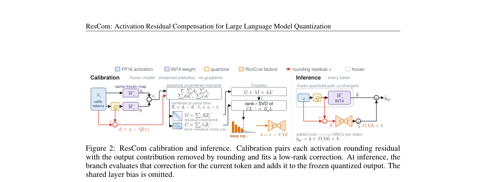
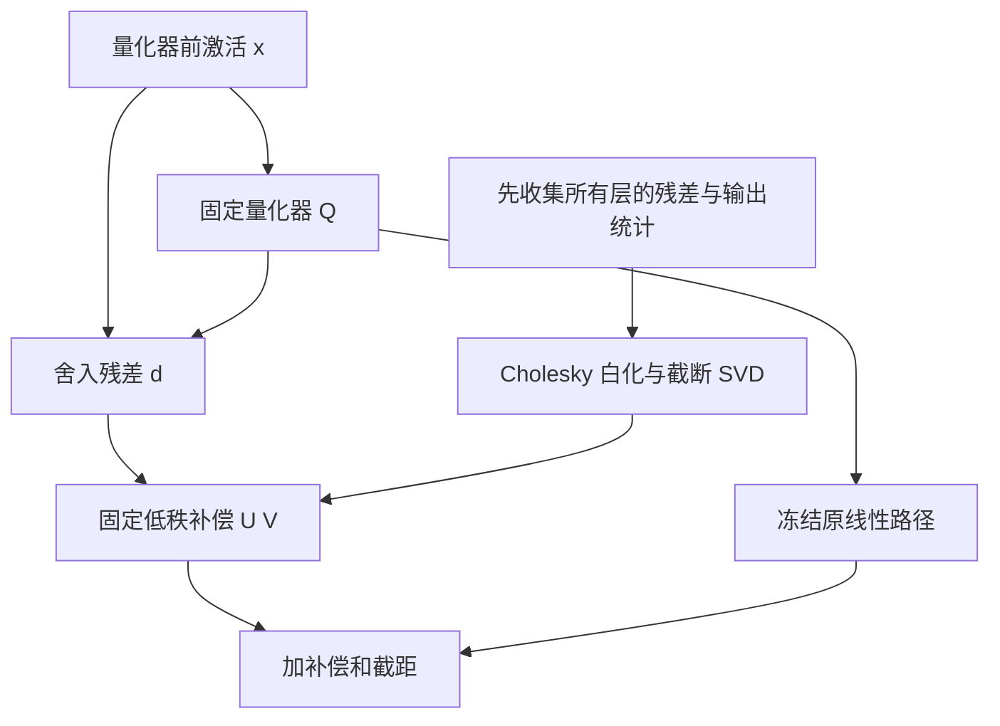

# ResCom：用激活舍入残差做低秩输出补偿

> 本地状态：**L1 独立闭式校准组件、diagnostic only**，不是完整量化模型或原生低比特内核。完整实验：**成本过高，不复现（审查 DONE）**，不自动重试、不接入 evolve 晋级。

## 论文信息

| 字段 | 内容 |
| --- | --- |
| 论文 | [ResCom: Activation Residual Compensation for Large Language Model Quantization](https://arxiv.org/abs/2610.35955v1) |
| 公司 / 作者机构 | 一作 Ning Yang：Institute of Automation, Chinese Academy of Sciences；合作 Fudan University、CUHK、UCAS。不是 Google / Meta 论文 |
| 原始发布日期 | **2026-10-25 03:02:21 UTC**，arXiv v1；提交日期不等于本轮抓取日期 |
| 原作者代码 | 固定 v1 正文、附录及 arXiv 页面未找到作者方法仓库；**未找到 / 未发布**，不拿 SERQ 等基线仓库冒充 ResCom |
| 本地 Adapter / key | `rescom`；独立组件，`adapter=null`、`evolve_integrated=false` |
| 本地代码 | `src/auto_research/foundation_models/rescom.py` |
| 本地入口 | `ResidualMoments`、`fit_residual_correction`、`diagnostic(seed, device)` |
| 验证边界 | 人工生成的冻结线性映射 / 舍入残差；CUDA 验收以本批真实 GPU 回执为准，不使用论文指标充当本地结果 |

## 原始论文总结

### 背景与主要改动

低比特激活把不同输入压到同一量化格点后，只读取量化值的补偿器无法分辨格点内部的差异。ResCom 保留当前前向中的残差 $d=x-Q(x)$，在冻结既有量化模型之后，以低秩分支补回这些残差造成的输出变化；不重新优化主权重或量化器。

它不是“找残差最大的通道”：残差很小也可能被主映射放大。论文通过输出误差与残差的交叉统计，按输出重建目标分配有限秩预算，并用带截距的正则化降秩回归闭式求解。

<!-- paper-figure:start -->
### 原论文关键图



原图来自[固定 v1 全文](https://arxiv.org/html/2610.35955v1)，未经重绘；源地址、原图哈希与图注见 `assets/provenance.json`。图中量化模型和 GPU 内核不是本地已接入能力。
<!-- paper-figure:end -->



### 核心公式

Eq.1–3 的目标是同一冻结映射 $W_s$ 在未舍入 / 舍入输入上的差，非直接拟合任意整层量化误差：

$$
d=x-Q(x),\quad e=W_sd,\qquad \hat y_{RC}=\hat y+UVd+b.
$$

$$
\min_{\operatorname{rank}(B)\le r,b}\sum_t\|e_t-Bd_t-b\|^2+\lambda\|B\|_F^2,\quad B=UV.
$$

中心化后使用**未除样本数**的 $G=\sum_t\tilde d_t\tilde d_t^\top$、$C=\sum_t\tilde e_t\tilde d_t^\top$。令 $G+\lambda I=LL^\top$、$CL^{-\top}=\Phi\Sigma\Psi^\top$，Eq.6 为：

$$
U=\Phi_r\Sigma_r,\quad V=\Psi_r^\top L^{-1},\quad b=\bar e-UV\bar d.
$$

所有目标层先基于**同一未挂补偿的冻结模型**收集统计，再一次性安装分支；逐层收集后立刻修改模型会改变后续层目标，不符合 Algorithm 1。

### 论文离线与线上效果

论文报告 Llama-3-8B W4A4 的 WikiText-2 PPL 从 7.708 降到 7.147，MMLU 增加 2.89 个百分点，另有多模型 / 跨量化流水线对照。它们是作者结果，本地没有加载这些模型。线上 A/B：**未报告**；本地不宣称复现 B200 低比特速度或显存收益。

## 本地复现

实现稳定可合并的中心化流式统计、Cholesky / 截断 SVD 求解和固定 $UVd+b$ 分支。可缩小维度，但保留输出感知、秩约束、未归一统计和不惩罚截距；不以普通 SVD($W$) 或残差幅度排序替代论文目标。

调用者必须提供来自同一冻结量化坐标系的真实残差与误差。本地没有 SERQ / FlatQuant、checkpoint 转换、MXFP4、融合内核或整个 LLM 插桩。校准不反向传播到外部输入；独立合成 held-out 残差只说明线性机制，不是语言模型泛化。

```bash
PYTHONPATH=src python -c 'from auto_research.foundation_models.rescom import diagnostic; print(diagnostic(42))'
python -m pytest tests/test_oct29_foundation_components.py -q
```

### 检查与负控

完整秩解与独立 ridge 求解比较；分批合并统计与一次统计比较；零秩退化为均值；校准均值由截距匹配。构造相同量化格点、不同残差的两条输入，验证补偿仍能区分；保留固定秩线性 host 的独立 held-out 误差。三种子是机制可重复性，不是正式模型对照。

### 高成本完整实验

完整配置涵盖 1B–70B 模型、128×2048 校准 token、多量化流水线、多下游任务、长上下文生成及 B200 / 原生 MXFP4 测量。作者 1B / 3B 的 B200 校准耗时不能推成单张 A100/A30 的全矩阵耗时。模型下载、完整基准和硬件对照不在短时单卡预算：**成本过高，不复现（审查 DONE）**。不启动下载或昂贵试跑证明成本，不自动重试。
