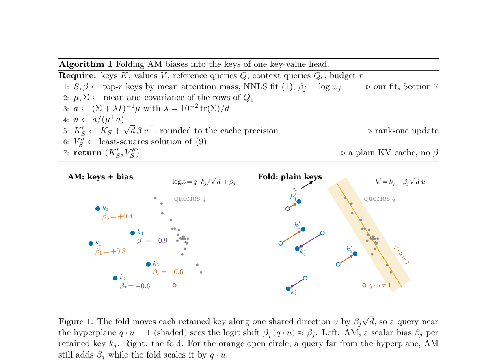

# FoldBias: Folding static attention biases into retained keys

<!-- source-sha256: 75acdc4bf86ed173dedadd355d09154087144327470a3a11a1856938b88ee9ce -->

[简体中文](README.md)

> **Local scope: L1 mechanism diagnostic for key folding and value refitting.** This is not a complete Attention Matching (AM) compressor, LLM prefill pipeline, or vLLM integration. The full quality and serving experiments were reviewed and not reproduced because of cost. The component does not establish a speedup or an Evolve capability.

## Paper information

| Field | Details |
| --- | --- |
| Paper | [Folding Attention Biases into Keys Makes Compacted KV Caches Run on Standard Kernels](https://arxiv.org/abs/2610.36520v1) |
| Reviewed version | [arXiv v1 full text](https://arxiv.org/html/2610.36520v1) |
| First author and affiliation | Utkarsh Kanwat, independent researcher |
| First public release | 2026-10-27 02:22:37 UTC, arXiv v1 |
| Author code | No verifiable method repository or code revision found in the reviewed v1 text or abstract page. |
| Local key | <code>fold-bias</code>; standalone component, no adapter or Evolve integration |
| Local implementation | <code>src/auto_research/foundation_models/fold_bias.py</code> |
| Entry points | <code>fit_direction</code>, <code>fold_keys</code>, <code>refit_rounded_cache</code>, <code>output_error_bound</code>, <code>diagnostic</code> |

## What the paper proposes

Attention Matching retains a subset of keys and fits a static logit bias and a value for each retained position. Standard attention kernels and KV-cache formats may not accept a separate per-key bias. Dropping it changes the compacted attention distribution. FoldBias fits one shared direction per head and encodes each bias as a key displacement along that direction. Head dimensionality and the model's query path remain unchanged.

This is an approximation, not an exact replacement for all future queries: a dot product is linear in the query, so it cannot represent a nonzero constant over the entire query space. The fit constrains the mean projection to one on the calibration queries and limits its variation. Query drift can still cause error, and values must be refit after rounding the folded keys to the actual cache precision.

### Original paper figure

The image is an unredrawn crop from the [reviewed paper](https://arxiv.org/html/2610.36520v1). See the [figure provenance](assets/provenance.json) for the original caption and digest.

### Core equations

For a head of dimension $d$ and retained key $k_j$ with bias $\beta_j$, Eq. 4 gives

$$
k'_j=k_j+\sqrt d\,\beta_j u,\qquad
\frac{q^\top k'_j}{\sqrt d}=\frac{q^\top k_j}{\sqrt d}+\beta_j(q^\top u).
$$

Eqs. 5–6 use the population covariance $\Sigma$ of the queries (normalization by $N$, not $N-1$) and mean $\mu$. The ridge fit retains the constraint $\mu^\top u=1$:

$$
\lambda=10^{-2}\operatorname{tr}(\Sigma)/d,\qquad
a=(\Sigma+\lambda I)^{-1}\mu,\qquad
u=\frac{a}{\mu^\top a}.
$$

An unconstrained fit that shrinks the mean projection would also attenuate the mean bias and would not implement Eq. 6. Algorithm 1 and Eq. 9 specify folding, then rounding, then refitting:

$$
\widetilde K=\operatorname{round}_{\mathrm{bf16}}(K'),\qquad
A=\operatorname{softmax}(Q\widetilde K^\top/\sqrt d),\qquad
V''=\arg\min_X\|AX-O\|_F^2.
$$

The local implementation uses the Moore–Penrose pseudoinverse to handle rank-deficient reference attention matrices. The returned coefficients are fitted values, not cache blocks installed in a serving engine.

For **the same values and unrounded keys**, Section 3.3 bounds the output error by

$$
\|o^{\mathrm{fold}}-o^{\mathrm{biased}}\|
\leq\frac{\max\beta-\min\beta}{4}\,
\max_{i,j}\|v_i-v_j\|\,|q^\top u-1|.
$$

AM's range $\beta\in[-3,3]$ gives the factor $3D_V/2$, where $D_V$ is the largest value-vector distance. Include unbiased participating positions with $\beta=0$. The bound does not directly apply after changing values or rounding keys.

### What the paper reports

The authors compare folding, original AM, and dropping the bias on QuALITY, LongHealth, and LongBench, across multiple models and budgets. They also test queries far from the calibration context and report serving integration experiments. Some settings transfer well, while some models and tasks degrade. The system tests are not a production traffic A/B test. The local component does not measure accuracy, throughput, or serving capacity on those tasks.

## Local reproduction and validation

Callers supply calibration queries, the actual retained keys, AM-fitted biases, and reference full-cache outputs. GQA callers must first combine query heads that share a KV head. The implementation rejects zero covariance, zero means, nonfinite inputs or results, and cache-precision overflow rather than inventing a fallback direction or altering the ridge. AM key selection, NNLS, the second prefill, paged caches, storage rounding of installed values, real decoding, and serving integration are out of scope.

From the repository root:

~~~bash
PYTHONPATH=src python -c 'from auto_research.foundation_models.fold_bias import diagnostic; print(diagnostic(42))'
PYTHONPATH=src python -m pytest tests/test_oct30_foundation.py -q
~~~

The synthetic tests check the rank-one logit identity, the mean constraint and KKT conditions, actual BF16 rounding, and the normal-equation residual of the value fit. Negative controls compare discarding the bias, check the same-value bound before refitting, and verify softmax invariance to a common bias. The [three-seed A100 metrics](metrics/component-cuda-seeds42-44.json) and [validation receipt](../../gpu-validations/fold-bias-a100-20261030.json) are evidence for this bounded mechanism, not for end-to-end KV compression.

### Full experiment: reviewed, not reproduced

The paper uses Qwen3 variants from 1.7B to 14B, Llama-3.1-8B, long-context benchmarks, multiple quality budgets, and serving tests across larger models and backends. Some capacity tests use random weights and do not measure checkpoint quality. The full multi-model calibration and serving matrix was too expensive for the project's single-card budget. No checkpoint download, serving probe, or automatic retry was performed for it.
