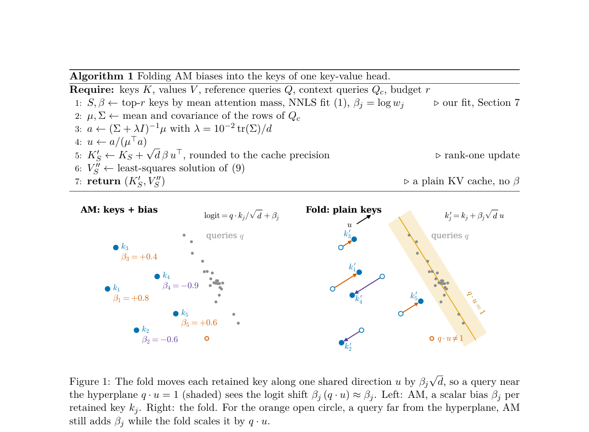
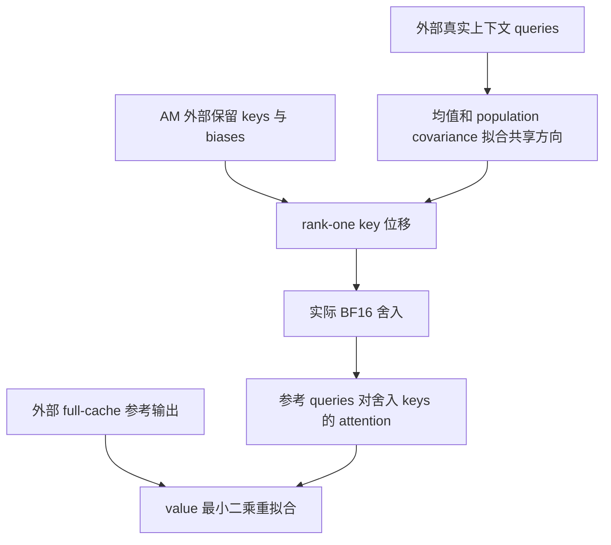

# FoldBias：把静态 attention bias 折入保留 keys

> 本地状态：**L1 key 折叠与 value 重拟合组件，diagnostic only**。不实现完整 AM 压缩、LLM prefill 或 vLLM 注入。完整质量 / serving 实验：**成本过高，不复现（审查 DONE）**；不宣称加速或 evolve 能力。

## 论文信息

| 字段 | 内容 |
| --- | --- |
| 论文 | [Folding Attention Biases into Keys Makes Compacted KV Caches Run on Standard Kernels](https://arxiv.org/abs/2610.36520v1) |
| 固定审查版本 | [arXiv v1 全文](https://arxiv.org/html/2610.36520v1) |
| 公司 / 作者机构 | 一作 Utkarsh Kanwat：Independent Researcher |
| 原始发布日期 | **2026-10-27 02:22:37 UTC**，arXiv v1 |
| 原作者代码 | 固定 v1 全文与摘要页未找到可核验方法源码仓库；**未找到 / 尚未发布**，没有源码 revision |
| 本地 Adapter / key | `fold-bias`；独立组件，`adapter=null`、`evolve_integrated=false` |
| 本地代码 | `src/auto_research/foundation_models/fold_bias.py` |
| 本地入口 | `fit_direction`、`fold_keys`、`refit_rounded_cache`、`output_error_bound`、`diagnostic(seed, device)` |
| 验证边界 | 单 head 小张量线性代数、实际 BF16 舍入与负控；CUDA 状态以本批 GPU 回执为准 |

## 原始论文总结

### 背景与主要改动

Attention Matching（AM）保留部分 keys，拟合每个保留项的静态 logit bias 和 values。标准 KV cache / attention 内核未必接收这项 bias；直接丢掉它，会改变压缩后注意力。FoldBias 在每个 head 的上下文 queries 上拟合一个共享方向，把每项 bias 写成沿该方向的 key 位移，保持 head 维度和模型自身 query 路径。

这不是对任意未来 query 的等价变换：key 点积是 query 的线性函数，非零常数 bias 不可能对所有 query 都精确表示。论文把上下文上的平均投影约束为 1，同时控制投影离散程度；未来 query 漂移时仍可能失真。value 重新拟合必须在实际 cache 精度舍入之后进行。

<!-- paper-figure:start -->
### 原论文关键图



来自[固定 v1 原文](https://arxiv.org/html/2610.36520v1)的原图裁切，未经重绘；来源、完整图注和哈希见 `assets/provenance.json`。
<!-- paper-figure:end -->



### 核心公式

Eq.4 对单 head，原 bias 为 $\beta_j$，维度为 $d$：

$$
k'_j=k_j+\sqrt d\,\beta_j u,\qquad
\frac{q^\top k'_j}{\sqrt d}=\frac{q^\top k_j}{\sqrt d}+\beta_j(q^\top u).
$$

Eq.5–6 的均值 $\mu$ 与协方差 $\Sigma$ 按样本数 $N$ 归一化，非 $N-1$。论文加入 ridge 后仍保持约束 $\mu^\top u=1$：

$$
\lambda=10^{-2}\operatorname{tr}(\Sigma)/d,\qquad
a=(\Sigma+\lambda I)^{-1}\mu,\qquad u=\frac a{\mu^\top a}.
$$

直接使用无约束最小二乘的缩短方向会衰减平均 bias，不能代替 Eq.6。Algorithm 1 / Eq.9 的顺序是**先折叠、再舍入 keys、最后拟合 values**：

$$
\widetilde K=\operatorname{round}_{bf16}(K'),\quad
A=\operatorname{softmax}(Q\widetilde K^\top/\sqrt d),\quad
V''=\arg\min_X\|AX-O\|_F^2.
$$

本地用 Moore–Penrose 伪逆求最小二乘解，支持秩亏参考矩阵；返回的是拟合精度 values 系数，不是已经安装到 serving backend 的 cache blocks。

对**同一组 values、未舍入 keys**，Section 3.3 的一般静态 bias 界为：

$$
\|o^{fold}-o^{biased}\|\leq\frac{\max\beta-\min\beta}{4}\,\max_{i,j}\|v_i-v_j\|\,|q^\top u-1|.
$$

AM 的 $\beta\in[-3,3]$ 给出 $3D_V/2$ 系数。无 bias 的参与项也必须以 $\beta=0$ 计入；该界**不能**直接用于换了 values 或舍入 keys 后的系统。

### 论文离线与线上效果

作者在 QuALITY、LongHealth 与 LongBench 比较折叠、原 AM 和丢弃 bias，并做多个模型 / budget、远离上下文 queries 与 serving 注入检查。论文既报告可迁移的情况，也记录部分模型和任务上的退化。线上真实流量 A/B：**未报告**；vLLM / 内核测试属于系统实验，不是生产 A/B。本地没有测这些任务的准确率、吞吐或容量。

## 本地复现

输入必须是调用者提供的上下文 queries、实际选中的 keys、AM 已拟合 biases，以及 full-cache 参考输出；没有用任意输出张量冒称真实 AM 校准。本地诊断用合成张量检验方程，不读 checkpoint 或 benchmark。GQA 需要调用者先合并共享 KV head 的 query heads。

零协方差、零均值、非有限值及 cache 精度溢出会拒绝；不发明备用方向或 epsilon 修改论文 ridge。拟合是冻结离线过程。AM 选 key、NNLS、第二次 prefill、paged cache、values 安装后的存储舍入、真实解码和 engine 集成均不在本地实现范围。

```bash
PYTHONPATH=src python -c 'from auto_research.foundation_models.fold_bias import diagnostic; print(diagnostic(42))'
python -m pytest tests/test_oct30_foundation.py -q
```

### 检查与负控

检查 rank-one logit 恒等式、上下文平均投影恰为 1、约束 ridge 的 KKT 方程；实际转 BF16 再反转拟合精度验证舍入确已发生。value 解以最小二乘正规方程残差核对。另对比丢 bias、重拟合前的同-value 误差界，以及所有 bias 相同的 softmax 不变性。三种子只是机制检查，不证明完整 KV 压缩有效。

### 高成本完整实验

论文涉及 Qwen3 的多个 1.7B–14B 模型、Llama-3.1-8B、长上下文 benchmark、多预算质量矩阵，以及更大模型 / 多 backend serving 测试。文中部分大模型容量测试使用随机权重，不能把它写成 checkpoint 的质量结果。完整多模型校准与 serving 基础设施成本超出本轮单卡边界：**成本过高，不复现（审查 DONE）**。不下载模型、不启动 serving 探针、不自动重试；仅提交有明确输入合同的低成本组件。
