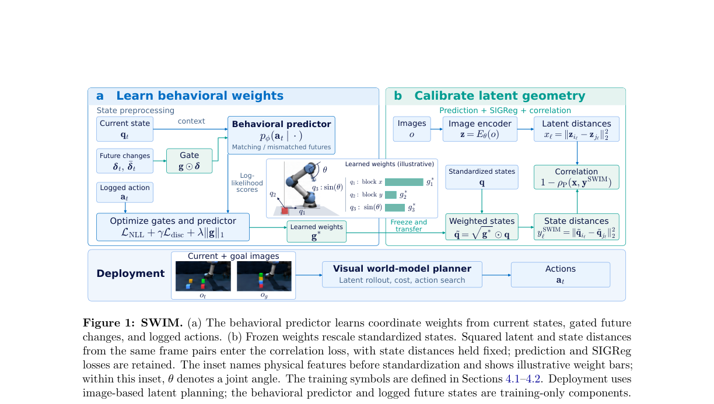

# SWIM: Learning which state coordinates matter for JEPA

<!-- source-sha256: b1450b4ec070178de84e51ec3ca4999c68dc5726901f7f1abf85d8c14260f3b6 -->

[简体中文](README.md)

> **Local scope: L1 diagnostic for gated inverse dynamics and weighted state distances.** No visual world model, environment, or planner is included. Full world-model training and planning evaluation were reviewed and not reproduced because of cost. These checks do not measure agent success or Evolve improvement.

## Paper information

| Field | Details |
| --- | --- |
| Paper | [SWIM: Learning What Matters from Behaviors for JEPA World Models](https://arxiv.org/abs/2610.36662v1) |
| Reviewed version | [arXiv v1 full text](https://arxiv.org/html/2610.36662v1) |
| First author and affiliation | Jiaming Hu, Boston University / Unity Technologies; coauthors from Unity Technologies |
| First public release | 2026-10-27 05:28:28 UTC, arXiv v1 |
| Author code | No verifiable SWIM repository or code revision found in the reviewed v1 text or abstract page. LeWM and other baseline repositories are not SWIM source code. |
| Local key | <code>swim</code>; standalone component, no adapter or Evolve integration |
| Local implementation | <code>src/auto_research/foundation_models/swim.py</code> |
| Entry points | <code>GatedInverseDynamics</code>, <code>weighted_state_distances</code>, <code>latent_state_correlation</code>, <code>diagnostic</code> |

## What the paper proposes

A JEPA world model predicts visual latents, but Euclidean distance in latent space need not reflect progress toward a goal. SCALE uses simulator-state distances to supervise latent geometry. Uniformly weighting irrelevant state coordinates can teach the model to track distractors. SWIM first learns coordinate gates from recorded behavior with an inverse dynamics model. It then freezes those gates and uses them to weight the target state distances.

Stage 1 gates **only the future displacement**, leaving the entire current state visible. Stage 2 scales previously standardized states by the square root of the frozen weights and matches latent and state distances for the same frame pairs. Ground-truth future states are offline training inputs; the planner is not given extra future states at inference time.

### Original paper figure

The image is an unredrawn crop from the [reviewed paper](https://arxiv.org/html/2610.36662v1). See the [figure provenance](assets/provenance.json) for the original caption and digest.

### Core equations

Stage 1 takes $(q_t,q_{t+h},a_t)$ from a single episode. The target $a_t$ is the **fixed-length recorded action chunk at the current decision step**, not the sequence of actions over the entire horizon $h$. Appendix A uses frame skip $c=5$: at raw frame $r$, the target concatenates the actions from frames $r$ through $r+4$. The horizon $h\in\{1,2,4,8\}$ determines the future-state offset $5h$ without changing the target length. A separate same-episode $r+45$ validity check filters start positions independently of $h$. The caller standardizes states and actions. With $g=\sigma(\alpha)$ and initial $\alpha=2$, the Gaussian inverse model reads

$$
\delta_t=q_{t+h}-q_t,\qquad
f_t=[q_t;g\odot\delta_t],\qquad
s_t(\delta)=\log p_\theta(a_t\mid q_t,g\odot\delta).
$$

The objective is $-\operatorname{mean}s_t(\delta_t)+\gamma\mathcal L_{\mathrm{disc}}+\lambda\sum_k g_k$. The two discrimination options are

$$
\mathcal L_{\mathrm{hinge}}
=\operatorname{mean}_t\max(0,m-s_t(\delta_t)+s_t(\delta_t^-)),
$$

$$
\mathcal L_{\mathrm{NCE}}
=-\operatorname{mean}_t\log\frac{e^{s_t(\delta_t)/\tau}}
{e^{s_t(\delta_t)/\tau}+\sum_{j=1}^{N}e^{s_t(\delta^-_{t,j})/\tau}}.
$$

The negatives keep the current state and recorded action fixed. They replace only the future state with the next one (hinge) or the next $N$ (InfoNCE) in cyclic batch order before subtracting the current state. They are not generated labels or an implicit full-batch denominator.

Stage 2 applies $\sqrt g$ to the previously standardized state coordinates. For frame pairs $(i_\ell,j_\ell)$,

$$
y_\ell=\sum_k g_k(q_{i_\ell,k}-q_{j_\ell,k})^2,\qquad
x_\ell=\|z_{i_\ell}-z_{j_\ell}\|_2^2,\qquad
\mathcal L_{\mathrm{corr}}=1-\rho_P(x,y).
$$

The state target is detached. Re-standardizing each coordinate after weighting would cancel the weights. The overall gate scale can be absorbed by the inverse model's first layer and cancels in Pearson correlation, so absolute gate magnitudes are not uniquely identifiable importance scores or automatic thresholds.

### What the paper reports

The authors compare uniform and behavior-weighted distances on Cube variants, Scene, and other environments, including structured distractors and ablations for gate regularization and discrimination. Planning uses a frozen world model with CEM or iCEM; the gates alone do not produce actions. No production user A/B test is reported, and the local component does not measure planning success in those environments.

## Local reproduction and validation

The implementation runs a two-layer LayerNorm/GELU inverse model, with Gaussian means and log standard deviations bounded to $[-5,2]$. It uses a narrower network than the paper's width of 1024 for the diagnostic. Tests verify behavior-loss gradients into both the inverse model and the gate even without the gate penalty, and verify a real optimizer step. The weighted state-distance target is frozen; only latent geometry receives gradients from the correlation objective. Constant distance vectors are rejected because Pearson correlation is undefined for them.

Appendix A floors the standard deviation at $10^{-3}$, clips standardized values to $[-10,10]$, and derives state statistics from all offline frames before its train/validation split. This component does not implement that preprocessing or claim a formal held-out comparison. Callers must record their normalization inputs and keep test data out of candidate selection. The implementation does not include an image encoder, LeWM prediction loss, SIGReg, a simulator, action sampling, or CEM.

From the repository root:

~~~bash
PYTHONPATH=src python -c 'from auto_research.foundation_models.swim import diagnostic; print(diagnostic(42))'
PYTHONPATH=src python -m pytest tests/test_oct30_foundation.py -q
~~~

Independent checks cover Gaussian NLL, cyclic hinge and InfoNCE selection, the ungated current state, and equivalence of square-root coordinate scaling to weighted squared distances. The [three-seed A100 metrics](metrics/component-cuda-seeds42-44.json) and [validation receipt](../../gpu-validations/swim-a100-20261030.json) cover these small tensors, not a trained robot policy or visual world model.

### Full experiment: reviewed, not reproduced

Stage 1 alone uses width 1024, 8,000 steps, a hinge batch of 4,096 or an InfoNCE batch of 1,024 with 255 negatives, and a regularization sweep. The full study adds visual world-model training, five environment families or variants, multiple methods and seeds, and CEM planning evaluation. No complete runtime on the project's single A100/A30 or Mac was measured. The full matrix was judged too expensive and was not launched; no simulator or checkpoint was downloaded for it.
