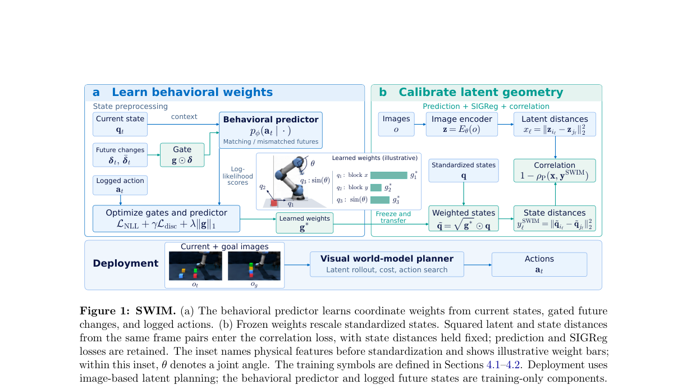
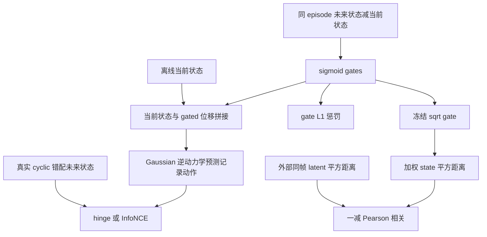

# SWIM：从离线行为学习 JEPA 状态距离的权重

> 本地状态：**L1 逆动力学门控目标与状态距离组件，diagnostic only**，不含视觉 world model、环境或规划器。完整 world-model 训练与规划评测：**成本过高，不复现（审查 DONE）**；不是 Agent 成功率或 evolve 提升证据。

## 论文信息

| 字段 | 内容 |
| --- | --- |
| 论文 | [SWIM: Learning What Matters from Behaviors for JEPA World Models](https://arxiv.org/abs/2610.36662v1) |
| 固定审查版本 | [arXiv v1 全文](https://arxiv.org/html/2610.36662v1) |
| 公司 / 作者机构 | 一作 Jiaming Hu：Boston University / Unity Technologies；合作作者来自 Unity Technologies |
| 原始发布日期 | **2026-10-27 05:28:28 UTC**，arXiv v1 |
| 原作者代码 | 固定 v1 全文与摘要页未找到可核验 SWIM 方法源码仓库；**未找到 / 尚未发布**，无固定源码 revision。LeWM 等基线源码不是 SWIM 源码 |
| 本地 Adapter / key | `swim`；独立组件，`adapter=null`、`evolve_integrated=false` |
| 本地代码 | `src/auto_research/foundation_models/swim.py` |
| 本地入口 | `GatedInverseDynamics`、`weighted_state_distances`、`latent_state_correlation`、`diagnostic(seed, device)` |
| 验证边界 | 小张量真实 MLP / gate 训练梯度与距离目标；CUDA 状态以本批 GPU 回执为准 |

## 原始论文总结

### 背景与主要改动

JEPA world model 预测视觉 latent，但 latent 欧氏距离不一定反映规划进展。SCALE 用 simulator state 的距离校准 latent 几何；若状态中含无关坐标，均匀加权会把这些干扰也学进去。SWIM 先用已记录动作训练门控逆动力学，再把冻结的连续权重传给状态距离监督。

第一阶段保留当前状态完整信息，**只给未来位移逐坐标加 gate**，避免把门控误写成当前与未来状态同时裁剪。第二阶段使用平方根权重缩放已经标准化的状态，再匹配同一 frame pairs 的 latent / state 平方距离；不额外向规划器提供未来真实状态。

<!-- paper-figure:start -->
### 原论文关键图



来自[固定 v1 原文](https://arxiv.org/html/2610.36662v1)的原图裁切，未经重绘；来源、完整图注和哈希见 `assets/provenance.json`。
<!-- paper-figure:end -->



### 核心公式

第一阶段输入为同 episode 的 $(q_t,q_{t+h},a_t)$，其中 $a_t$ 是当前决策步的**固定长度记录动作 chunk**，并不覆盖整个行为 horizon $h$。Appendix A 采用 frame skip $c=5$：raw frame $r$ 的目标由 $r$ 到 $r+4$ 五帧动作拼接而成；$h\in\{1,2,4,8\}$ 只决定未来状态相距 $5h$ 个 raw frames，不改变动作目标长度。起点还需通过与 $h$ 无关的同 episode `r+45` 有效性过滤。$q$ 和 actions 均由调用者完成固定标准化；$g=\sigma(\alpha)$，初始 $\alpha=2$。Gaussian 逆动力学读取：

$$
\delta_t=q_{t+h}-q_t,\quad
f_t=[q_t;g\odot\delta_t],\quad
s_t(\delta)=\log p_\theta(a_t\mid q_t,g\odot\delta).
$$

完整 Stage 1 目标为 $-\operatorname{mean}s_t(\delta_t)+\gamma\mathcal L_{disc}+\lambda\sum_k g_k$。两种 discrimination 分支分别是：

$$
\mathcal L_{hinge}=\operatorname{mean}_t\max(0,m-s_t(\delta_t)+s_t(\delta_t^-)),
$$

$$
\mathcal L_{NCE}=-\operatorname{mean}_t\log\frac{e^{s_t(\delta_t)/\tau}}
{e^{s_t(\delta_t)/\tau}+\sum_{j=1}^{N}e^{s_t(\delta_{t,j}^-)/\tau}}.
$$

负例保持当前状态和记录动作不变，把 batch **下一个 / 接下来 $N$ 个**样本的未来状态 cyclic 地换进来，再减当前状态；不是随机生成“gold 负例”，也不是默认全 batch 分母。本地保留这项索引规则。

第二阶段冻结 gates，在**先前标准化**的状态上应用 $\sqrt g$：

$$
y_\ell=\sum_k g_k(q_{i_\ell,k}-q_{j_\ell,k})^2,
\quad x_\ell=\|z_{i_\ell}-z_{j_\ell}\|_2^2,
\quad\mathcal L_{corr}=1-\rho_P(x,y).
$$

state target 停梯度；应用 gate 后不能重新逐坐标标准化，否则会抵消权重。门控整体尺度可被逆动力学第一层吸收、也会在 Pearson 中抵消，不能把绝对 gate 数值当作唯一可识别的重要性或自动阈值。

### 论文离线与线上效果

作者在 Cube 变体及 Scene 等环境比较均匀状态距离与行为加权，包含结构化干扰变量、门惩罚和 discrimination 消融。规划由冻结 world model 与 CEM / iCEM 求解，不是 gate 单独生成动作。线上真实用户 A/B：**未报告**。本地不报告这些环境的规划成功率。

## 本地复现

`GatedInverseDynamics` 真实运行两层 LayerNorm / GELU MLP，输出 Gaussian mean 和限制在 `[-5,2]` 的 log standard deviation。论文 hidden width 1024，本地使用明确缩小的宽度以做 L1；gate 和逆模型均收到行为损失梯度，不靠 L1 产生“训练成功”。`weighted_state_distances` 生成冻结状态 target；`latent_state_correlation` 只回传 latent 的几何梯度。

论文 Appendix A 对离线数据采用标准差 floor `1e-3`、clip `[-10,10]`，且状态统计在 train / validation 分割前从所有离线 frames 计算。本组件**不实现该数据预处理或宣称正式 held-out 比较**；实际适配必须记录统计来源，候选选择不得访问 test。未来状态仅作为离线训练输入，不进入真实规划时输入。

本地不实现图像 encoder、LeWM prediction loss、SIGReg、simulator、动作采样或 CEM。常量距离向量的 Pearson 未定义，接口明确拒绝，不加 epsilon 伪造相关度。矩阵 / batch 有显式小规模上限，原论文完整 batch 和训练配置不属于此接口的已验证路径。

```bash
PYTHONPATH=src python -c 'from auto_research.foundation_models.swim import diagnostic; print(diagnostic(42))'
python -m pytest tests/test_oct30_foundation.py -q
```

### 检查与负控

Gaussian NLL、cyclic hinge 和只选接下来 $N$ 项的 InfoNCE 与独立公式核对。检查当前状态没有 gate、位移有 gate；去掉 L1 后行为项仍给 gate 非零梯度，真实 optimizer step 改变参数。第二阶段核对 $\sqrt g$ 坐标距离等于 $g$ 加权平方差，权重 / state 停梯度而 latent 收到梯度。三个 seed 不将它升级为策略或机器人能力评估。

### 高成本完整实验

作者 Stage 1 使用宽度 1024 的逆模型、8000 steps、hinge batch 4096 或 InfoNCE batch 1024 / 255 negatives，另有 gate 惩罚网格。完整结果还需训练视觉 world model、五类环境 / 变体、多方法多种子及 CEM 规划评测。论文未给本机完整 GPU 小时，不虚构实测耗时。相对单 A100/A30 / Mac，本轮完整实验**成本过高，不复现（审查 DONE）**；不下载模拟环境或 checkpoint、不启动高成本探针、不自动重试。
