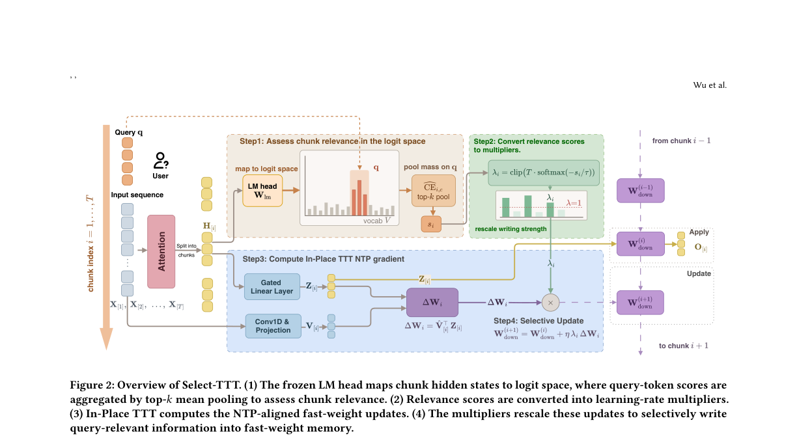
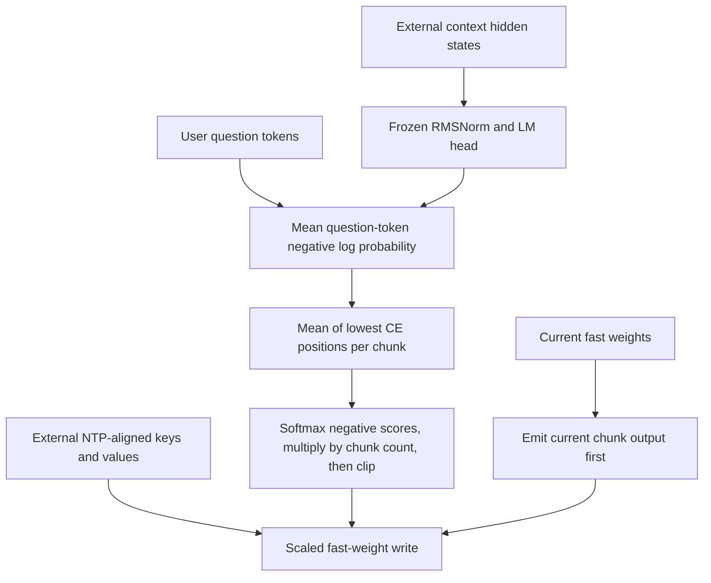

# Select-TTT: Allocating fast-weight writes by question relevance

<!-- source-sha256: 491118c2fc7561bd2c545980a3376a88f45fa4c67b8954eebf114f2f01c13083 -->

[简体中文](README.md)

> Local status: **L1 query scoring and fast-weight writing; diagnostic only**. No LLM or LongMemEval integration is loaded. The full experiment is **not reproduced due to cost (review complete)**. This is not an executable Evolve capability operator.

## Paper information

| Field | Details |
| --- | --- |
| Paper | [Select-TTT: Query-Conditioned Selective Fast Weight Updates for In-Place Test-Time Training](https://arxiv.org/abs/2610.36794v1); [reviewed v1 full text](https://arxiv.org/html/2610.36794v1) |
| Affiliations | First author Yue Wu: USTC; collaborators at NUS and Huawei Noah's Ark Lab |
| First public release | 2026-10-27 07:58:39 UTC, arXiv v1 |
| Author code | Appendix D promises a release on publication; the reviewed v1 has no verifiable project link or method implementation. |
| Local key | `select-ttt`; standalone component, no adapter or Evolve integration |
| Local code | `src/auto_research/foundation_models/select_ttt.py` |
| Entry points | `query_chunk_scores`, `write_multipliers`, `apply_then_write`, `diagnostic(seed, device)` |
| Local evidence | [Three-seed mechanism metrics](metrics/component-cuda-seeds42-44.json); [A100 validation receipt](../../gpu-validations/select-ttt-a100-20261029.json) |

## What the paper changes

In-Place TTT uses an MLP down-projection as fast weights and writes to them while reading context. A uniform learning rate gives irrelevant chunks the same write strength as useful ones. Select-TTT needs no new retrieval encoder or trainable gate. It uses a frozen output head to measure how well context hidden states predict the **user's question tokens**, then maps that score to a continuous write multiplier per chunk.

The answer-chunk experiment motivates the method; identifying gold answer chunks is not part of the deployment rule. The scoring interface takes the question, not answer annotations. A different question requires new scores and write strengths. This is not query-independent long-term memory.

### Original paper figure



Unredrawn figure from the [reviewed v1 paper](https://arxiv.org/html/2610.36794v1); see [figure provenance](assets/provenance.json). The local scope is the tensor rule, not a complete checkpoint or QA result.



### Core equations

Equations 7–9 use the model's actual RMSNorm and output head. Average the question tokens in sequence, including repetitions. With question length $Q$:

$$
z_{i,c}=W_{lm}\operatorname{RMSNorm}(h_{i,c})+b_{lm},\qquad
CE_{i,c}=\log\sum_v e^{z_{i,c,v}}-\frac1Q\sum_j z_{i,c,q_j}.
$$

For $K=\max(1,\lceil\rho C\rceil)$, $s_i$ is the mean of the $K$ positions with the **lowest** CE, not the highest. Equations 10 and 6 give

$$
\lambda_i=\operatorname{clip}\left(T\operatorname{softmax}(-s/\tau)_i,0,M\right),\quad
W_{i+1}=W_i+\eta\lambda_i\widehat V_i^\top Z_i.
$$

First emit the output of the current chunk with $W_i$, then write to the weights. Updating first would let the current output read that chunk's value prematurely. The multipliers sum to $T$ without clipping, but can sum to less after clipping. The local implementation follows Equation 10 without a second normalization.

### Results reported by the authors

The authors evaluate inference and continued pretraining on Llama-3.1-8B-Instruct and Qwen3-4B with LongMemEval-S and LoCoMo. The paper reports that indiscriminate writing gives limited gains on realistic long-context QA, and uses the question-conditioned rule to improve on it. No production A/B test was reported. The local component does not run those questions, models or judges and reports no corresponding accuracy.

## Local reproduction and limits

The component implements vocabulary-blocked log-sum-exp and direct extraction of question-token logits, lowest-CE top-$K$ scoring, temperature and clipping, and a reference apply-then-write sequence. Callers must provide actual model RMSNorm parameters and epsilon and the original In-Place TTT next-token-aligned keys and values. Arbitrary targets or gold answers are not substitutes.

There is no backbone forward pass, TTT initialization, meta-learning/continued pretraining, context-parallel kernel, QA judge or persistent conversation memory. The scoring path stops gradients and checks the rule on fixed hidden states, not full training gradients. The write does update the fast-weight tensor.

```bash
PYTHONPATH=src python -c 'from auto_research.foundation_models.select_ttt import diagnostic; print(diagnostic(42))'
export PYTHONPATH=src
python -m pytest tests/test_oct29_foundation_components.py -q
```

Tests compare blocked log-sum-exp against a full-vocabulary log-softmax reference and preserve repeated question tokens. Reversing top-$K$ selection or write order fails the reference checks. An extreme-score example shows clipping lowering the total multiplier from 3 to 1.2, rather than assuming strict conservation. The three seeds validate the tensor mechanism and real writes, not improved task performance.

### Full experiment: not reproduced

The authors use H200 hardware, 4B/8B backbones, up to 65,536 tokens, batch size eight and up to 5,000 continued pretraining steps. Evaluation includes roughly 115k-token LongMemEval-S histories and LoCoMo. The full long-context training and multi-arm evaluation is too expensive for one A100/A30 or a Mac. No checkpoint or benchmark was downloaded, and no probe or automatic retry was scheduled.
