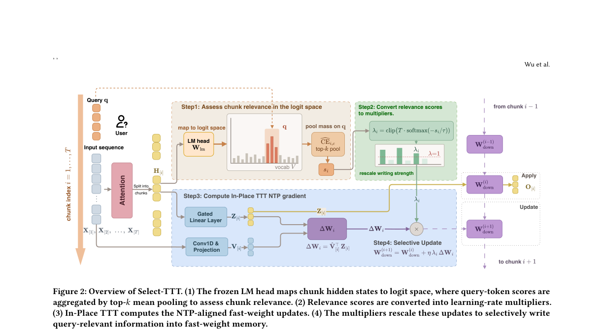
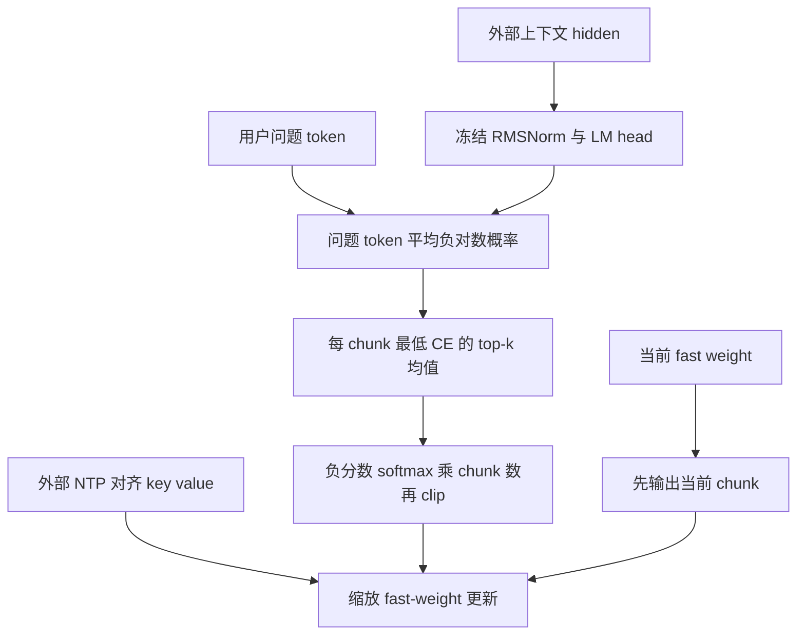

# Select-TTT：按问题相关性分配 fast-weight 写入强度

> 本地状态：**L1 查询评分与 fast-weight 写入组件、diagnostic only**，没有加载 LLM 或接入 LongMemEval。完整实验：**成本过高，不复现（审查 DONE）**；不是可执行 evolve 能力算子。

## 论文信息

| 字段 | 内容 |
| --- | --- |
| 论文 | [Select-TTT: Query-Conditioned Selective Fast Weight Updates for In-Place Test-Time Training](https://arxiv.org/abs/2610.36794v1) |
| 公司 / 作者机构 | 一作 Yue Wu：USTC；合作 NUS、Huawei Noah's Ark Lab。不是 Google / Meta 论文 |
| 原始发布日期 | **2026-10-27 07:58:39 UTC**，arXiv v1 |
| 原作者代码 | Appendix D 仅承诺在发表时发布，固定 v1 没有可核验项目链接；**未找到 / 尚未发布** |
| 本地 Adapter / key | `select-ttt`；独立组件，`adapter=null`、`evolve_integrated=false` |
| 本地代码 | `src/auto_research/foundation_models/select_ttt.py` |
| 本地入口 | `query_chunk_scores`、`write_multipliers`、`apply_then_write`、`diagnostic(seed, device)` |
| 验证边界 | 外部 hidden / frozen LM-head / NTP 对齐 keys-values 的纯张量协议；真实 GPU 验收以本批回执为准 |

## 原始论文总结

### 背景与主要改动

In-Place TTT 把 MLP 下投影作为 fast weights，边读上下文边写入；对所有 chunk 使用相同学习率会把无关内容也等强写进去。Select-TTT 不新增检索编码器或可学习门控，而从冻结输出头读取上下文 hidden 对**用户问题 token**的预测程度，为每个 chunk 生成连续写入倍率。

它不是先找到 gold answer chunk 再加强写入。论文的 answer-chunk 实验只是动机分析；部署规则只用问题，不允许答案标记进入评分接口。问题换了，要重算问题条件下的写入强度，不能把它当作 query-free 长期记忆。

<!-- paper-figure:start -->
### 原论文关键图



原图来自[固定 v1 全文](https://arxiv.org/html/2610.36794v1)，未经重绘；来源与哈希见 `assets/provenance.json`。本地只实现图中的张量规则，不是完整 checkpoint 或 QA 结果。
<!-- paper-figure:end -->



### 核心公式

Eq.7–9 读取模型实际 RMSNorm 和输出头；问题 token 有重复时仍按原序列平均，不能先去重。设 $Q$ 为问题长度：

$$
z_{i,c}=W_{lm}\operatorname{RMSNorm}(h_{i,c})+b_{lm},\qquad CE_{i,c}=\log\sum_v e^{z_{i,c,v}}-\frac1Q\sum_j z_{i,c,q_j}.
$$

$K=\max(1,\lceil\rho C\rceil)$；$s_i$ 是 **CE 最小**的 $K$ 个位置的均值，而非最大 CE。Eq.10、6：

$$
\lambda_i=\operatorname{clip}\left(T\operatorname{softmax}(-s/\tau)_i,0,M\right),\quad
W_{i+1}=W_i+\eta\lambda_i\widehat V_i^\top Z_i.
$$

先用 $W_i$ 输出当前 chunk，再写入，不能先更新后输出而偷看当前 chunk 的 value。无 clipping 时倍率和为 $T$；**clip 生效后可以小于 $T$**。本地忠实 Eq.10，不二次归一化“修复”论文的近似预算描述。

### 论文离线与线上效果

作者在 Llama-3.1-8B-Instruct / Qwen3-4B、LongMemEval-S / LoCoMo 上做推理与继续预训练评估；论文强调无差别写入在现实长上下文 QA 上收益有限，再由问题条件规则改善。线上 A/B：**未报告**。本地未运行这些问题、模型或作者评分器，不能报告相应准确率。

## 本地复现

实现词表分块 log-sum-exp 与直接问题 token logits、最低 CE top-k、温度 / clip 倍率及顺序 apply-then-write 参考。调用者必须提供真实模型的 RMSNorm 参数和 epsilon，以及原 In-Place TTT 的 NTP 对齐 keys / values；没有用任意 target 或 gold answer 伪造这些特征。

不实现 backbone 前向、TTT 初始化、Meta-learning / CPT、分布式 context-parallel 内核、QA judge 或持久会话记忆。评分接口停止梯度，属于固定 hidden 下的规则验证，不宣称重现完整训练梯度；fast-weight 写入实际改变张量状态。

```bash
PYTHONPATH=src python -c 'from auto_research.foundation_models.select_ttt import diagnostic; print(diagnostic(42))'
python -m pytest tests/test_oct29_foundation_components.py -q
```

### 检查与负控

分块 LSE 与完整词表 log-softmax 独立核对；保留重复问题 token；反转 top-k / 写入先后将不能通过参考。另用极端分数触发 clip，显式记录总倍率从 3 降至 1.2 的教学状态，不伪造严格守恒。三种子只支持张量机制与真实写入，不是任务效果改善。

### 高成本完整实验

作者使用 H200、4B / 8B backbone、最长 65,536 token、batch 8、最多 5k CPT steps，并评估约 115k token 的 LongMemEval-S 历史及 LoCoMo。相对于单张 A100/A30 或 Mac，完整模型 / 多臂长上下文训练评测明显昂贵：**成本过高，不复现（审查 DONE）**。不下载 checkpoint / benchmark，不启动探针，不自动重试。
