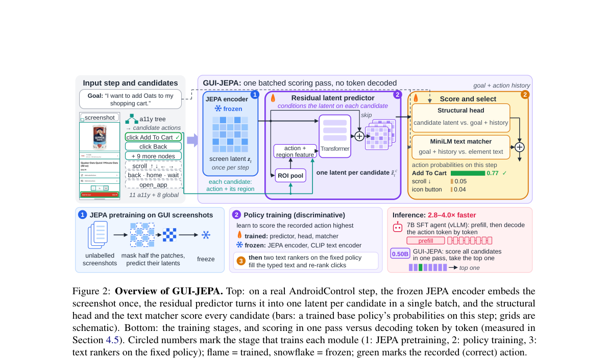
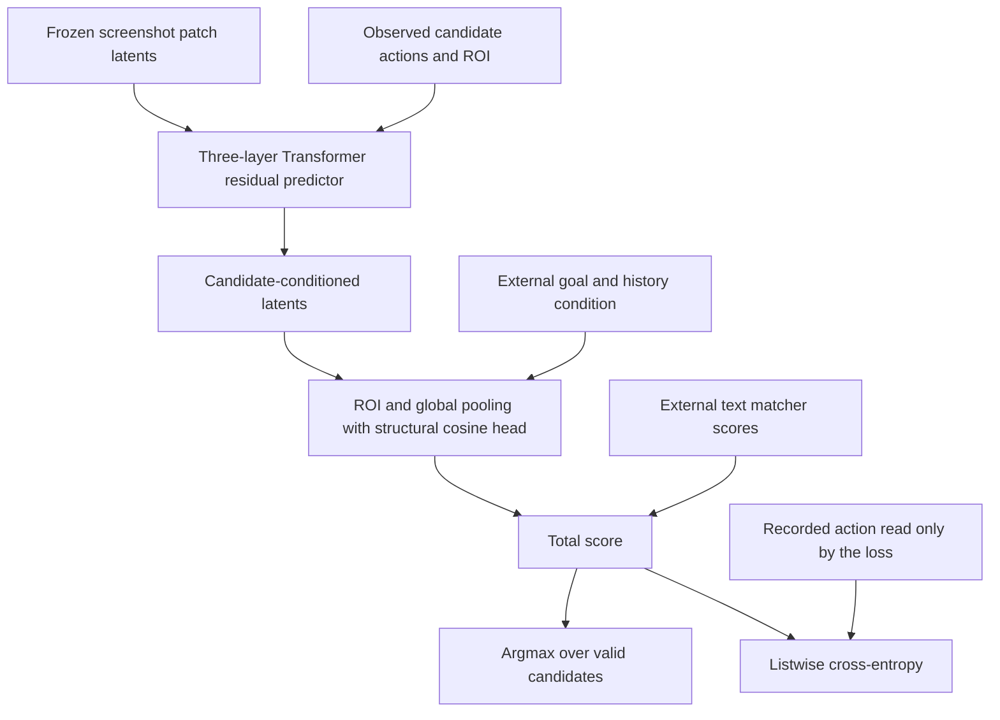

# GUI-JEPA: One-pass GUI action selection with candidate-conditioned latents

<!-- source-sha256: 5de10a527ec5abe710f7881beaf0ef48dfe68bb3cad8dab33703d8aa8574e02d -->

[简体中文](README.md)

> Local status: **L1 latent predictor and structural head; diagnostic only**. This is neither a GUI agent nor an AndroidControl integration. The full experiment is **not reproduced due to cost (review complete)** and the local results are not Evolve capability evidence.

## Paper information

| Field | Details |
| --- | --- |
| Paper | [GUI-JEPA: Candidate-Conditioned JEPA Latents as a Fast Action Policy for Mobile GUI Agents](https://arxiv.org/abs/2610.36877v1); [reviewed v1 full text](https://arxiv.org/html/2610.36877v1) |
| Affiliations | First author Bingchao Wang: Shanghai Jiao Tong University and Nanyang Technological University; collaboration with Alibaba Cloud |
| First public release | 2026-10-27 09:17:51 UTC, arXiv v1 |
| Author code | [bcwang-sjtu/GUI-JEPA](https://github.com/bcwang-sjtu/GUI-JEPA), reviewed at `07e82c786d7ca3ace67385fdf59b9a52f8982fd6`, contained only a placeholder README. No method code or LICENSE was found. No code or weights were copied. The paper uses CC BY 4.0. |
| Local key | `gui-jepa`; standalone component, no adapter or Evolve integration |
| Local code | `src/auto_research/foundation_models/gui_jepa.py` |
| Entry points | `CandidateLatentPolicy`, `listwise_loss`, `sine_cosine_positions`, `diagnostic(seed, device)` |
| Local evidence | [Three-seed mechanism metrics](metrics/component-cuda-seeds42-44.json); [A100 validation receipt](../../gpu-validations/gui-jepa-a100-20261029.json) |

## What the paper changes

Many GUI agents use a roughly 7B-parameter vision-language model to generate action tokens. GUI-JEPA instead enumerates executable actions from the accessibility tree and encodes the screenshot once with a frozen JEPA encoder. The action type, coordinates and region-of-interest (ROI) features condition a residual predictor, which produces a latent for each candidate. The candidates are scored in a batch and the top valid action is selected, without decoding action text.

The policy does not equate latent proximity to a goal screenshot with action value. Its predictor is trained on actual candidate sets with a listwise decision loss; the structural head sees candidate visual information through the conditioned latent. In the paper, a randomly initialized predictor can match the dynamics-pretrained version. The latent should therefore not be assumed to be a reliable prediction of the future screen.

### Original paper figure



Unredrawn figure from the [reviewed v1 paper](https://arxiv.org/html/2610.36877v1); see [figure provenance](assets/provenance.json). The JEPA encoder, MiniLM and real screen data in the figure are not local training artifacts.



### Core equations

Sections 3.3–3.4 use an MLP to add action $a_c$ and its ROI-pooled current features to a learned query. The query and the patch tokens with 2D sine-cosine positions go through a three-layer Transformer:

$$
\tilde z^c=z+\Delta(z,a_c,u_c),\quad
v_c=[\operatorname{pool}_{ROI(c)}(\tilde z^c);\operatorname{mean}(\tilde z^c)].
$$

$$
s(c)=\kappa\cos(MLP_v(v_c),MLP_t(cond))+b_{type(c)}+s_{text}(c).
$$

For global actions the predictor uses zero ROI features, the structural head pools the whole screen, and the text score is zero. The training loss averages per-step $-w_t\log\operatorname{softmax}(s)_{c^*}$ with $w_t=1$ for clicks and $1.5$ otherwise. It does not renormalize by the sum of weights. The positive action is used by the loss only, not by the forward pass.

### Results reported by the authors

The authors' IDD comparison uses the same inputs, judge and split. GUI-JEPA scores 84.06% / 60.99% on AC-Low / High, versus 91.01% / 70.87% for the 7B reference. It is 2.8–4.0 times faster on the same H20. Candidates come from the accessibility tree and the evaluation supplies ground-truth history; these are not general claims for a live, pixel-only agent. No production A/B test was reported. Neither GUI accuracy nor a speedup was measured locally.

## Local reproduction and limits

The local module executes a three-layer Transformer residual predictor, candidate ROI and whole-screen pooling, the structural cosine head, type bias, addition of external text scores, validity masking and weighted listwise loss. Small dimensions allow actual forward and backward passes, rather than substituting a fixed candidate answer or cosine similarity to the original screenshot.

External screen and condition tensors are detached. This does not implement a frozen screenshot encoder, accessibility enumeration, candidate text, the three MiniLM rankers, JEPA pretraining or GUI execution. The Transformer uses an explicit standard PyTorch configuration, not the authors' unreleased exact parameterization. Only the paper-defined path and loss are checked.

```bash
PYTHONPATH=src python -c 'from auto_research.foundation_models.gui_jepa import diagnostic; print(diagnostic(42))'
export PYTHONPATH=src
python -m pytest tests/test_oct29_foundation_components.py -q
```

Checks cover score equivariance under candidate reordering, invalid-action exclusion, an independent weighted cross-entropy calculation, gradients to predictor and head, an SGD parameter update and no gradient to frozen screenshot inputs. Changing the action or ROI must change the conditioned latent rather than reusing a fixed score table. The three seeds validate only the L1 mechanism.

### Full experiment: not reproduced

The full setup includes a 303M ViT-L, pretraining on 189,262 screenshots, 74,714 AndroidControl steps for six epochs across three seeds, multiple text rankers and a 7B LoRA reference. The reported 0.76 GPU-hours for encoder pretraining on one H20 excludes the full policy/reference matrix. It is not a total cost estimate. No data or weights were downloaded, and no GUI run, training trial or automatic retry was scheduled.
