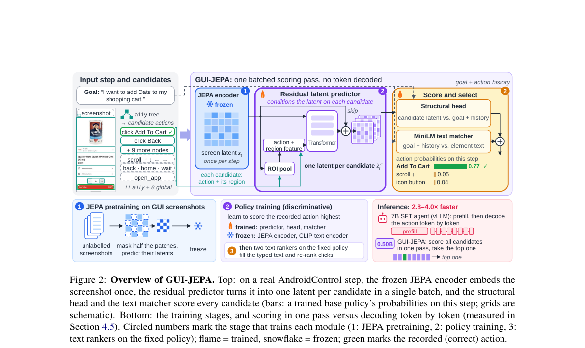
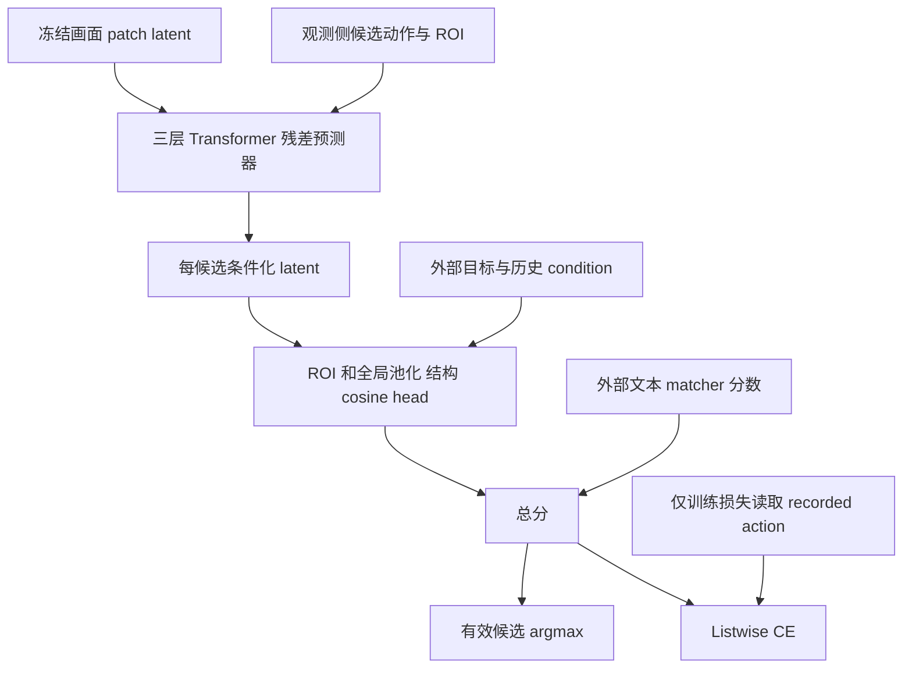

# GUI-JEPA：用候选条件 latent 一次打分选择 GUI 动作

> 本地状态：**L1 latent predictor / structural-head 组件、diagnostic only**，不是 GUI Agent 或 AndroidControl 接入。完整实验：**成本过高，不复现（审查 DONE）**；不作为 evolve 能力证据。

## 论文信息

| 字段 | 内容 |
| --- | --- |
| 论文 | [GUI-JEPA: Candidate-Conditioned JEPA Latents as a Fast Action Policy for Mobile GUI Agents](https://arxiv.org/abs/2610.36877v1) |
| 公司 / 作者机构 | 一作 Bingchao Wang：Shanghai Jiao Tong University / Nanyang Technological University；合作 Alibaba Cloud。不是 Google / Meta 论文 |
| 原始发布日期 | **2026-10-27 09:17:51 UTC**，arXiv v1 |
| 原作者代码 | [bcwang-sjtu/GUI-JEPA](https://github.com/bcwang-sjtu/GUI-JEPA)，固定 `07e82c786d7ca3ace67385fdf59b9a52f8982fd6`；当前仅 README 占位，**方法源码尚未发布** |
| 原作者代码许可 | 占位仓库未找到 LICENSE；不复制上游代码或权重。论文为 CC BY 4.0 |
| 本地 Adapter / key | `gui-jepa`；独立组件，`adapter=null`、`evolve_integrated=false` |
| 本地代码 | `src/auto_research/foundation_models/gui_jepa.py` |
| 本地入口 | `CandidateLatentPolicy`、`listwise_loss`、`sine_cosine_positions`、`diagnostic(seed, device)` |
| 验证边界 | 外部冻结 screenshot / condition latents，真实 Transformer 与梯度；不生成候选、不执行 GUI、不报告任务成功率 |

## 原始论文总结

### 背景与主要改动

多数 GUI Agent 依靠 7B 级视觉语言模型逐 token 生成动作。GUI-JEPA 则从 accessibility tree 枚举可执行动作，用冻结 JEPA 编码器只编码一次画面；动作类型、坐标与 ROI 特征条件化残差 predictor，为每个候选生成 latent，再一次批量打分选 argmax，不解码动作文本。

关键不是把“画面 latent 离目标越近”当动作价值。预测器通过真实候选上的 listwise 决策损失训练，结构头的候选视觉信息必须经过条件化 latent；论文发现随机初始化 predictor 也能达到 dynamics 预训练版本，不能把所得 latent 自动解释成可靠未来世界预测。

<!-- paper-figure:start -->
### 原论文关键图



原图来自[固定 v1 全文](https://arxiv.org/html/2610.36877v1)，未经重绘；源地址与哈希见 `assets/provenance.json`。其中 JEPA 编码器、MiniLM 与真实页面不是本地已训练模型。
<!-- paper-figure:end -->



### 核心公式

Section 3.3–3.4：$a_c$ 与 ROI-pooled 当前特征经 MLP 加到 learned query；query 和带 2D sine-cosine 位置的 patch tokens 经过三层 Transformer。

$$
\tilde z^c=z+\Delta(z,a_c,u_c),\quad
v_c=[\operatorname{pool}_{ROI(c)}(\tilde z^c);\operatorname{mean}(\tilde z^c)].
$$

$$
s(c)=\kappa\cos(MLP_v(v_c),MLP_t(cond))+b_{type(c)}+s_{text}(c).
$$

全局动作在 predictor 的 ROI 特征为零，在结构头改用全屏池化，文本 matcher 分数为零。训练损失为每步 $-w_t\log\operatorname{softmax}(s)_{c^*}$ 后均值；click 的 $w=1$，非 click 为 $1.5$，不是按权重和重新归一化。正例只进入 loss，不进入 forward。

### 论文离线与线上效果

作者同输入 / judge / split 的 IDD 对照中，GUI-JEPA AC-Low / High 为 84.06% / 60.99%，7B 参考为 91.01% / 70.87%；速度为同 H20 上 2.8–4.0 倍。候选来自 a11y、评测使用 ground-truth 历史，不能当作像素输入实时 Agent 的通用优势。线上 A/B：**未报告**。这些均为作者结果，本地未测 GUI 准确率或加速比。

## 本地复现

实现真实三层 Transformer residual predictor、候选 ROI / 全屏池化、cosine 结构头、动作类型 bias、外部 text score 相加、有效候选 mask 和 weighted listwise loss。用缩小维度执行真实前向和反向，不用固定候选答案或 cosine 原画面近似 predictor。

外部画面与 condition 在接口停止梯度；真实冻结编码器、a11y 枚举、候选文本、MiniLM 三个 ranker、JEPA 预训练及 GUI 执行均未实现。Transformer 内部参数化采用明示的标准 PyTorch 配置，并非作者未发布的精确实现；只有论文定义的路径和损失合同，不宣称复现完整 base policy。

```bash
PYTHONPATH=src python -c 'from auto_research.foundation_models.gui_jepa import diagnostic; print(diagnostic(42))'
python -m pytest tests/test_oct29_foundation_components.py -q
```

### 检查与负控

候选顺序置换时分数等变；无效候选不能选中；独立公式核对加权 CE。真实反向产生 predictor 与结构头梯度，一次 SGD 改变参数；外部冻结画面不收到梯度。候选条件 latent 必须因动作 / ROI 改变，不能复用一个固定打分表。三种子仍只支持 L1 机制。

### 高成本完整实验

完整方案包含 303M ViT-L、189,262 截图预训练、74,714 AndroidControl steps / 6 epochs / 3 seeds、多文本 ranker 和 7B LoRA 参考。作者单 H20 编码器预训练约 0.76 GPU-hour，尚不包含完整策略与参考模型矩阵；本地不以此推算全流程短时可负担。完整实验：**成本过高，不复现（审查 DONE）**，不下载数据 / 权重、不启动 GUI 或试训练，不自动重试。
