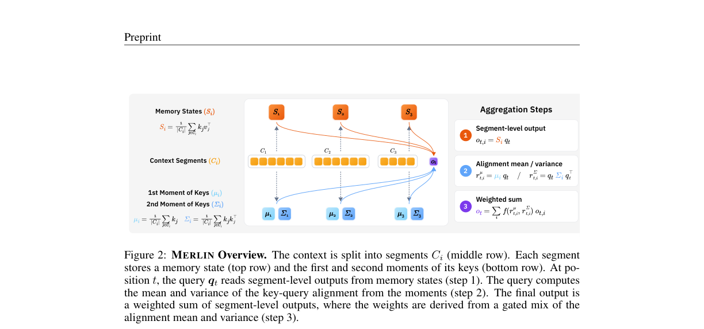
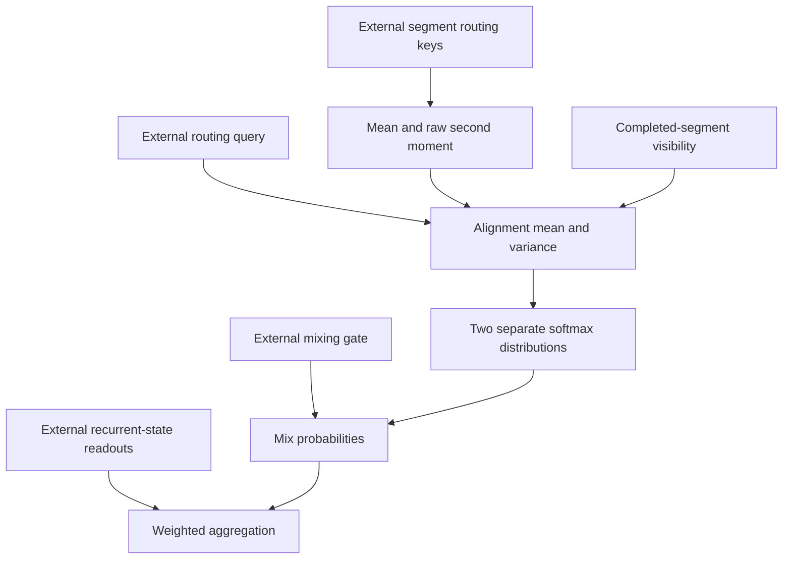

# MERLIN: Multi-state linear attention with second-order routing

<!-- source-sha256: 5549f39008d450d4a2446631403f0b94d55ea76f976bcc61197cb3c9f1fa0f01 -->

[简体中文](README.md)

> Local status: **L1 routing formula component; diagnostic only**. It checks weights for externally supplied routing keys, queries and segment readouts. It is not a full attention layer or LLM. Full training and long-context evaluation are **not reproduced due to cost (review complete)**, and the component is not used for Evolve promotion.

## Paper information

| Field | Details |
| --- | --- |
| Paper | [Multi-State Linear Attention with Generalized Second-Order Routing](https://arxiv.org/abs/2610.37645v1); [reviewed v1 full text](https://arxiv.org/html/2610.37645v1) |
| Affiliations | First author Hee Seung Hwang: Princeton University; co-author Zhiwei Deng: Google DeepMind |
| First public release | 2026-10-27 17:55:49 UTC, arXiv v1 |
| Author code | No verifiable author implementation was found in the v1 paper or abstract page; no source revision can be pinned. |
| Local key | `merlin`; standalone component, no adapter or Evolve integration |
| Local code | `src/auto_research/foundation_models/merlin.py` |
| Entry points | `segment_moments`, `completed_segment_visibility`, `routing_weights`, `aggregate_readouts`, `diagnostic(seed, device)` |
| Validation | Small tensors, masks, negative controls and actual gradients; [three-seed metrics](metrics/component-cuda-seeds42-44.json), [A100 receipt](../../gpu-validations/merlin-a100-20261030.json) |

## What the paper changes

Multi-state linear attention partitions context into segments, retains a compressed state per segment and combines the readouts for a query. Position-based or mean-key routing can miss a segment with a particularly good match when the mean looks like that of another segment. MERLIN instead stores the mean and **raw second moment** of a lower-dimensional routing-key projection. It recovers the mean and variance of query–key alignment and mixes two separately normalized probability distributions. This changes segment aggregation; it does not replace the recurrent memory with the moment statistics or recover exact full softmax attention. The second-order cumulant analysis assumes equal-length segments.

### Original paper figure



An unredrawn crop of Figure 2 from the [reviewed v1 paper](https://arxiv.org/html/2610.37645v1). The full caption, page and checksum are in the [figure provenance](assets/provenance.json).



### Core equations

For equal-length segments $C_i$ and routing keys $k'_j$, Equation 7 stores

$$
\mu_i=\frac1{|C_i|}\sum_{j\in C_i}k'_j,\qquad
\Sigma_i=\frac1{|C_i|}\sum_{j\in C_i}k'_j{k'_j}^{\top}.
$$

Here $\Sigma_i$ is **not a centered covariance**. Equation 8 computes the mean and variance of alignment in the routing-query direction:

$$
r^\mu_{t,i}={q'_t}^{\top}\mu_i,\qquad
r^{\mathrm{var}}_{t,i}={q'_t}^{\top}\Sigma_iq'_t-(r^\mu_{t,i})^2.
$$

Equation 9 applies a softmax per branch and then mixes the probabilities. The $\tau$ values multiply the scores:

$$
\lambda_{t,i}=\gamma_t\operatorname{softmax}_i(\tau_\mu r^\mu_{t,i})
+(1-\gamma_t)\operatorname{softmax}_i(\tau_{\mathrm{var}}r^{\mathrm{var}}_{t,i}),
\qquad o_t=\sum_i\lambda_{t,i}o_{t,i}.
$$

The branches use the same visibility mask. Mixing the logits and applying one softmax would be a different algorithm.

### Results reported by the authors

The paper compares multi-state Gated DeltaNet-1.3B and Mamba-2-780M on RULER and LongBench, reporting improvements over positional or mean aggregation and analyzing moment dimensionality, segment length and memory overhead. It reports **no production A/B test**. These results come from the authors' complete models, not the local routing diagnostic.

## Local reproduction and limits

The component takes equal-length segments of routing keys, computes their statistics and both sets of weights, and aggregates external readouts. In `completed_segment_visibility` a segment occupies the half-open interval `[start, start+length)`. At zero-based query position `t` only segments satisfying `start+length <= t+1` are visible. The component does not implement the incomplete segment's recurrent state, streaming moment updates, original query/key projections, learned gate network or multilayer training. Computing the full current segment's statistics and exposing them to an earlier token would leak future information.

Inputs are explicitly bounded small tensors. Non-finite values, asymmetric raw second moments, clearly negative alignment variances and queries with no visible segment are rejected. Only tiny negative variances consistent with rounding are clamped to zero. No checkpoint, data download or model call is needed.

```bash
PYTHONPATH=src python -c 'from auto_research.foundation_models.merlin import diagnostic; print(diagnostic(42))'
PYTHONPATH=src python -m pytest tests/test_oct30_foundation.py -q
```

The diagnostic cross-checks the moment formula against direct per-token alignment statistics. Treating the raw second moment as variance or replacing two branch softmaxes with one mixed-logit softmax gives different results in the negative controls. It checks completion boundaries, invariance to masked future readouts, and actual gradients to queries, keys and the gate. Seeds 42/43/44 support this L1 check only, not claims about RULER, LongBench or downstream ability.

### Full experiment: not reproduced

The authors start with Gated DeltaNet-1.3B pretrained on 50B FineWebEdu tokens and Mamba-2-780M pretrained on 300B Pile tokens. Mid-training uses a 2B-token stage followed by a 60M-token stage. The full matrix also uses 16K context, multiple segment states, two backbones and multiple benchmarks/baselines. The paper does not provide a transferable single-device GPU-hour estimate. For one A100/A30 or a Mac, the full experiment is not reproduced due to cost: no download, trial run or automatic retry. This closes the cost review without elevating the local component to a full reproduction.
