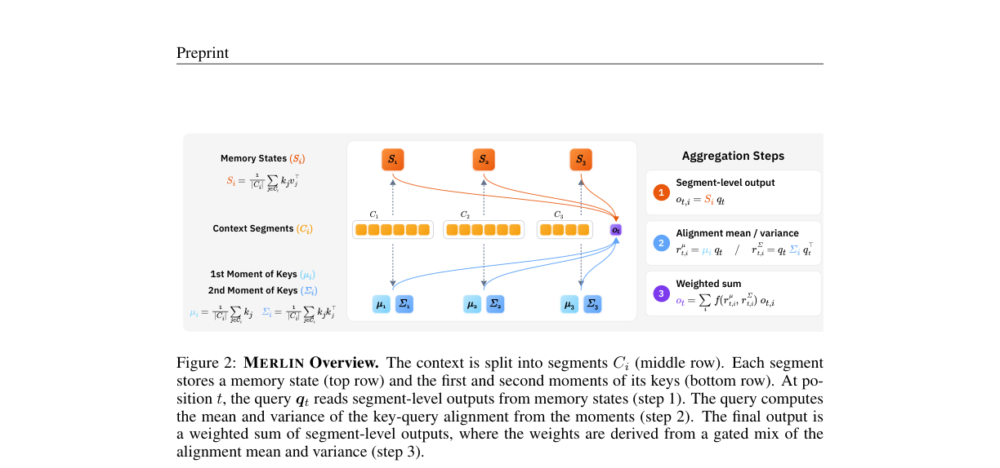
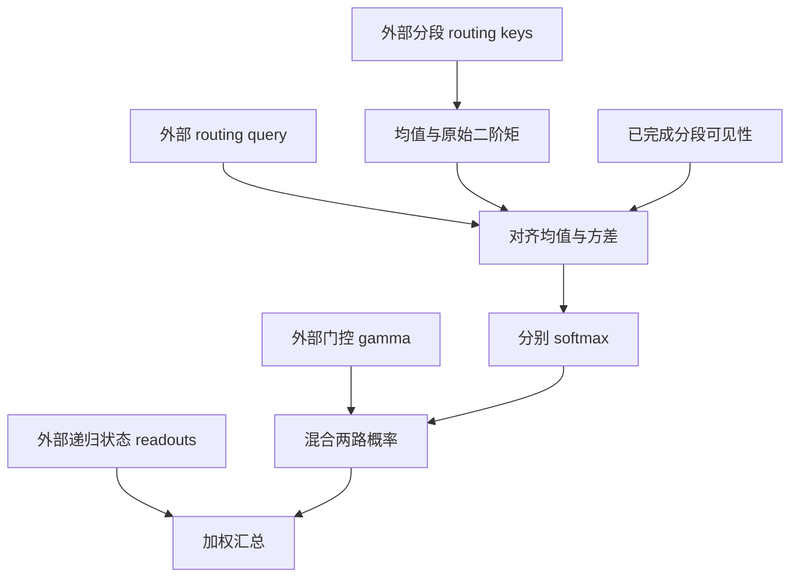

# MERLIN：用 key 的一、二阶矩路由多状态线性注意力

> 本地状态：**L1 路由公式组件，diagnostic only**。只验证由外部 routing keys / queries 和分段 readout 计算权重，不实现完整线性注意力层或 LLM。完整训练与长上下文评测：**成本过高，不复现（审查 DONE）**；不接入 evolve 晋级。

## 论文信息

| 字段 | 内容 |
| --- | --- |
| 论文 | [Multi-State Linear Attention with Generalized Second-Order Routing](https://arxiv.org/abs/2610.37645v1) |
| 固定审查版本 | [arXiv v1 全文](https://arxiv.org/html/2610.37645v1) |
| 公司 / 作者机构 | 一作 Hee Seung Hwang：Princeton University；合作作者 Zhiwei Deng：Google DeepMind |
| 原始发布日期 | **2026-10-27 17:55:49 UTC**，arXiv v1 |
| 原作者代码 | 固定 v1 全文与摘要页未找到可核验方法源码仓库；**未找到 / 尚未发布**，无可固定源码 revision |
| 本地 Adapter / key | `merlin`；独立组件，`adapter=null`、`evolve_integrated=false` |
| 本地代码 | `src/auto_research/foundation_models/merlin.py` |
| 本地入口 | `segment_moments`、`completed_segment_visibility`、`routing_weights`、`aggregate_readouts`、`diagnostic(seed, device)` |
| 验证边界 | 小张量公式、遮罩、负控与真实梯度；CUDA 状态以本批提交的 GPU 回执为准 |

## 原始论文总结

### 背景与主要改动

多状态线性注意力把上下文切成段，每段保留一个压缩状态。查询先读取多个状态，再加权汇总。只用位置或每段 key 均值做路由，会忽略同段 key 与查询对齐程度的分布：两个均值相同的段，可能只有一个含特别匹配的 key。

MERLIN 在独立、较小维度的 routing 投影上保存 key 的均值和**原始二阶矩**，恢复每个查询的对齐均值及方差，再把两路 softmax 分布按门控混合。它改变的是段级 readout 的汇总，不是用二阶矩替换原模型的递归记忆，也不是精确还原完整 softmax 注意力。论文的二阶累积量分析以等长分段为前提。

<!-- paper-figure:start -->
### 原论文关键图



来自[固定 v1 原文](https://arxiv.org/html/2610.37645v1)的原图裁切，未经重绘；页码、完整图注和哈希保存在 `assets/provenance.json`。
<!-- paper-figure:end -->



### 核心公式

Eq.7 对等长段 $C_i$ 的 routing keys $k'_j$ 记录：

$$
\mu_i=\frac1{|C_i|}\sum_{j\in C_i}k'_j,\qquad
\Sigma_i=\frac1{|C_i|}\sum_{j\in C_i}k'_j{k'_j}^{\top}.
$$

这里 $\Sigma_i$ **不是中心化协方差**。Eq.8 的对齐均值与方差为：

$$
r^\mu_{t,i}={q'_t}^{\top}\mu_i,\qquad
r^{\mathrm{var}}_{t,i}={q'_t}^{\top}\Sigma_iq'_t-(r^\mu_{t,i})^2.
$$

Eq.9 分别归一化，再混合；$\tau$ 是乘分数的尺度，不是除数：

$$
\lambda_{t,i}=\gamma_t\operatorname{softmax}_i(\tau_\mu r^\mu_{t,i})
+(1-\gamma_t)\operatorname{softmax}_i(\tau_{\mathrm{var}}r^{\mathrm{var}}_{t,i}),
\qquad o_t=\sum_i\lambda_{t,i}o_{t,i}.
$$

两路各自使用同一可见性遮罩。不能把两个 logits 先加权再做一次 softmax，那是另一个算法。

### 论文离线与线上效果

作者以多状态 Gated DeltaNet-1.3B、Mamba-2-780M 比较 RULER 与 LongBench 的长上下文表现，报告相较位置 / 均值聚合的改善，并分析矩维度、段长度与额外内存。论文线上 A/B：**未报告**。这些是作者完整模型实验，不是本地路由诊断的效果。

## 本地复现

组件接受等长分段的 routing keys，计算矩统计、对齐分数、两路权重和外部 readout 汇总。`completed_segment_visibility` 使用半开区间 `[start,start+length)`：零起始查询位置 `t` 只允许 `start+length <= t+1` 的**已完成**段。当前未完成段的递归状态、矩增量更新、原模型 q/k 投影、learned gate 网络及多层训练均不实现；调用者不能先算完整当前段矩再暴露给较早 token。

输入限于显式有界的小张量。非有限值、未对称原始二阶矩、明显负的对齐方差或没有可见段的查询会失败，不靠伪造 fallback 状态通过。舍入误差范围内的微小负方差才归零。无需 checkpoint、数据下载或模型调用。

```bash
PYTHONPATH=src python -c 'from auto_research.foundation_models.merlin import diagnostic; print(diagnostic(42))'
python -m pytest tests/test_oct30_foundation.py -q
```

### 检查与负控

独立逐 token 计算对齐均值 / 方差，与矩公式核对；负控把原始二阶矩误当方差、或把两个 softmax 改成单个混合 logits softmax，都会出现非零差异。未来段 readout 改动不能影响被遮罩输出，边界位置逐一检查；routing query、keys 和门控实际收到梯度。42/43/44 三种子只支持 L1 机制检查，不代表 RULER、LongBench 或下游能力。

### 高成本完整实验

论文从经 50B FineWebEdu tokens 预训练的 1.3B Gated DeltaNet、经 300B Pile tokens 预训练的 Mamba-2-780M 开始；中期训练先用 2B tokens，再用 60M tokens，另有 16K 上下文、多段状态、两个 backbone 与多基线评测。文中未给可直接迁移到本机的完整 GPU 小时数，不虚构估计。对单 A100/A30 或 Mac，完整训练矩阵成本过高：**不复现（审查 DONE）**，不下载、不试跑、不自动重试。此决定不阻塞审查水位，但也不把组件升级为完整复现。
