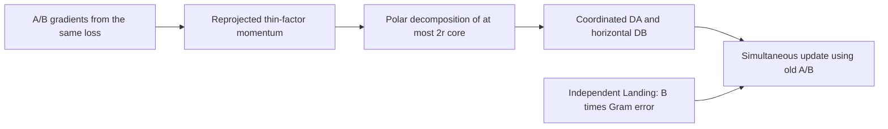
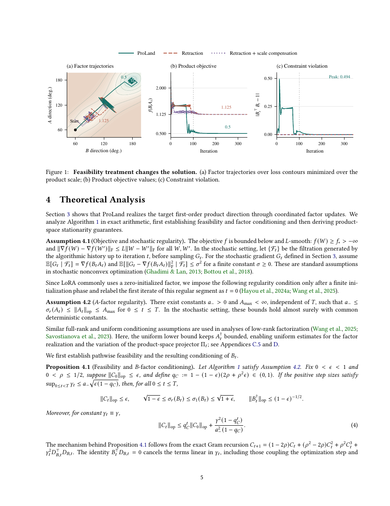

# ProLand: product-space spectral updates with independent Landing for LoRA

<!-- source-sha256: 275d98175b4b5d888c6ccc97f04fa6557753a442a671f465e091e376a8fc3e35 -->

[简体中文](README.md)

## Paper information

| Field | Details |
| --- | --- |
| Paper | [arXiv 2611.00236](https://arxiv.org/abs/2611.00236); [fixed v1 full text](https://arxiv.org/html/2611.00236v1) |
| Original title | ProLand: A New Infeasible Manifold Optimization Method for LoRA Fine-Tuning |
| Company / institution | First author Chenyu Zhou: Shanghai Jiao Tong University; collaborators at SIMIS and Stanford University |
| First publication | 2026-10-30 18:18:00 UTC; found in the official 2026-11-03 announcement, which does not replace the v1 date |
| Author code | No verifiable method implementation found in fixed v1, the abstract page, or method/author searches; not found/not yet released. Muon or other LoRA repositories are not this method's code |
| Local adapter / stable key | `proland`; `adapter: null`, no executable Evolve mapping |
| Local code | `src/auto_research/foundation_models/proland.py` |
| Implementation status | `component_only`, L1 mechanism diagnostic; CUDA verification is recorded separately in this batch's GPU receipt |
| Full experiment | Too costly, not reproduced (review DONE); `not_reproduced_high_cost` |

## Original paper summary

### Background and main changes

LoRA's factors $\Delta W=BA$ can develop redundant basis directions. ProLand constrains $B^\top B=I$ without retracting onto the manifold every step. It first forms coordinated spectral directions in the product space of $BA$, then independently restores feasibility with Landing. Running Muon separately on A and B is not an equivalent algorithm.



<!-- paper-figure:start -->
### Key original-paper figure

[](https://arxiv.org/pdf/2611.00236v1#page=5)

> Original-page screenshot from fixed-v1 PDF page 5, preserving Figure 1 and its caption in full without redrawing. It compares Landing and per-step retractions in trajectories, objective values, and constraint violation—not local results. Copyright belongs to the authors. The paper uses the arXiv perpetual non-exclusive license; this does not establish an open image license.
<!-- paper-figure:end -->

### Core equations

With $P_B=BB^\dagger$, $P_A=A^\dagger A$, and $\Pi(Z)=P_BZ+(I-P_B)ZP_A$, momentum and spectral direction are

$$
\bar H_t=\beta\Pi_t\bar H_{t-1}+(1-\beta)\Pi_tG_t,\quad
J_t=\beta\bar H_t+(1-\beta)\Pi_tG_t,\quad Y_t=\operatorname{polar}(J_t).
$$

$$
D_A=B^\dagger Y,\quad D_B=(I-P_B)YA^\dagger,\quad
A^+=A-\gamma D_A,\quad B^+=B-\gamma D_B-\rho B(B^\top B-I).
$$

Both right-hand sides use the old factors; $\rho$ is not multiplied by $\gamma$ again. Since $B^\top D_B=0$, the objective direction does not perturb the Gram constraint to first order. From gradients of the same loss, $g_A=B^\top G$ and $g_B=GA^\top$, Algorithm 2 reconstructs momentum of width at most $2r$. QR and an SVD core no larger than $2r\times2r$ produce the exact compact polar factor; zero singular directions stay zero.

### Reported offline and online evidence

The authors evaluate four GLUE validation tasks on DeBERTa-v3-base and seven language benchmarks on Qwen2.5-3B, Llama-3.2-3B, and Moonlight-16B-A3B, reporting the best average for each tested model/rank configuration. This does not mean every individual task wins. Production online A/B: not reported.

## Local reproduction

### Implementation and commands

`step` executes Algorithm 2 using real factor gradients, returning simultaneously updated factors and thin momentum. The caller copies the returned factors into parameters. FP32/FP64 are supported; mismatched shapes, devices, dtypes, nonfinite inputs, and invalid configurations are rejected. No weight decay or pseudoinverse regularization is silently added.

```bash
PYTHONPATH=src python -c 'from auto_research.foundation_models.proland import diagnostic; print(diagnostic(42, "cpu"))'
PYTHONPATH=src python -m pytest tests/test_nov04_foundation_components.py -q
```

### Checks and negative controls

The synthetic small-matrix recipe uses $8\times2$ and $2\times7$ factors with genuine MSE gradients. Four consecutive steps are checked against dense Algorithm 1. The independent reference uses an eigendecomposition for the polar factor instead of reusing the QR/SVD core. Checks cover momentum reprojection, $B^\top D_B$, Gram feasibility recovery, objective descent, zero-gradient/zero-Landing identity, and zero cores. A separate test covers one exact rank-deficient step.

This is not public language-capability evaluation. Pseudoinverses may be ill-conditioned near a rank change. Arbitrary-rank equivalence in exact arithmetic does not guarantee floating-point stability at every condition number; tests do not pretend multistep cancellation near rank transitions is exactly zero.

### Cost assessment and scope

The paper spans 11 tasks, multiple backbones, ranks, and ablations. Appendix L discloses H100 80GB settings with rank 16, sequence length 512, effective batch 640, 290 updates, and nine primary runs. Available resources are one A100/A30 or a Mac: the full matrix is **too costly, not reproduced (review DONE)**. No checkpoint was downloaded, full training hours measured, or language score/throughput verified.

Local coverage is the optimizer core only: no LoRA-layer installation, production mixed-precision kernel, GLUE data, or model training. There is no automatic Evolve integration or full-paper reproduction claim. CPU checks do not replace a real CUDA receipt.

This batch's unified GPU evidence belongs in the [per-seed component metrics](metrics/component-cuda-seeds42-44.json) and [A100 receipt](../../gpu-validations/proland-a100-20261104.json). Their actual completion status is authoritative; this page does not assert success in advance.
