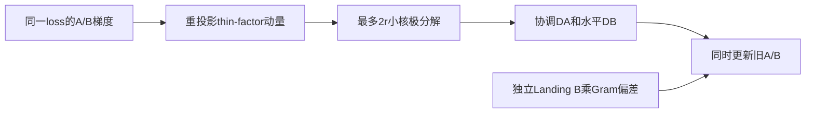
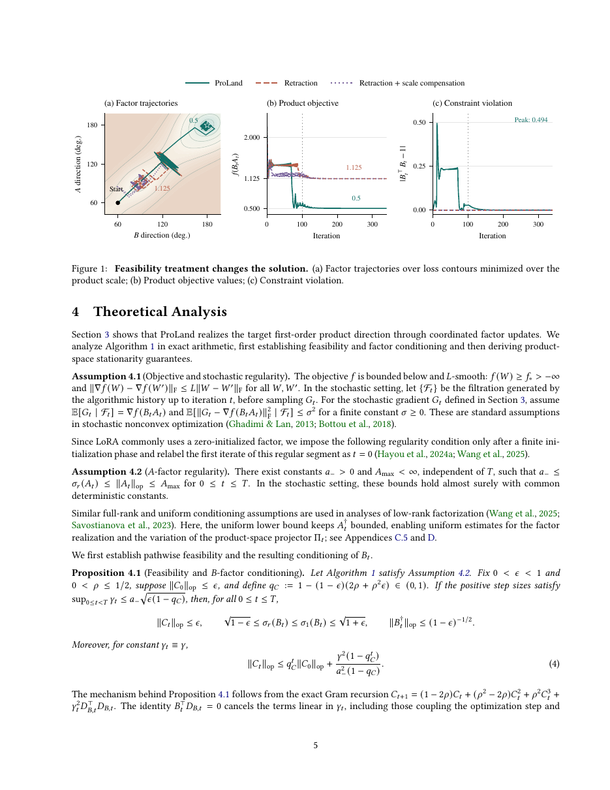

# ProLand：乘积空间谱更新与独立 Landing 的 LoRA 优化器

[English](README-en.md)

## 论文信息

| 字段 | 内容 |
| --- | --- |
| 论文链接 | [arXiv 2611.00236](https://arxiv.org/abs/2611.00236)；[固定 v1 全文](https://arxiv.org/html/2611.00236v1) |
| 原文标题 | ProLand: A New Infeasible Manifold Optimization Method for LoRA Fine-Tuning |
| 公司 / 机构 | 一作 Chenyu Zhou：Shanghai Jiao Tong University；合作 SIMIS、Stanford University |
| 首次公开日期 | 2026-10-30 18:18:00 UTC；本轮在 2026-11-03 官方公告中核到，不用公告日替代 v1 日期 |
| 原作者代码 | 固定 v1、摘要页及方法名/作者检索未找到可核验方法源码；未找到/尚未发布，不以 Muon 或其他 LoRA 项目替代 |
| 本地 adapter / 稳定键 | `proland`；`adapter: null`，无 Evolve 可执行映射 |
| 本地复现代码目录 | `src/auto_research/foundation_models/proland.py` |
| 实现状态 | `component_only`，L1 机制诊断；CUDA 验证由本批 GPU 收据单独记录 |
| 完整实验 | 成本过高，不复现（审查 DONE）；`not_reproduced_high_cost` |

## 原始论文总结

### 背景与主要改动

LoRA 的两因子 $\Delta W=BA$ 可以产生冗余基方向。ProLand 约束 $B^\top B=I$，但不每步强制投回流形；它先在 $BA$ 的乘积空间形成协调的谱方向，再独立以 Landing 恢复可行性。不能用“对 A、B 各自运行一次 Muon”替代该定义。



<!-- paper-figure:start -->
### 原论文关键图

[](https://arxiv.org/pdf/2611.00236v1#page=5)

> 固定 v1 PDF 第 5 页的原页截图，完整保留 Figure 1 与图注，不重绘。该图比较 Landing 与每步 retraction 的轨迹、目标值和约束偏差，不是本地结果。版权归原作者所有；原论文采用 arXiv perpetual non-exclusive license，不据此声称图片开放许可。
<!-- paper-figure:end -->

### 核心公式

记 $P_B=BB^\dagger$、$P_A=A^\dagger A$，$\Pi(Z)=P_BZ+(I-P_B)ZP_A$。动量与谱方向为

$$
\bar H_t=\beta\Pi_t\bar H_{t-1}+(1-\beta)\Pi_tG_t,\quad
J_t=\beta\bar H_t+(1-\beta)\Pi_tG_t,\quad Y_t=\operatorname{polar}(J_t).
$$

$$
D_A=B^\dagger Y,\quad D_B=(I-P_B)YA^\dagger,\quad
A^+=A-\gamma D_A,\quad B^+=B-\gamma D_B-\rho B(B^\top B-I).
$$

两个右端都使用旧因子；$\rho$ 不再乘 $\gamma$。$B^\top D_B=0$ 使目标更新不在一阶扰动 Gram 约束。Algorithm 2 从同一损失的 $g_A=B^\top G$、$g_B=GA^\top$ 重建宽度不超过 $2r$ 的动量，以 QR 和不超过 $2r\times2r$ 的 SVD 核求精确紧致极分解；零奇异方向保持零。

### 论文离线与线上效果

作者比较 DeBERTa-v3-base 的 4 项 GLUE 验证任务，以及 Qwen2.5-3B、Llama-3.2-3B、Moonlight-16B-A3B 的 7 项语言 benchmark；报告各受测模型/rank 配置的平均分领先。此处不把平均领先改写为每项任务都赢。生产线上 A/B：未报告。

## 本地复现

### 实现与运行

`step` 实际执行 Algorithm 2，接受两因子的真实梯度并返回同时更新的因子与 thin momentum；调用方负责复制回参数。支持 FP32/FP64，拒绝不匹配的 shape、device、dtype、非有限输入和非法配置；不暗加 weight decay 或伪逆正则项。

```bash
PYTHONPATH=src python -c 'from auto_research.foundation_models.proland import diagnostic; print(diagnostic(42, "cpu"))'
PYTHONPATH=src python -m pytest tests/test_nov04_foundation_components.py -q
```

### 检查与负控

人工小矩阵 recipe 使用 $8\times2$ 与 $2\times7$ 因子、MSE 真梯度，连续 4 步核对稠密 Algorithm 1；独立参考通过特征分解求极分解，而非重用 QR/SVD 小核。检查 momentum 重投影、$B^\top D_B$、Gram 偏差恢复、目标下降、零梯度/零 Landing 恒等与零核。测试另覆盖精确秩亏的一步。

这不是公开语言能力评测。秩变附近的伪逆可能病态；精确算术的任意秩等价定理不等于浮点任意条件数稳定性，测试不把秩变多步消去误差伪称严格为零。

### 成本判断与复现边界

论文覆盖 11 任务、多 backbone、rank 和消融；附录 L 披露 H100 80GB、rank16、sequence512、effective batch640、290 updates 的配置及 9 次 primary runs。现有资源是单张 A100/A30 或 Mac，完整矩阵**成本过高，不复现（审查 DONE）**。未下载 checkpoint、未测完整训练小时、未验证语言分数或吞吐。

本地仅优化器核心，无 LoRA 层安装、混合精度生产 kernel、GLUE 数据或模型训练；不自动加入 Evolve，不宣称全论文复现。CPU 检查通过不替代真实 CUDA 收据。

本批统一 GPU 验证的证据位置为[逐 seed 组件指标](metrics/component-cuda-seeds42-44.json)与[A100 收据](../../gpu-validations/proland-a100-20261104.json)；以产物中实际完成状态为准，不由本页预先断言通过。
