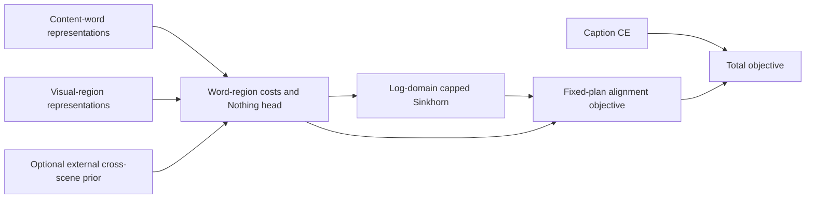
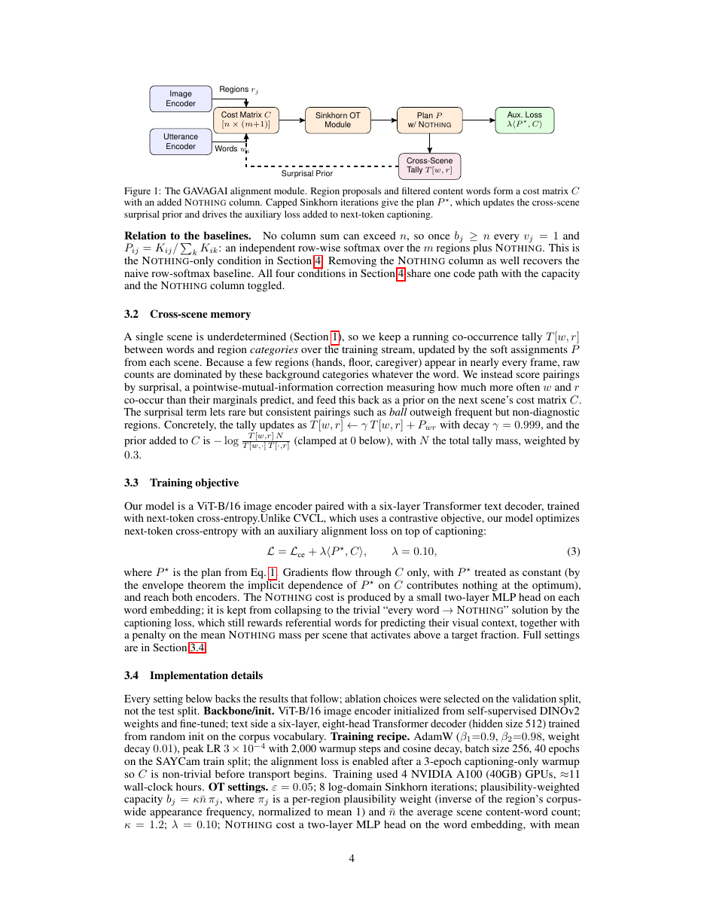

# GAVAGAI: capacity-constrained word–region alignment with a Nothing outcome

<!-- source-sha256: 1a7e35bf34453c39ed0546866ee662989d49a7f9b0971987ee48dcb064213fc7 -->

[简体中文](README.md)

## Paper information

| Field | Details |
| --- | --- |
| Paper | [arXiv 2611.00319](https://arxiv.org/abs/2611.00319); [fixed v1 full text](https://arxiv.org/html/2611.00319v1) |
| Original title | GAVAGAI: Referential Alignment for Infant-Scale Vision-Language Models via Balanced Optimal Transport |
| Company / institution | First author Rajdeep Pal: St Thomas’ College of Engineering and Technology; equal-contribution authors Jotiraditya Banerjee and Saptarshi Pani: Jadavpur University |
| First publication | 2026-10-30 19:39:12 UTC; officially announced 2026-11-03, not first submitted in November |
| Author code | No verifiable method implementation found in fixed v1, the abstract page, or method/author searches; not found/not yet released |
| Local adapter / stable key | `gavagai`; `adapter: null`, not integrated into Evolve |
| Local code | `src/auto_research/foundation_models/gavagai.py` |
| Implementation status | `component_only`, L1 mechanism diagnostic, not infant vocabulary-capability evaluation |
| Full experiment | Too costly, not reproduced (review DONE); `not_reproduced_high_cost` |

## Original paper summary

### Background and main changes

Many content words in caregiver speech do not refer to currently visible objects. A word-wise softmax over visual regions forces those words onto backgrounds; persistent hands or floors can absorb the vocabulary. GAVAGAI adds both an uncapped Nothing column and upper capacities on visual regions. It does not require every visual column to use all its capacity.



<!-- paper-figure:start -->
### Key original-paper figure

[](https://arxiv.org/pdf/2611.00319v1#page=4)

> Original-page screenshot from fixed-v1 PDF page 4, preserving Figure 1 and its caption in full without redrawing. It connects Nothing, capacity-constrained transport, the cross-scene prior, and captioning. Copyright belongs to the authors; source attribution follows the paper's CC BY 4.0 license. This is not local full-training evidence.
<!-- paper-figure:end -->

### Core equations

Column 0 is Nothing. Each of $n$ words has unit mass; only visual columns $j\ge1$ have capacities:

$$
\min_{P\ge0}\langle P,C\rangle-\varepsilon H(P),\quad
\sum_{j=0}^{m}P_{ij}=1,\quad\sum_iP_{ij}\le b_j\;(j\ge1).
$$

For $K=\exp(-C/\varepsilon)$, Eq. 2 gives

$$
u\leftarrow1/(Kv),\quad v_j\leftarrow\min(1,b_j/(K^\top u)_j),\quad v_0=1,\quad P=\operatorname{diag}(u)K\operatorname{diag}(v).
$$

Defaults are $\varepsilon=.05$ and eight log-domain iterations. Visual costs are negative normalized-embedding dot products divided by $\tau=.07$; a two-layer MLP produces Nothing costs. $\mathcal L=\mathcal L_{ce}+.1\langle\operatorname{stopgrad}(P),C\rangle$ uses a matrix **sum**, not a mean over words.

The original method also has a decayed cross-scene-tally PMI prior and a hinge of coefficient .01 when mean Nothing mass exceeds .6. Although v1 explicitly fixes $P$ for alignment, it does not specify another differentiable route for the hinge. The local implementation invents no such route: it reports the fixed-plan hinge value only, and cannot claim to solve training collapse.

### Reported offline and online evidence

The paper reports SAYCam four-choice word–picture accuracy of 32.4%→48.7% and localization IoU .18→.38. The realistic-noise simulation's .058→.075 uses a different scoring protocol, not four-choice accuracy. The authors explicitly note that a contrastive model on the same child's data is stronger on its own benchmark; this is not across-the-board SOTA. Online A/B: not reported.

## Local reproduction

### Implementation and commands

`capped_transport` executes Eq. 2. `ReferentialAlignment` constructs unit-normalized costs, a trainable Nothing head, a detached plan, and the objective, accepting a fixed external cost prior. Region proposals, content-word selection, and cross-scene prior statistics are caller responsibilities; labels do not generate them.

```bash
PYTHONPATH=src python -c 'from auto_research.foundation_models.gavagai import diagnostic; print(diagnostic(42, "cpu"))'
PYTHONPATH=src python -m pytest tests/test_nov04_foundation_components.py -q
```

### Checks and negative controls

An independent small-matrix reference bisects the dual multiplier for one visual column and checks the converged plan. Additional checks cover inactive capacities reducing to row softmax including Nothing, zero capacity sending all mass to Nothing, underused visual capacities, rejection of invalid values/shapes, alignment gradient exactly $.1P$, and no plan gradient. Gradients of real embeddings and the Nothing head, plus one SGD update, are also exercised.

**Eight fixed steps do not guarantee exact feasibility.** The last column scaling enforces capacities, but row sums may not have converged. Local results expose residuals rather than renormalize rows and break capacities again. The 512-step run is an independent-reference check, not the paper's default. Extreme costs have a separate nonconvergence negative control.

### Cost assessment and scope

Section 3.4 reports four A100 40GB GPUs for approximately 11 wall-clock hours, 40 SAYCam epochs, batch 256, a vision backbone and six-layer hidden-512 decoder, plus 2,000 hand-labeled tokens for the filter. The full experiment is **too costly, not reproduced (review DONE)**. The authors' four-GPU timing is not a local single-GPU measurement.

No real SAYCam data, vision encoder, caption decoder, content-word classifier, or cross-scene tally is implemented here. There is no vocabulary-accuracy, full anti-collapse-training, or Evolve-improvement claim. Tests verify component mathematics, gradients, and boundaries; CUDA still needs a separate real-GPU receipt.

This batch's unified GPU evidence belongs in the [per-seed component metrics](metrics/component-cuda-seeds42-44.json) and [A100 receipt](../../gpu-validations/gavagai-a100-20261104.json). Their actual completion status is authoritative; this page does not assert success in advance.
