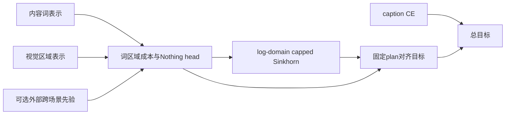
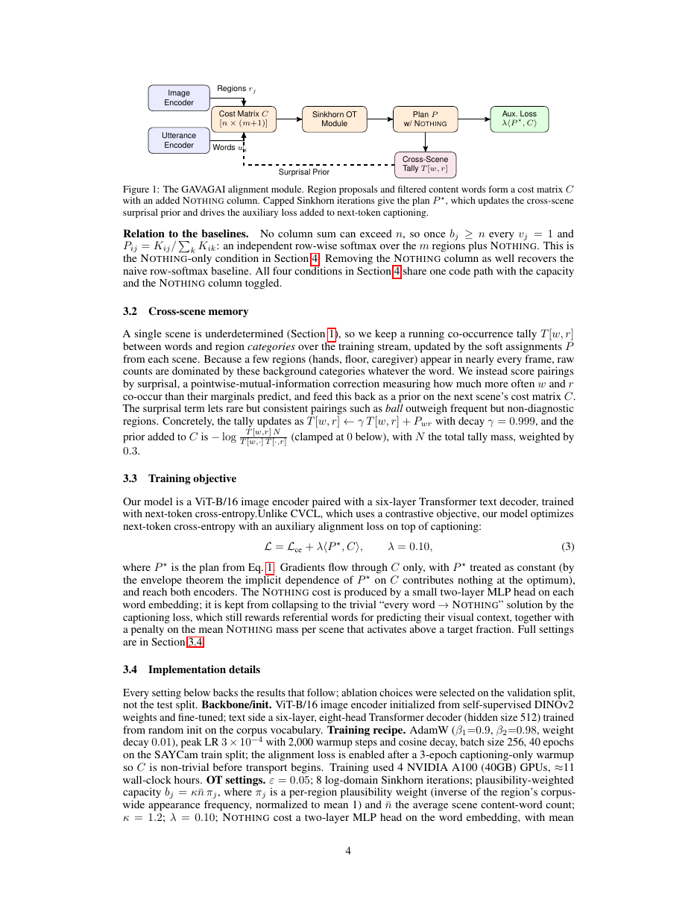

# GAVAGAI：允许“没有所指”的容量约束词—区域对齐

[English](README-en.md)

## 论文信息

| 字段 | 内容 |
| --- | --- |
| 论文链接 | [arXiv 2611.00319](https://arxiv.org/abs/2611.00319)；[固定 v1 全文](https://arxiv.org/html/2611.00319v1) |
| 原文标题 | GAVAGAI: Referential Alignment for Infant-Scale Vision-Language Models via Balanced Optimal Transport |
| 公司 / 机构 | 一作 Rajdeep Pal：St Thomas’ College of Engineering and Technology；共同贡献作者 Jotiraditya Banerjee、Saptarshi Pani：Jadavpur University |
| 首次公开日期 | 2026-10-30 19:39:12 UTC；2026-11-03 官方公告，本轮不是 11 月首次提交 |
| 原作者代码 | 固定 v1、摘要页及方法名/作者检索未找到可核验方法源码；未找到/尚未发布 |
| 本地 adapter / 稳定键 | `gavagai`；`adapter: null`，未接入 Evolve |
| 本地复现代码目录 | `src/auto_research/foundation_models/gavagai.py` |
| 实现状态 | `component_only`，L1 机制诊断，不是婴儿词汇能力评测 |
| 完整实验 | 成本过高，不复现（审查 DONE）；`not_reproduced_high_cost` |

## 原始论文总结

### 背景与主要改动

照护者语言中许多内容词并不指向当前可见物体。逐词对视觉区域 softmax 会强制这些词选择背景，常在画面中的手、地板便吞噬词汇。GAVAGAI 同时加入无容量限制的 Nothing 列和视觉区域的容量上界，不把每个视觉列强制填满。



<!-- paper-figure:start -->
### 原论文关键图

[](https://arxiv.org/pdf/2611.00319v1#page=4)

> 固定 v1 PDF 第 4 页的原页截图，完整保留 Figure 1 与图注，不重绘。原图描述 Nothing、容量约束传输、跨场景先验与 caption 目标的连接，版权归原作者所有，按原论文 CC BY 4.0 标注来源；它不是本地完整训练结果。
<!-- paper-figure:end -->

### 核心公式

第 0 列为 Nothing，$n$ 个词各有单位质量；只有视觉列 $j\ge1$ 受容量限制：

$$
\min_{P\ge0}\langle P,C\rangle-\varepsilon H(P),\quad
\sum_{j=0}^{m}P_{ij}=1,\quad\sum_iP_{ij}\le b_j\;(j\ge1).
$$

令 $K=\exp(-C/\varepsilon)$，Eq.2 为

$$
u\leftarrow1/(Kv),\quad v_j\leftarrow\min(1,b_j/(K^\top u)_j),\quad v_0=1,\quad P=\operatorname{diag}(u)K\operatorname{diag}(v).
$$

原文默认 $\varepsilon=.05$、8 次 log-domain 迭代。视觉成本为归一化表示负点积除 $\tau=.07$；Nothing 成本来自两层 MLP。$\mathcal L=\mathcal L_{ce}+.1\langle\operatorname{stopgrad}(P),C\rangle$，该项按矩阵**求和**而非除词数。

原方法还有跨场景衰减 tally 的 PMI 先验和 Nothing 平均质量超过 .6 时系数 .01 的 hinge。v1 明确对齐项的 $P$ 固定，但没有说明 hinge 的另一条可微路径；本地不虚构这一训练路径，只报告固定 plan hinge 的值，不能称已经解决训练防塌缩。

### 论文离线与线上效果

原文 SAYCam 的四选一词—图准确率为 32.4%→48.7%，定位 IoU .18→.38。受控模拟中真实噪声条件 .058→.075，与四选一不是同一口径；作者也明确同一儿童数据的对比模型在其 benchmark 更强，不能写成全面 SOTA。线上 A/B：未报告。

## 本地复现

### 实现与运行

`capped_transport` 执行 Eq.2；`ReferentialAlignment` 实际构造单位归一化成本、可训练 Nothing head、停梯度计划和目标，接受固定外部成本先验。区域 proposal、内容词选择与跨场景先验统计必须由调用方提供，不用标签生成它们。

```bash
PYTHONPATH=src python -c 'from auto_research.foundation_models.gavagai import diagnostic; print(diagnostic(42, "cpu"))'
PYTHONPATH=src python -m pytest tests/test_nov04_foundation_components.py -q
```

### 检查与负控

小矩阵独立参考对单视觉列的对偶乘子做标量二分，核对收敛计划；另验容量不活跃时退化为含 Nothing 的逐行 softmax、容量零时全部进入 Nothing、视觉列不必花完容量、非法值/shape 拒绝、对齐梯度恰为 $.1P$ 且 plan 不反传。真实表示和 Nothing head 的梯度及一步 SGD 更新也实际检查。

**固定 8 步不是精确可行性保证。** 最后一次列缩放保证容量上界，但行和可能未收敛；本地公开返回 residual，不事后逐行归一化而重新违反容量。512 步只用于独立参考核验，不伪称论文默认迭代数。极端成本另有不收敛负控。

### 成本判断与复现边界

Section3.4 报告 4 张 A10040GB、约 11 墙钟小时，SAYCam 40epochs、batch256，视觉骨干和六层 hidden512 decoder，并需 2000-token 手标过滤样本。完整实验**成本过高，不复现（审查 DONE）**；不将作者 4 卡时间冒充本地单卡实测。

没有真实 SAYCam、视觉 encoder、caption decoder、内容词分类器或跨场景 tally；不宣称复现词汇准确率、完整防塌缩训练或 Evolve 增益。测试只验证组件数学、梯度和边界，CUDA 仍须独立真实 GPU 收据。

本批统一 GPU 验证的证据位置为[逐 seed 组件指标](metrics/component-cuda-seeds42-44.json)与[A100 收据](../../gpu-validations/gavagai-a100-20261104.json)；以产物中实际完成状态为准，不由本页预先断言通过。
