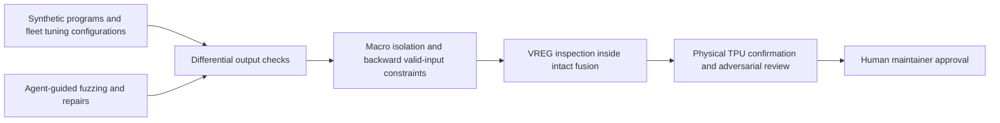
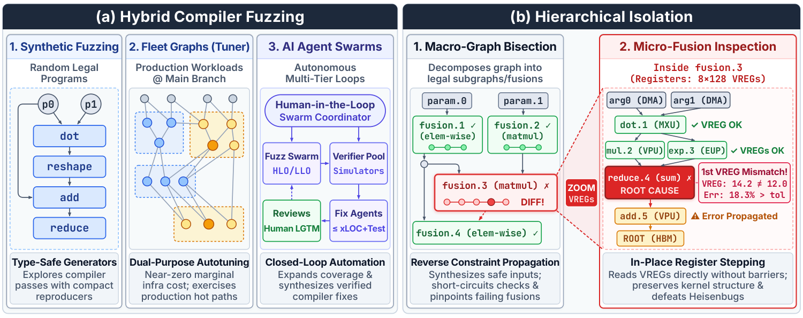

# XLA from the Trenches: differential fuzzing and hierarchical isolation for production TPU compilers

<!-- source-sha256: 8d0084d662cf8f2c947333f64603556d3da43a5cf47fab26b5eb1aab086313a7 -->

[简体中文](README.md)

## Paper information

| Field | Details |
| --- | --- |
| Paper | [arXiv 2611.00624](https://arxiv.org/abs/2611.00624); [fixed v1 full text](https://arxiv.org/html/2611.00624v1) |
| Original title | XLA from the Trenches: Correctness on TPU Workloads at Scale |
| Company / institution | First author Ignacio Cano; all authors at Google |
| First publication | 2026-10-31 04:48:13 UTC; officially announced 2026-11-03 |
| Author code | Public [HLO isolation](https://github.com/openxla/xla/blob/main/docs/hlo_isolation.md) and [reference evaluator](https://github.com/openxla/xla/tree/main/xla/hlo/evaluator) are upstream components; OpenXLA uses Apache-2.0. The internal agent harness, TPU tools, production graphs, and micro-fusion debugging pipeline are not public; the complete implementation is not released |
| Local adapter / stable key | `xla-trenches`; `adapter: null`, no executable operator |
| Local code | None; local coverage consists of this review and catalog metadata. OpenXLA itself is not a local reproduction |
| Implementation status | `deferred_high_cost`; review-only, no TPU surrogate implementation |
| Full experiment | Too costly, not reproduced (review DONE); `not_reproduced_high_cost` |

## Original paper summary

### Background and main changes

Successful compilation and execution do not guarantee numerical correctness. Google combines template-guided synthetic programs, real production-autotuner fusion configurations, and agent swarms to find silent miscompilations. Isolation proceeds from a large HLO graph to a fusion, then inspects intermediate VREG values without splitting the fusion. This is compiler-correctness infrastructure, not a new recommender or an industrial recommendation paper passing an A/B gate.

<!-- paper-figure:start -->
### Key original-paper figure

> Original figure from [fixed-v1 HTML](https://arxiv.org/html/2611.00624v1/methodology_diagram_elegant.png), preserving Figure 3 without redrawing. Copyright belongs to the authors. The paper uses the arXiv perpetual non-exclusive license; this does not establish an open image license. This is not a local workflow or measurement.
<!-- paper-figure:end -->

### Core mechanisms and numerical example

There is no standalone training loss that substitutes for the whole system. Differential checking needs valid inputs, shared semantics, and target-TPU numerics. Backward interval constraints exclude negative square roots, division by zero, and meaningless overflow. The reference must model approximate functions and subnormal flushing, avoiding false reports of valid hardware differences.

The quantization-residual example is

$$
r=x-\operatorname{f32}(\operatorname{f16}(x)).
$$

If lowering skips the register-level narrowing/widening round trip, it incorrectly computes $x-x=0$. Splitting the fusion for debugging can spill intermediates to 16-bit HBM, restore rounding, and make the bug disappear. Micro-fusion inspection should not manufacture a correct reference by splitting the graph. The paper's 16-byte tensor summaries are localization tools, not full-tensor equivalence proofs.

### Reported engineering and production evidence

The authors report more than 142 compiler bugs resolved and 103 still under review; the latter are not fixed. Table 1 distributes defects across TensorCore LLO/emitters 43%, HLO rewrites 25%, precision/emulation 14%, SparseCore 10%, and custom kernels 8%. These are production engineering findings, not user A/B uplift.

One fault zeroed all 131,072 quantization residuals; the repair restored 0.00% reference error. Another incident restored top-1000 recall to >99%. These examples cannot be extrapolated into accuracy or throughput gains for every workload.

## Local reproduction and cost assessment

### Reviewed and not implemented

The review checked fixed-v1 Sections 2–4, upstream isolation/evaluator links, and publication history. No internal harness was run or trained. There is no local algorithm directory, metric, GPU receipt, or Evolve mapping. Public macro-graph tools do not imply public agent orchestration, ISA/MXU simulation, VREG stepping, or fleet samples.

### Resources and reproduction scope

The paper depends on multiple TPU generations, a sample of approximately 200,000 private production graphs, internal TPU tools, and hardware-accurate simulators, with final physical-TPU confirmation. Its parameterized static suite has approximately 200,000 tests and exceeds one million executions per cross-backend pass. One A100/A30 or a Mac cannot substitute for the hardware semantics and observability; this is not fixed by reducing batch size.

The full experiment is **too costly, not reproduced (review DONE)**. No CUDA substitute validation is launched, unavailable internal dependencies downloaded, or automatic retries scheduled. Review completion means the sources, applicability, and non-reproduction decision are closed—not that an implementation or experiment passed.
