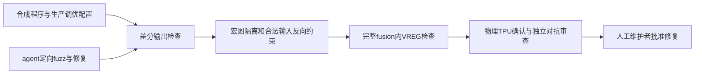
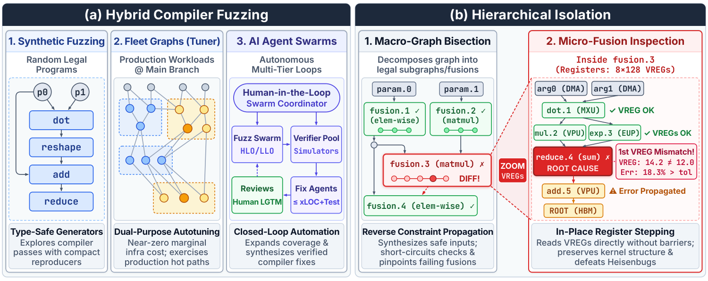

# XLA from the Trenches：生产 TPU 编译器的差分模糊测试与分层隔离

[English](README-en.md)

## 论文信息

| 字段 | 内容 |
| --- | --- |
| 论文链接 | [arXiv 2611.00624](https://arxiv.org/abs/2611.00624)；[固定 v1 全文](https://arxiv.org/html/2611.00624v1) |
| 原文标题 | XLA from the Trenches: Correctness on TPU Workloads at Scale |
| 公司 / 机构 | 一作 Ignacio Cano；全部作者 Google |
| 首次公开日期 | 2026-10-31 04:48:13 UTC；2026-11-03 官方公告 |
| 原作者代码 | [公开 HLO isolation](https://github.com/openxla/xla/blob/main/docs/hlo_isolation.md)、[reference evaluator](https://github.com/openxla/xla/tree/main/xla/hlo/evaluator) 是已上游组件；OpenXLA 为 Apache-2.0。内部 agent harness、TPU 工具层、生产图集及微融合调试链路未公开，完整实现未发布 |
| 本地 adapter / 稳定键 | `xla-trenches`；`adapter: null`，无执行算子 |
| 本地复现代码目录 | 无；本地仅有本论文审查文档与 catalog 元数据，不把 OpenXLA 框架当作本地复现 |
| 实现状态 | `deferred_high_cost`；review-only，不实现 TPU 替身 |
| 完整实验 | 成本过高，不复现（审查 DONE）；`not_reproduced_high_cost` |

## 原始论文总结

### 背景与主要改动

编译器成功生成并执行程序，不保证数值正确。Google 将模板引导合成程序、生产 autotuner 的真实融合配置和 agent swarm 组合，发现静默错编译；随后从大 HLO 图定位到单个 fusion，再保留 fusion 原貌检查 VREG 中间值。它是编译正确性基础设施，不是新的推荐模型或通过 A/B 门槛的工业推荐条目。

<!-- paper-figure:start -->
### 原论文关键图

> 原图来自[固定 v1 HTML](https://arxiv.org/html/2611.00624v1/methodology_diagram_elegant.png)，保留 Figure 3，不重绘。版权归原作者所有；原论文采用 arXiv perpetual non-exclusive license，不据此声称图片开放许可。它不是本地运行流程或测量。
<!-- paper-figure:end -->

### 核心机制与数值例子

原文没有一个可独立替代整套系统的训练损失。差分检查必须保证合法输入、相同语义和目标 TPU 数值行为；反向区间约束排除负数开方、除零及无意义溢出，reference 还要模拟近似函数和 subnormal flush，避免把合法硬件差异当 bug。

量化残差例子是

$$
r=x-\operatorname{f32}(\operatorname{f16}(x)).
$$

若 lowering 省掉寄存器中的窄精度往返，得到错误的 $x-x=0$；若为调试拆开 fusion，中间值落入 16 位 HBM 又会意外恢复舍入，让 bug 消失。故微融合检查不应靠拆图制造“正确”参考。原文 16-byte 张量统计摘要也只是定位手段，不是全张量等价证明。

### 论文工程与线上证据

作者报告超过 142 个 compiler bugs 已解决，103 项仍在审查，后者不是已修复。Table1 分布为 TensorCore LLO/emitters 43%、HLO rewrites25%、precision/emulation14%、SparseCore10%、custom kernel8%。这些是生产工程证据，不是用户 A/B uplift。

原文另给特定故障：全部 131072 个量化残差被错误置零，修复后对参考误差 0.00%；另有 top-1000 recall 恢复到 >99% 的事故案例。它们不能外推成所有工作负载准确率或吞吐改进。

## 本地复现与成本判断

### 已核查与未实现

只读核对固定 v1 的 Sections2–4、上游 isolation/evaluator 链接与日期；没有运行、训练或调用其内部 harness，没有本地算法目录、metrics、GPU 收据或 Evolve 映射。公开宏图工具不意味着 agent 编排、目标 ISA/MXU 仿真、VREG stepping 和生产样本全部公开。

### 资源与复现边界

论文依赖多代 TPU、约 20 万私有生产图样本、内部 TPU 工具层和硬件精确模拟器，最后仍需真实 TPU 确认。本文静态测试参数化后约 20 万项，跨后端一次超过百万次执行。单张 A100/A30 或 Mac 在硬件语义和可观测性上都不能替代这套系统；不是简单缩小 batch 即可保真。

完整实验**成本过高，不复现（审查 DONE）**。不启动 CUDA“替代验证”、不下载内部不可得依赖、不留自动重试任务。审查完成只代表来源、适用性和不复现决策已收口，绝不代表实现或实验通过。
