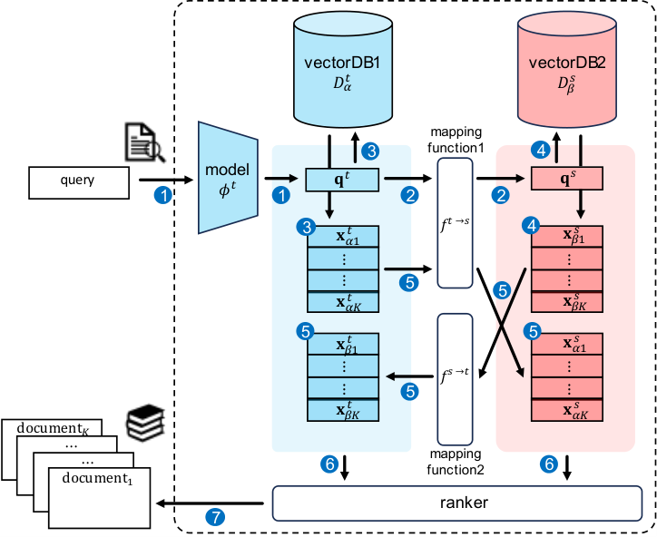

<!-- source-sha256: 4673c164f643de52050232d5e9d2f315f8b808681b67986253a3558d88c4a4eb -->
# HVMap: Mapping and two-space reranking across heterogeneous vector databases

[简体中文](README.md)

> **L1 mechanism component**: the mapping network, fuzzy contrastive loss, SCORE2 and hub/spoke paths. Small-tensor diagnostics are not semantic retrieval evidence or Evolve promotion.

## Paper information

| Field | Content |
| --- | --- |
| Paper | [Federated Vector Retrieval across Heterogeneous VectorDBs](https://arxiv.org/abs/2611.01514v2); [fixed v2](https://arxiv.org/html/2611.01514v2) |
| Institution | First author Mintaek Lim: Seoul National University |
| First publication | 2026-11-01 03:47:55 UTC, arXiv v1; reviewed v2: 2026-11-13 05:59:39 UTC |
| Original source code | [yoon123seul/HVMap](https://github.com/yoon123seul/HVMap), commit `1fe819a0369b5a2a00bfb535c5755daa15a5d035`. Public source has no declared license; local code independently implements formulas rather than copying it |
| Local adapter / key | `hvmap`; adapter is null; no Evolve integration |
| Local code | `src/auto_research/foundation_models/hvmap.py`; tests: `tests/test_nov18_root_components.py` |

## Paper summary

### Motivation and changes

Different encoders produce incompatible vector spaces. HVMap encodes a query once in a hub, maps it to other spaces, retrieves K candidates independently per database, and reranks their union using mapped candidates. All final K results may come from one database; equal quotas are not required. [Sections 3.3–3.5](https://arxiv.org/html/2611.01514v2#S3)

<!-- paper-figure:start -->
### Original figure

Original Figure 2, copyright belongs to its authors; not a local complete-system result. [Source and SHA256](assets/provenance.json).
<!-- paper-figure:end -->

### Core formulas

Four affine layers, three SELUs, hidden width five times the target dimension, and L2-normalized output implement the map. Paired embeddings, not relevance gold, supervise:

$$L=\sum_{i,j}[\mu(y_i,y_j)-d(f(x_i),y_j)]^2.$$

The observed matrix is **mapped-to-original-target**, not mapped-to-mapped RKD. Its diagonal anchors absolute alignment; InfoNCE or hinge is not equivalent. Cosine/L2 are explicit choices; sum matches the formula, while mean is an explicit scaling option.

Retain each candidate's native embedding:

$$\mathrm{SCORE2}=w_1\cos(q^{native},x^{native})+w_2\cos(q^{mapped},f(x^{native})),\quad w_1=0.7,\ w_2=0.3.$$

The 0.7 coefficient always weights the candidate database's native space, not always the hub. Multiple databases use spoke→hub→spoke with at most two maps. Local code neither builds ANN indexes nor trains complete multi-database mappings.

### Author results

The paper compares retrieval quality, construction time and QPS across heterogeneous encoders, modalities and large databases. These are author measurements, not local small-tensor loss results. Production A/B was not verified; this is admitted as a foundation/retrieval mechanism, not as having passed the industrial A/B gate.

## Local implementation

### Data and code mapping

`HVMap`, `fuzzy_contrastive_loss`, `score2`, `map_via_hub` and `federated_topk` implement the map, loss, two-space score, star path and final merge. Inputs are seeded small tensors and explicit ranking examples. The [author dataset](https://huggingface.co/datasets/snu-aidas/HVMap-dataset) and semantic encoders are not downloaded or trained.

    PYTHONPATH=src python -c 'from auto_research.foundation_models.hvmap import diagnostic; print(diagnostic(42, device="cpu"))'

### Controls and limits

Seeds 42/43/44 check actual forward/backward, unit norms, zero loss at exact alignment, unchanged RKD but increased fuzzy loss after a global sign flip, native weights and no final database quota. Zero/nonfinite vectors and mismatched shapes/pairs are rejected. CUDA checks the same mechanism, not throughput; actual artifacts are stored separately under `metrics/`.

### High-cost full experiments

The original includes roughly 2.5 million pairs, 40 epochs, batch 1792, multiple datasets/encoders and large indexes. **Not reproduced due to cost; review DONE.** No full download, single-card campaign or automatic retry. An L1 component does not constitute full reproduction.
