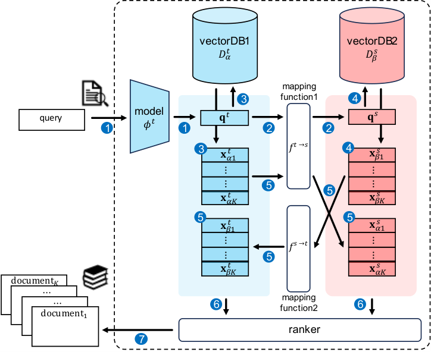

# HVMap：异构向量库的映射与双空间重排

[English](README-en.md)

> **L1 机制组件**：实现映射网络、fuzzy contrastive loss、SCORE2 和 hub/spoke 路径。小张量诊断不代表语义检索能力，不接入 Evolve 晋级。

## 论文信息

| 字段 | 内容 |
| --- | --- |
| 论文链接 | [Federated Vector Retrieval across Heterogeneous VectorDBs](https://arxiv.org/abs/2611.01514v2)；[固定 v2 全文](https://arxiv.org/html/2611.01514v2) |
| 公司 / 机构 | 一作 Mintaek Lim：Seoul National University |
| 首次公开日期 | 2026-11-01 03:47:55 UTC（arXiv v1）；核对 v2：2026-11-13 05:59:39 UTC |
| 原作者开源代码 | [yoon123seul/HVMap](https://github.com/yoon123seul/HVMap)，固定 commit `1fe819a0369b5a2a00bfb535c5755daa15a5d035`；源码可见但未声明许可证，本地按公式独立实现，不复制代码 |
| 本地 adapter / key | `hvmap`；adapter 为 null，未接入 Evolve |
| 本地复现代码目录 | `src/auto_research/foundation_models/hvmap.py`；测试 `tests/test_nov18_root_components.py` |

## 原始论文总结

### 背景与主要改动

异构向量库由不同编码器生成，查询不能直接拿同一向量跨库检索。HVMap 先在 hub 空间编码一次，再映射到其他空间；每库独立取 K 个候选，映射候选后联合重排。最终 K 个结果可以全来自同一库，不强制均分配额。[§3.3—3.5](https://arxiv.org/html/2611.01514v2#S3)

<!-- paper-figure:start -->
### 原论文关键图

原论文 Figure 2，版权归原作者；不是本地完整系统架构或实测结果。[图源与 SHA256](assets/provenance.json)。
图片来自[原论文](https://arxiv.org/html/2611.01514v2)，版权归原作者所有。
<!-- paper-figure:end -->

### 核心公式

映射为四个线性层，三个 SELU，中间宽度为目标维度的 5 倍，输出 L2 归一化。训练使用配对编码，不需要相关性 gold：

$$
L=\sum_{i,j}\left[\mu(y_i,y_j)-d(f(x_i),y_j)\right]^2.
$$

注意右边是 **mapped-to-original-target** 距离，不是 mapped-to-mapped RKD；对角项可锚定绝对对齐，不能换成 InfoNCE 或 hinge。本地显式支持 cosine/L2，sum 为论文原式；mean 仅是明确缩放选项。

对来自某库的候选，保留其原生向量：

$$
\mathrm{SCORE2}=w_1\cos(q^{native},x^{native})+w_2\cos(q^{mapped},f(x^{native})),\quad w_1=0.7,\ w_2=0.3.
$$

0.7 始终作用于该候选所属库的 **native** 空间，而非始终偏向 hub。多库采用 spoke→hub→spoke，最多两次映射；本地不建立 ANN 索引或训练完整多库映射。

### 论文离线与线上效果

论文在异构编码、跨模态和大规模向量库上比较质量、构建时间与 QPS；它们属于作者测量，不能用本地小张量 loss 替代。没有核实生产线上 A/B，本项目按基础模型/检索机制收录，不把工业 A/B 门槛套成已通过。

## 本地复现

### 数据协议与代码映射

`HVMap`、`fuzzy_contrastive_loss`、`score2`、`map_via_hub` 与 `federated_topk` 分别实现映射、损失、双空间分数、星形路径和最终联合排序。输入是固定种子的随机小张量与显式排序例子；未下载 [作者数据](https://huggingface.co/datasets/snu-aidas/HVMap-dataset)，未训练语义编码器。

    PYTHONPATH=src python -c 'from auto_research.foundation_models.hvmap import diagnostic; print(diagnostic(42, device="cpu"))'

### 结果、负控与边界

种子 42/43/44 检查真实前后向、单位范数、完全对齐时零损失、整体取负后 RKD 不变而 fuzzy loss 增大、native 权重方向及无最终库配额。非法零向量、非有限数、维度/配对不一致会拒绝。CUDA 只验证相同机制，不是 GPU 性能跑分；实际执行产物单独保留在 `metrics/`。

### 高成本完整实验

原配置包括约 250 万配对样本、40 epoch、batch 1792、多数据/编码器与大规模索引矩阵。**成本过高，不复现（审查 DONE）**；不下载全量数据、不尝试完整单卡训练，不自动重试。局部 L1 组件完成不等于完整论文复现。
