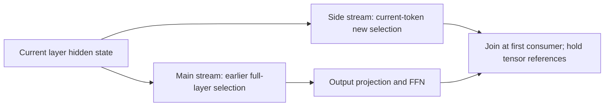
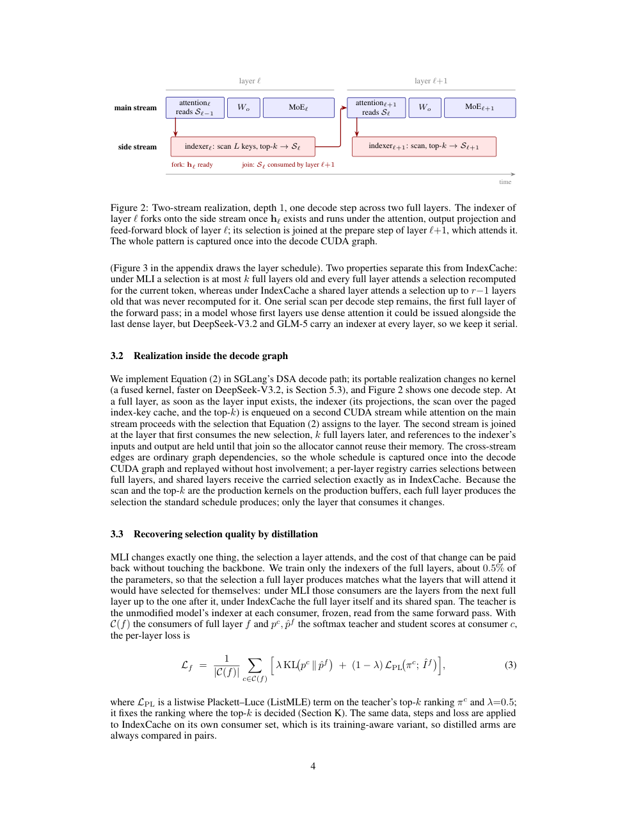

# Multi-layer Indexer: overlapping selection and attention

<!-- source-sha256: 5d25ba2c96e5fc8f810acb4399730ebd925836ddd3c27228b0b3ed20cadd0a94 -->

[简体中文](README.md)

## Paper information

| Field | Details |
| --- | --- |
| Paper | [arXiv 2611.03768](https://arxiv.org/abs/2611.03768); [fixed v1](https://arxiv.org/html/2611.03768v1) |
| Original title | Multi-layer Indexer: Overlapping Selection and Attention in DeepSeek Sparse Attention |
| Institution | First author Serdarcan Dilbaz: Writer AI Research, Writer Inc. |
| First publication | 2026-11-02 15:46:01 UTC; November 4 is the observed announcement date |
| Author code | [Official implementation](https://github.com/ArjunKrishnak/dsa-multi-layer-indexer), found |
| Local key / adapter | `multi-layer-indexer`; `adapter: null`, `local_operator: null` |
| Local code | None; this is `review_only`, not an executable adapter |
| Status | `deferred_high_cost`; no local metrics or GPU receipt |
| Full experiment | Too costly, not reproduced (review DONE); `not_reproduced_high_cost`; no automatic retry |

## Original paper summary

### Background and main changes

DSA normally scans the index cache, selects top-k and then attends. MLI consumes an earlier full layer's selection while computing a new selection on another CUDA stream. It composes with IndexCache but does not reuse stale selections across generated tokens. See Sections 3/4 and Appendix A.

<!-- paper-figure:start -->
### Key original-paper figure

> Visually checked screenshot of fixed-v1 PDF page 4, preserving Figure 2's fork/join/consumer order and complete caption. Copyright belongs to the authors; CC BY 4.0. This is not a local execution trace.
<!-- paper-figure:end -->

### Core equation

For retained-indexer layers F, nearest preceding full layer p and k-full-layer predecessor π:

$$
\sigma(\ell)=\pi_k(p(\ell)),\qquad \ell\text{ consumes }\mathcal S_{\sigma(\ell)}.
$$

The first k full layers lack a predecessor and follow the standard schedule. The first consumer joins the producer event, keeping input/output references alive against allocator reuse. A dependency diagram alone is not executed CUDA-graph overlap.

### Paper results

The paper compares paired serving configurations on fixed nodes and reports decode/quality results. Gains can vanish at high concurrency. These are systems experiments, not business A/B, and not local measurements.

## Local disposition

### Reviewed and unimplemented

Selection routing, stream lifetimes, IndexCache composition, resources and author code were reviewed. There is no local scheduler, sparse kernel, SGLang installation, synthetic timing proxy or fabricated metric. A constant-latency simulator would not establish production-path behavior.

### Cost decision

The experiments use FP8 DeepSeek-V3.2/GLM-5 checkpoints, SGLang v0.5.16, eight H200 GPUs with TP8, 10K-195K contexts and full quality sweeps. A single A100/A30 or Mac cannot reproduce that setup affordably: **not reproduced due to cost (review DONE)**. No model download, probe or automatic retry is launched. Local runtime, metrics, GPU receipts and executable Evolve mappings remain absent.
