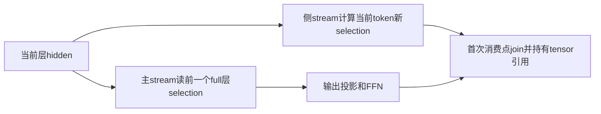
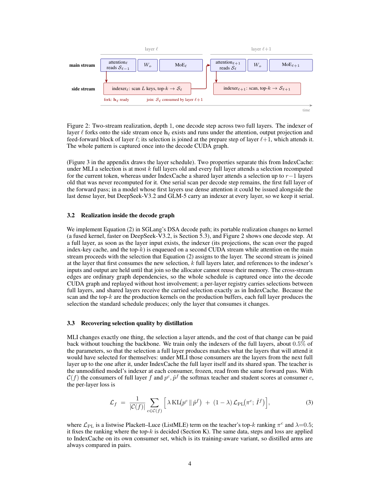

# Multi-layer Indexer：将选择与注意力解耦的双流调度

[English](README-en.md)

## 论文信息

| 字段 | 内容 |
| --- | --- |
| 论文链接 | [arXiv 2611.03768](https://arxiv.org/abs/2611.03768)；[固定 v1 全文](https://arxiv.org/html/2611.03768v1) |
| 原文标题 | Multi-layer Indexer: Overlapping Selection and Attention in DeepSeek Sparse Attention |
| 公司 / 机构 | 一作 Serdarcan Dilbaz：Writer AI Research, Writer Inc. |
| 首次公开日期 | 2026-11-02 15:46:01 UTC；2026-11-04 为本次公告日 |
| 原作者代码 | [ArjunKrishnak/dsa-multi-layer-indexer](https://github.com/ArjunKrishnak/dsa-multi-layer-indexer)；已找到作者实现 |
| 本地 adapter / 稳定键 | `multi-layer-indexer`；`adapter: null`、`local_operator: null` |
| 本地复现代码目录 | 无运行实现；本页为 `review_only`，不是可执行 adapter |
| 实现状态 | `deferred_high_cost`，未产生本地 metrics 或 GPU 收据 |
| 完整实验 | 成本过高，不复现（审查 DONE）；`not_reproduced_high_cost`，不自动重试 |

## 原始论文总结

### 背景与主要改动

DSA 层通常先扫描索引缓存、取 top-k，再执行稀疏 attention。MLI 让当前层读较早 full layer 的选择，当前索引器于是可在另一 CUDA stream 与主计算重叠。它可与 IndexCache 组合，但不是跨生成 token 复用过期选择。依据固定 v1 §3、§4、Appendix A。

<!-- paper-figure:start -->
### 原论文关键图

> 固定 v1 PDF 第 4 页原页截图，已视觉核对 Figure 2 的 fork、join、selection 消费顺序及完整图注。版权归原作者所有；原文为 CC BY 4.0。图示不是本地执行时间线。
<!-- paper-figure:end -->

### 核心公式

令 $F$ 为保留索引器的 full layers，$p(\ell)$ 是不晚于 $\ell$ 的最近 full layer，$\pi_k$ 沿 $F$ 回退 $k$ 个：

$$
\sigma(\ell)=\pi_k(p(\ell)),\qquad \ell\text{ 读取 }\mathcal S_{\sigma(\ell)}.
$$

最前 $k$ 个 full layers 无前驱，执行标准 schedule。新 selection 的首次消费者必须等待对应事件，且输入/输出引用需活到 join，以免 allocator 复用内存。仅画一个依赖图不等于真正实现 CUDA graph overlap。

### 论文离线与线上效果

原文比较固定节点与配对配置的 decode 吞吐和长上下文质量；高并发时收益可能消失。它是服务系统实验，不是业务线上 A/B。此处不把原文加速数字写成本地结果。

## 本地复现

### 已核查与未实现

已核查 selection routing、双 stream 生命周期、IndexCache 组合、实验资源和作者代码。没有本地调度器、稀疏 kernel、SGLang 安装、代理计时器或假 metrics；不会把常数延迟模拟器宣称为生产路径。

### 成本判断与复现边界

作者使用 DeepSeek-V3.2/GLM-5 的 FP8 checkpoint、SGLang v0.5.16、8 张 H200 的 TP8 节点、10K–195K 上下文及完整质量矩阵。现有单 A100/A30 或 Mac 不能等价执行；**成本过高，不复现（审查 DONE）**。没有下载模型、启动探针或自动重试；本地代码、指标、GPU 收据和 Evolve 映射均为空。
