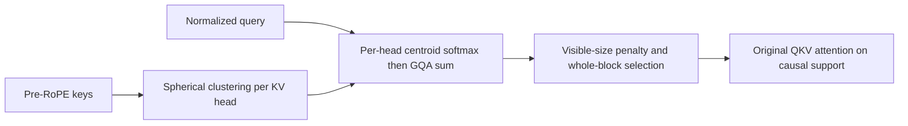
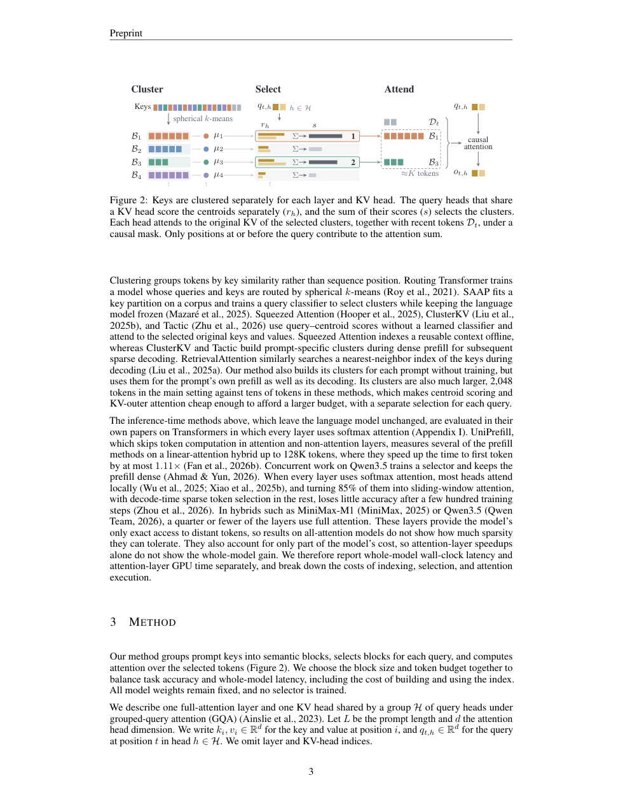

# Coarse Semantic Blocks: training-free semantic-block sparse attention

<!-- source-sha256: 3b0bb31da00667fd680fb94208f1f9ba87fbec43ce3433a20e56eb3756cd9ff5 -->

[简体中文](README.md)

## Paper information

| Field | Details |
| --- | --- |
| Paper | [arXiv 2611.04313](https://arxiv.org/abs/2611.04313); [fixed v1](https://arxiv.org/html/2611.04313v1) |
| Original title | Coarse Semantic Blocks for Efficient Training-Free Sparse Attention |
| Institution | First author Sosuke Kobayashi: Preferred Networks |
| First publication | 2026-11-03 04:46:30 UTC, not the November 4 announcement date |
| Author code | [Official repository](https://github.com/pfnet-research/semantic-block-sparse-attention/); found, but its large-model serving path is not run here |
| Local key / adapter | `semantic-block-sparse-attention`; `adapter: null`; no Evolve mapping |
| Local code | `src/auto_research/foundation_models/semantic_block_sparse_attention.py` |
| Status | `component_only`, L1 index/selection/attention reference; actual receipts determine GPU acceptance |
| Full experiment | Too costly, not reproduced (review DONE); `not_reproduced_high_cost` |

## Original paper summary

### Background and main changes

The method clusters normalized keys rather than adjacent positions, selects semantic blocks for each query, then attends to their original KV. Coarser blocks reduce routing overhead but coarsen selection. Training-free means unchanged model weights, not free prompt indexing. See fixed-v1 Section 3 and Appendix B.



<!-- paper-figure:start -->
### Key original-paper figure

[](https://arxiv.org/pdf/2611.04313v1#page=3)

> Visually checked screenshot of fixed-v1 PDF page 3, preserving Figure 2 and its full caption without redrawing. Copyright belongs to the authors; CC BY 4.0. This is not a local performance result.
<!-- paper-figure:end -->

### Core equations

$$
a_i=\arg\max_c\tilde k_i^\top\mu_c,\qquad
s(c)=\frac{\sum_{h\in\mathcal H}\operatorname{softmax}_c(\tilde q_{t,h}^\top\mu_c/\tau)}{(1+|\mathcal B'_{c,t}|)^\beta}.
$$

Whole blocks are selected until history count reaches or exceeds K, then unioned with unconditional region D. Defaults are τ=.1 and β=.25. Normalized routing vectors are not substituted for original attention QKV or values.

### Paper results

The paper reports long-context speedups on 4B/35B models and also exposes a multi-key retrieval drop on 4B. It does not report production business A/B results. Paper latency is not a local measurement.

## Local component

### Implementation and commands

`build_index` fits spherical k-means separately for each KV head. `select_positions` preserves per-head softmax before summation, visible-size penalties and last-block overshoot. `sparse_attention` preserves gradients through original QKV on the selected support. The interface handles one prompt and accepts separate routing queries.

```bash
PYTHONPATH=src python -c 'from auto_research.foundation_models.semantic_block_sparse_attention import diagnostic; print(diagnostic(42, "cpu"))'
PYTHONPATH=src python -m pytest tests/test_nov04b_foundation_components.py -q
```

### Checks and boundaries

Small-tensor diagnostics compare the full-budget limit against an independent dense calculation and check noncontiguous blocks, GQA, original-QKV gradients and zero future support. Unindexed generated tokens must stay in the unconditional region; whole blocks must not be truncated merely to hit K exactly.

The attention support is causal, but an index fitted to the entire prompt can depend on future keys. We do not claim unchanged early outputs after refitting on a different future, or a strictly streaming-causal language model. No FlashAttention-3, KV-outer, paged cache or vLLM acceleration kernel is implemented, and no throughput claim is made.

### Cost decision

The full H200 experiment uses 4B/35B models, up to one million context tokens and repeated multi-benchmark evaluations. Its KV and evaluation matrix exceed this batch's lightweight single-A100/A30 or Mac budget: **not reproduced due to cost (review DONE)**. No models/data were downloaded or full runs attempted. CPU checks do not replace actual GPU receipts; this L1 component is neither capability evidence nor an Evolve operator.
