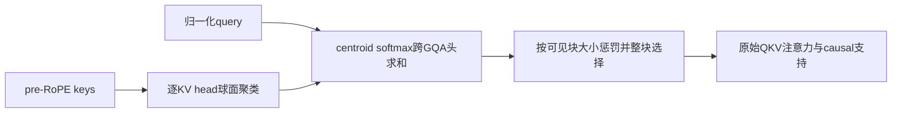
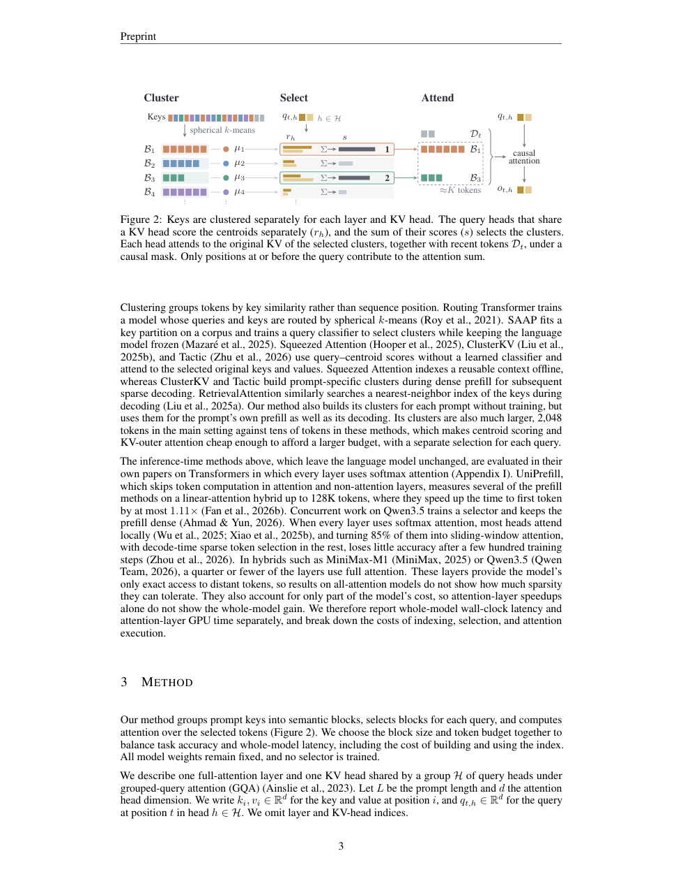

# Coarse Semantic Blocks：按语义成块选择的免训练稀疏注意力

[English](README-en.md)

## 论文信息

| 字段 | 内容 |
| --- | --- |
| 论文链接 | [arXiv 2611.04313](https://arxiv.org/abs/2611.04313)；[固定 v1 全文](https://arxiv.org/html/2611.04313v1) |
| 原文标题 | Coarse Semantic Blocks for Efficient Training-Free Sparse Attention |
| 公司 / 机构 | 一作 Sosuke Kobayashi：Preferred Networks |
| 首次公开日期 | 2026-11-03 04:46:30 UTC；2026-11-04 公告不是 v1 日期 |
| 原作者代码 | [pfnet-research/semantic-block-sparse-attention](https://github.com/pfnet-research/semantic-block-sparse-attention/)；已找到原作者仓库，本轮不运行其大模型服务 |
| 本地 adapter / 稳定键 | `semantic-block-sparse-attention`；`adapter: null`，不接入 Evolve |
| 本地复现代码目录 | `src/auto_research/foundation_models/semantic_block_sparse_attention.py` |
| 实现状态 | `component_only`，L1 索引、选择与注意力参考组件；GPU 通过状态只以实际收据为准 |
| 完整实验 | 成本过高，不复现（审查 DONE）；`not_reproduced_high_cost` |

## 原始论文总结

### 背景与主要改动

位置相邻的 token 未必语义相关。本文用归一化 key 的球面聚类建立不连续位置的语义块；每个 query 选择少量块，再对其中**原始** KV 做注意力。大块降低路由开销，但选择粒度更粗。免训练指不更新预训练模型权重，不等于没有逐 prompt 建索引成本。依据固定 v1 §3、Appendix B。



<!-- paper-figure:start -->
### 原论文关键图

[](https://arxiv.org/pdf/2611.04313v1#page=3)

> 固定 v1 PDF 第 3 页原页截图，Figure 2 与完整图注已视觉核对，无重绘。版权归原作者所有；原文为 CC BY 4.0。图中示例不是本地速度或模型效果。
<!-- paper-figure:end -->

### 核心公式

令 $\mu_c$ 为单位球面 centroid，$\mathcal B'_{c,t}$ 为排除无条件可读区域 $\mathcal D_t$ 后的可见块：

$$
a_i=\arg\max_c\tilde k_i^\top\mu_c,\qquad
s(c)=\frac{\sum_{h\in\mathcal H}\operatorname{softmax}_c(\tilde q_{t,h}^\top\mu_c/\tau)}{(1+|\mathcal B'_{c,t}|)^\beta}.
$$

按 $s(c)$ 整块累加，直到历史 token 数达到或超过 $K$，再并入 $\mathcal D_t$。默认 $\tau=0.1,\beta=0.25$。路由用归一化表示；最终注意力用原始 QKV，不能把 centroid 当 value。当前 chunk 的因果可见 token 与生成 token 不占所选历史预算。

### 论文离线与线上效果

作者在 Qwen3.5-4B/35B-A3B 的长上下文推理上报告加速，同时披露 4B 多 key 检索精度下降；并非所有质量指标不降。生产线上 A/B：未报告。原论文时延不是本地测量。

## 本地复现

### 实现与运行

`build_index` 实现逐 KV head 的球面 k-means；`select_positions` 保留 GQA 头独立 softmax 后求和、可见大小惩罚与末块超预算；`sparse_attention` 对选中支持执行原始 QKV 注意力并保留梯度。接口只处理单 prompt，可显式传入独立路由 query。

```bash
PYTHONPATH=src python -c 'from auto_research.foundation_models.semantic_block_sparse_attention import diagnostic; print(diagnostic(42, "cpu"))'
PYTHONPATH=src python -m pytest tests/test_nov04b_foundation_components.py -q
```

### 检查与负控

小张量诊断检查全预算退化为独立稠密参考、非连续块、GQA 选择、原始 QKV 梯度和不可见位置零支持；测试还覆盖新生成而未建索引的 token 必须留在无条件区域。整块选择允许超额，不能强行切块以制造恰好 $K$ 个位置。

支持集具有因果 mask，但索引可从整个 prompt 拟合，后文 key 会影响 centroid。因此这里**不声称**重建索引后早期输出对未来完全不变，亦不把该接口宣称为严格流式因果语言模型。没有 FlashAttention-3、KV-outer、分页缓存或 vLLM 加速 kernel，不报告吞吐提升。

### 成本判断与复现边界

完整论文使用单 H200、4B/35B 模型、最高百万 token、多个 benchmark 与三次运行；大 KV、长生成和完整矩阵超出本轮单 A100/A30 或 Mac 的轻量预算，**成本过高，不复现（审查 DONE）**。未下载模型与数据、未尝试完整推理。CPU 测试不替代实际 A100/A30 验证；本地仅 L1 参考组件，无公开模型能力或 Evolve 晋级证据。
