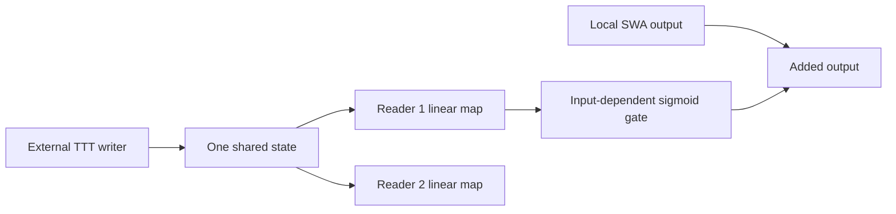
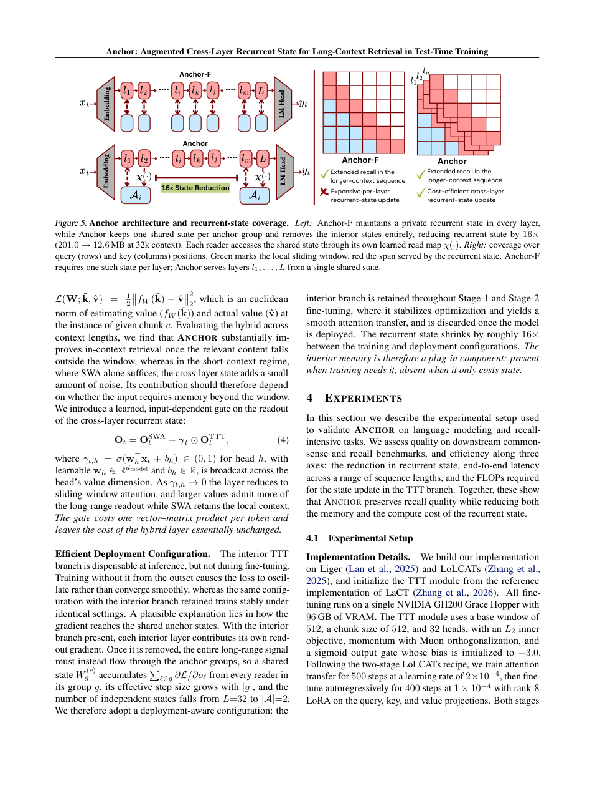

# Anchor: shared KV-state read maps and gates

<!-- source-sha256: 5a703a2971010298f912f7228fdf5b41e8fb5603169bd8890a9fb2163f949422 -->

[简体中文](README.md)

## Paper information

| Field | Details |
| --- | --- |
| Paper | [arXiv 2611.04327](https://arxiv.org/abs/2611.04327); [fixed v1](https://arxiv.org/html/2611.04327v1) |
| Original title | Anchor: Augmented Cross-Layer Recurrent State for Long-Context Retrieval in Test-Time Training |
| Institution | First author Vimal William: University of Arizona |
| First publication | 2026-11-03 05:07:50 UTC; observed in the November 4 announcement |
| Author code | No verifiable Anchor-author implementation found in fixed v1 or abstract; not found/not released. Referenced Liger/LoLCATs/LaCT projects are not this paper's code |
| Local key / adapter | `anchor-kv`; `adapter: null`; no executable Evolve mapping |
| Local code | `src/auto_research/foundation_models/anchor_kv.py` |
| Status | `component_only`; external-state writing/read-map/gate L1 component, not complete TTT |
| Full experiment | Too costly, not reproduced (review DONE); `not_reproduced_high_cost` |

## Original paper summary

### Background and main changes

Layers may encode related information in different bases. Anchor shares a recurrent state, learns a read map for each reader and gates memory into local SWA output. Interior TTT branches remain during training and are removed only at deployment. See Sections 3.2/4.1 and Appendix C.



<!-- paper-figure:start -->
### Key original-paper figure

[](https://arxiv.org/pdf/2611.04327v1#page=6)

> Visually checked original-page screenshot with complete Figure 5 caption. Copyright belongs to the authors. The arXiv perpetual non-exclusive license does not establish an open image license. The illustrated 16-fold change belongs to the paper's configuration, not local measurements.
<!-- paper-figure:end -->

### Core equations

$$
o_\ell=\chi_\ell(f_{W^{(c)}}(\hat q_\ell)),\qquad
O_t=O_t^{\mathrm{SWA}}+\gamma_t\odot O_t^{\mathrm{TTT}},\quad
\gamma_{t,h}=\sigma(w_h^\top x_t+b_h).
$$

Bias-free reader maps start at identity; the writer retains its own basis. The actual state optimizer uses LaCT-style momentum/Muon. An arbitrary SGD step, mean cache or fixed answer is not a substitute for complete Anchor.

### Paper results

The paper reports retrieval/state-efficiency gains on 7B/8B models and notes that memory can add short-context noise, motivating a learned gate. Production business A/B is not reported. No language-model accuracy or speed is remeasured here.

## Local component

### Implementation and commands

`SharedKVReadout` accepts externally updated `KVState`. Only the designated writer may advance its revision. Input buffers are cloned to prevent later caller mutation; outer-loop gradient links are not silently detached. Readers share the state while learning separate identity-initialized linear maps and sigmoid gates.

```bash
PYTHONPATH=src python -c 'from auto_research.foundation_models.anchor_kv import diagnostic; print(diagnostic(42, "cpu"))'
PYTHONPATH=src python -m pytest tests/test_nov04b_foundation_components.py -q
```

### Checks and boundaries

The diagnostic uses an explicitly supplied synthetic KV matrix, not LaCT training. It checks equal initial writer/reader outputs, real read-map/gate gradients and preserved old state. Tests reject reader writes and stale revisions, verify a nonidentity basis change and recover local output when the gate is closed. No answer is read or memory capability measured.

### Cost decision

The original GH200-96GB study uses Llama-3.1-8B/Mistral-7B, 500 attention-transfer steps, 400 LoRA steps and multiple evaluations: **too costly, not reproduced (review DONE)**. No checkpoints/data are downloaded. LaCT/Muon writing, SWA kernels, inner-loop TTT training and model installation are outside this component. An external writer interface does not certify those algorithms. Actual A100/A30 receipts remain required for the CUDA path; no Evolve or capability claim is made.
