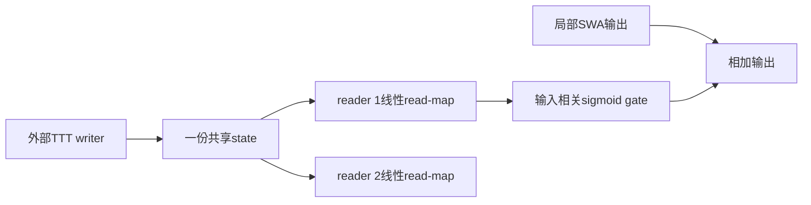
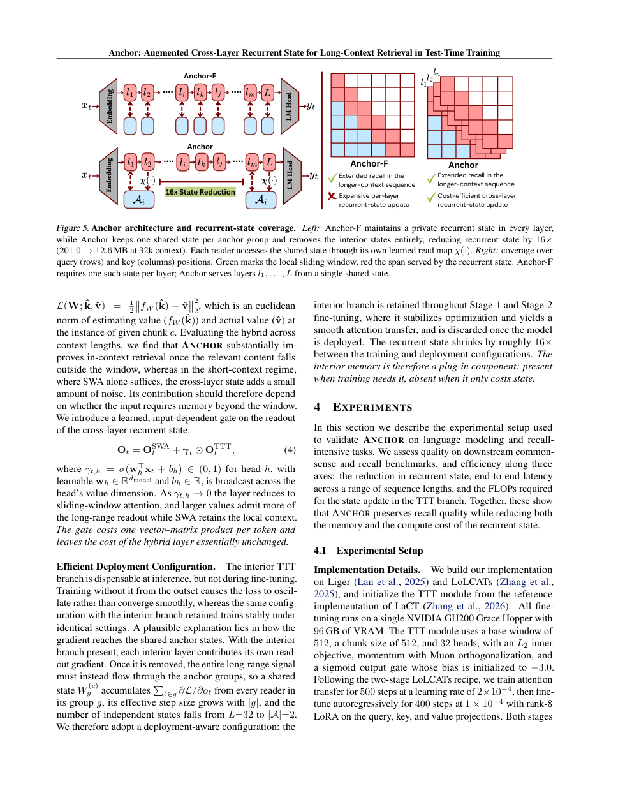

# Anchor：跨层共享 KV 状态的读映射与门控组件

[English](README-en.md)

## 论文信息

| 字段 | 内容 |
| --- | --- |
| 论文链接 | [arXiv 2611.04327](https://arxiv.org/abs/2611.04327)；[固定 v1 全文](https://arxiv.org/html/2611.04327v1) |
| 原文标题 | Anchor: Augmented Cross-Layer Recurrent State for Long-Context Retrieval in Test-Time Training |
| 公司 / 机构 | 一作 Vimal William：University of Arizona |
| 首次公开日期 | 2026-11-03 05:07:50 UTC；在 2026-11-04 公告中发现 |
| 原作者代码 | 固定 v1 与摘要页未找到可核验的 Anchor 作者实现；未找到/尚未发布。Liger、LoLCATs、LaCT 是相关上游，不替代本论文作者代码 |
| 本地 adapter / 稳定键 | `anchor-kv`；`adapter: null`，无 Evolve 可执行映射 |
| 本地复现代码目录 | `src/auto_research/foundation_models/anchor_kv.py` |
| 实现状态 | `component_only`；L1 外部状态写入、跨层 read-map 与 gate，不是完整 TTT |
| 完整实验 | 成本过高，不复现（审查 DONE）；`not_reproduced_high_cost` |

## 原始论文总结

### 背景与主要改动

不同层可能存储相近信息，却使用不同坐标基。Anchor 让一组层共享一个 recurrent state，以各层可学习 read-map 变换读出，再由输入相关 gate 与局部 SWA 合并。训练时保留 interior TTT 分支，部署时才删除，不能把部署结构直接当作训练配方。依据固定 v1 §3.2、§4.1、Appendix C。



<!-- paper-figure:start -->
### 原论文关键图

[](https://arxiv.org/pdf/2611.04327v1#page=6)

> 固定 v1 PDF 第 6 页原页截图，已视觉核对 Figure 5 与完整图注。版权归原作者所有；原文为 arXiv perpetual non-exclusive license，不据此声称图片开放许可。图中的 16 倍状态变化是原文配置，非本地测量。
<!-- paper-figure:end -->

### 核心公式

$$
o_\ell=\chi_\ell(f_{W^{(c)}}(\hat q_\ell)),\qquad
O_t=O_t^{\mathrm{SWA}}+\gamma_t\odot O_t^{\mathrm{TTT}},\quad
\gamma_{t,h}=\sigma(w_h^\top x_t+b_h).
$$

reader 的无偏置线性映射初始化为单位矩阵；writer 读出保持同一基。论文 state 的实际更新使用 LaCT 系列内层优化及 momentum/Muon，不能用随意 SGD、缓存均值或固定答案代替后宣称完整 Anchor。

### 论文离线与线上效果

原文在 7B/8B 模型报告检索与状态效率改进；短上下文下额外 memory 也可能带来噪声，因此加入可学习 gate。生产线上 A/B：未报告。这里没有重测语言模型分数或速度。

## 本地复现

### 实现与运行

`SharedKVReadout` 接收外部已更新 `KVState`，只允许指定 writer 推进 revision；复制输入 buffer 以免调用方后续修改旧证据。多个 reader 共享该 state，各自学习 identity 初始化的线性变换与 sigmoid gate。外部 writer 的 autograd 图不会被暗自 detach。

```bash
PYTHONPATH=src python -c 'from auto_research.foundation_models.anchor_kv import diagnostic; print(diagnostic(42, "cpu"))'
PYTHONPATH=src python -m pytest tests/test_nov04b_foundation_components.py -q
```

### 检查与负控

诊断使用明确提供的人工 KV 矩阵，并非 LaCT 训练。检查 reader 初始等于 writer、read-map 和 gate 收到真实梯度、旧状态不变；测试覆盖 reader 冒充 writer、过期 revision、非单位基变换与 gate 关闭时退化局部输出。矩阵本身不读取答案，也不用于报告记忆能力。

### 成本判断与复现边界

论文使用 GH200 96GB，Llama-3.1-8B/Mistral-7B，500 步 attention transfer、400 步 LoRA 与多项评测。完整训练与配置矩阵**成本过高，不复现（审查 DONE）**。本轮不下载 checkpoint/data，不实现 LaCT/Muon writer、SWA kernel、TTT 内层训练或完整模型安装；外部 writer 接口不是这些算法已经验收。CUDA 组件仍须实际 A100/A30 收据，不由 CPU 诊断替代；不加入 Evolve，不宣称能力复现。
