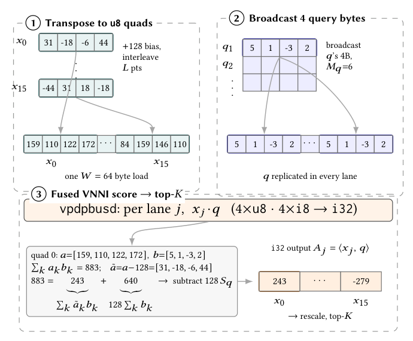

# PiPNN II: quantized scoring and streaming top-K for graph construction

<!-- source-sha256: 72447c8db8bae20185d4f912d20440bfe798e5a0043bd675fc27005282d8f22b -->

[简体中文](README.md)

> **L1 mechanism diagnostic, not a performance reproduction.** The local implementation covers decoded-byte scoring and top-K only. The full CPU/GPU experiments are **too costly and not reproduced (review DONE)**.

## Paper information

| Field | Details |
| --- | --- |
| Paper | [Turbocharging PiPNN for Proximity and k-NN Graph Building](https://arxiv.org/abs/2611.05690v1); [fixed v1 full text](https://arxiv.org/html/2611.05690v1) |
| Company / author institutions | First author **Tobias Rubel**, University of Maryland, College Park. Guy Blelloch and Laxman Dhulipala list CMU and UMD respectively alongside Google Research; Lars Gottesbüren, Jakub Łącki, and Vahab Mirrokni list Google Research. Google is a collaborator, not the first author's affiliation. |
| First publication | **2026-11-03 22:20:36 UTC**, arXiv v1; see the November 5 [cs.DB announcement](https://arxiv.org/list/cs.DB/recent?show=2000). |
| Original author code | **Verifiable source has not been released.** [GINGER v1 §1](https://arxiv.org/html/2611.08306v1#S1) identifies [google/ginger](https://github.com/google/ginger) as the official PiPNN II implementation. The [pinned tree](https://api.github.com/repos/google/ginger/git/trees/ce77e5faa3b0451b84908acf399e610f5349446b?recursive=1), checked November 7, 2026, contains only documentation, a license, and a contributor guide. It does not provide executable CPU code and does not establish a GPiPNN release. |
| Local adapter / key | `pipnn-ii`; `adapter: null`, L1 component only, not integrated into Evolve. |
| Local code | `src/auto_research/foundation_models/pipnn_ii.py` |

## Original paper summary

### Background and main changes

PiPNN recursively partitions nearby points into shared leaves and scores them in batches, avoiding point-by-point searches in the partially built graph. PiPNN II quantizes vectors to reduce memory traffic and fuses scoring with top-K to avoid writing and rereading the full distance matrix. A direct k-NN graph retains neighbors seen within leaves. This differs from a navigable ANNS index, which prunes edges. The paper also presents GPiPNN, with flat segmented routing, segmented top-K, sort-and-aggregate, and pruning that reuses already observed edges. These pieces are outside the local implementation.

<!-- paper-figure:start -->
### Key original-paper figure

[](https://arxiv.org/pdf/2611.05690v1#page=5)

Figure 2, page 5 of the [original paper](https://arxiv.org/pdf/2611.05690v1#page=5), fixed v1. Cropped at the figure boundary without redrawing it. Copyright belongs to the original authors; CC BY 4.0. See `assets/provenance.json` for crop coordinates, dimensions, and hash.
<!-- paper-figure:end -->

### Core equation

Section 4.1 and Algorithm 2 take already decoded signed database bytes $\tilde a_j$ and signed query bytes $b_j$. The VNNI database operand must be unsigned, so $a_j=\tilde a_j+128$. The correction is shared by all candidates scored against the same query:

$$
D=\sum_j a_j b_j-128\sum_j b_j=\sum_j\tilde a_j b_j,\qquad
d=-D\,\sigma_d\,\sigma_q .
$$

Keep the K smallest scaled negative dot products $d$. Integer top-K followed by scaling is not equivalent. In the original figure, one lane has biased dot product 883 and query-byte sum 5, so its signed dot product is $883-640=243$. The paper additionally uses vector norms for L2; the local component covers only the negative dot-product case.

### Offline and online paper results

Section 6 reports up to 8x faster CPU index construction than the original PiPNN. For direct 10-NN construction at recall@10 of at least 0.9, the CPU and GPU paths are up to 13x and 6.6x faster than their respective strongest baselines. These are the authors' offline construction and retrieval measurements, not local results or production A/B tests.

## Local reproduction

### Data protocol and code mapping

`corrected_dot` validates i8 range and dimensions and applies the bias correction. `fused_quantized_topk` scores a stream of `(row, scale)` candidates for one query and retains K entries; ties favor earlier positions. This reference uses Python integer accumulation and floating-point scales. It does not claim bitwise agreement with hardware i32/fp32 rounding. No quantizer, index, or external dataset is included.

```bash
PYTHONPATH=src python -c 'from auto_research.foundation_models.pipnn_ii import diagnostic; print(diagnostic(42, "cpu"))'
PYTHONPATH=src python -m pytest tests/test_nov06_priority.py -q
```

### Results, negative controls, and limits

Small synthetic matrices compare corrected integer scores and final ordering against independent signed-dot and full-sort references. Counterexamples include nonzero query-byte sums, unequal database scales, and ties. The input is consumed once; beyond the query and current row, the routine keeps only K candidates. These diagnostics do not validate TurboQuant encoding or decoding, partitioning, pruning, or hundred-million-point construction and retrieval.

### Cost of the full experiment

The full suite spans 12 datasets, up to one billion CPU points and 100 million GPU points. The authors' CPU machines had 192/288 vCPUs and 1.5/2.2 TB DRAM. GPU construction ran on an H100 80 GB with Hopper SM90a. One A100/A30 or a Mac cannot faithfully reproduce that scale and performance matrix. **Too costly, not reproduced (review DONE).** No vector dataset or GPU run was launched, and no timings were extrapolated. This CPU reference needs no GPU acceptance.
